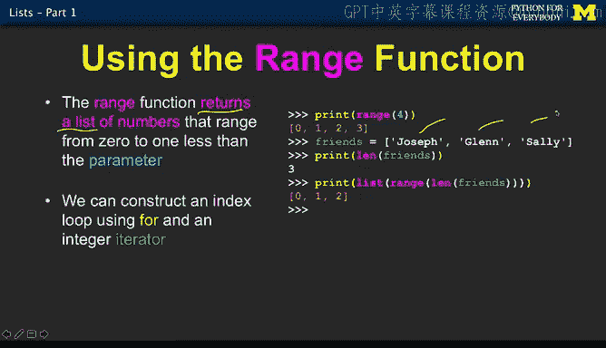

# 密歇根大学《给所有人的Python课》课程2：《Python数据结构》｜P18：列表 📋


## 概述
在本节课中，我们将要学习Python中的第一个重要数据结构——列表。列表是一种可以存储多个元素的变量，它允许我们以更有组织的方式处理数据。我们将了解如何创建列表、访问列表中的元素以及修改它们。

---

## 什么是数据结构？🧱
上一章我们主要讨论了算法，即代码执行的步骤和路径。本章我们将转向一个不同的方向，探讨数据结构。

数据结构是组织变量的方式。到目前为止，我们使用的变量都非常简单，例如 `x = 5`。但变量可以有更复杂的用法，即集合变量。列表、字典和元组是我们首先要讨论的三种数据结构。

设计数据结构，即程序运行时如何组织数据，可以帮助你解决问题。你既有一套执行步骤（算法），也有数据的内部形态（数据结构）。

## 从简单变量到集合变量 🔄
在深入讨论集合之前，我们先回顾一下什么不是集合。

在这个例子中：
```python
x = 2
```
Python找到一块内存，标记为`x`，并存入`2`。之后执行：
```python
x = 4
```
它找到同一块内存，用`4`覆盖了`2`。最终，变量`x`的值是`4`。

列表则是一种集合，意味着在单个变量中可以存放多个事物。

## 认识列表常量 📦
我们其实一直在使用列表。当我们看到方括号语法时，那就是列表。方括号是列表常量。

以下是如何将多个值放入一个变量（列表）中：
```python
friends = [‘Joseph‘, ‘Glenn‘, ‘Sally‘]
carryon = [‘socks‘, ‘shirt‘, ‘perfume‘]
```
`friends`不再是一个字符串，而是一个字符串列表。你可以把它想象成一个贴有标签`x`或`y`的行李箱，里面可以放多件物品。

这些数据结构的有趣之处在于，如何放入元素以及如何取出元素，将是我们将要讨论的三种集合类型的主要区别。

列表常量就是方括号内的任何内容：
*   `[1, 24, 76]` 是一个包含三个整数的列表。
*   `[‘red‘, ‘yellow‘, ‘blue‘]` 是一个包含三个字符串的列表。

列表中的元素类型可以不同：
```python
[‘red‘, 24, 98.6]
```
这个列表包含一个字符串、一个整数和一个浮点数。

列表甚至可以包含其他列表：
```python
[1, [5, 6], 7]
```
这个列表有三个元素：第一个是整数`1`，第二个是另一个列表`[5, 6]`，第三个是整数`7`。你还可以创建一个空列表：`[]`。

## 列表与循环：老朋友 👫
就像我们之前用`for`循环遍历数字序列一样，我们也可以用`for`循环遍历列表。

你可以把列表看作一个集合。`in`操作符就像在说“对于这个集合中的所有成员”。

以下是遍历列表的例子：
```python
friends = [‘Joseph‘, ‘Glenn‘, ‘Sally‘]
for friend in friends:
    print(‘Happy New Year:‘, friend)
```
`friend`变量会依次取列表中的每个值。变量名的选择（这里用复数`friends`和单数`friend`）对Python没有意义，但能帮助人类阅读代码。下面的代码完全等效：
```python
for x in friends:
    print(‘Happy New Year:‘, x)
```

## 访问和修改列表元素 🔍✏️
将多个元素放入集合是一方面，取出它们则是另一方面。我们使用索引操作符（和查看字符串内部相同的操作符）来查看列表内部。

我将其读作“sub”（下标）。所以`friends[1]`读作“friends sub 1”。

**注意**：Python使用从0开始的计数方式。第一个元素是`[0]`，第二个是`[1]`。因此，`friends[1]`实际上是列表中的第二个项，这里会打印出`‘Glenn‘`。

列表是可变的，意味着可以更改。这与字符串不同。

尝试修改字符串会出错：
```python
fruit = ‘banana‘
fruit[0] = ‘b‘  # 这会导致错误！
```
字符串是不可变的。这就是为什么我们对字符串使用`.lower()`等方法时，它会返回一个新的小写副本，而不改变原始字符串。

但列表可以改变：
```python
lotto = [2, 14, 26, 41, 63]
print(lotto)  # 输出：[2, 14, 26, 41, 63]
lotto[2] = 28
print(lotto)  # 输出：[2, 14, 28, 41, 63]
```
`lotto[2] = 28`将`28`放入那个位置，列表被真正改变了。原来的`26`消失了。这就像任何赋值语句一样，只不过我们是赋值到列表的一部分。

## 列表的长度与`range`函数 📏
列表有长度，就像字符串一样。我们使用完全相同的`len()`函数。
```python
print(len(‘banana‘))  # 输出：9
print(len([1, ‘two‘, 3.0, ‘four‘]))  # 输出：4
```
`range`函数是一个特殊的函数，我们主要在构造循环时使用。它返回一个列表。
```python
print(range(4))  # 输出：[0, 1, 2, 3]
```
`range(4)`给出4个数字，但从0开始，到3结束（不包括4）。这样它们就可以对应列表或字符串的索引位置（0, 1, 2...）。

如果我们有一个三元素列表`friends`，`len(friends)`是3，那么`range(len(friends))`就是`[0, 1, 2]`。

## 使用索引进行计数循环 🔢
遍历列表的最佳方式通常是简单的`for-in`循环，这很清晰，特别是当我们只想打印元素时。



但如果我们想知道元素在列表中的位置（索引）呢？我们可以使用`while`循环和一个计数器`i`。

或者，我们可以使用`for`循环，但让迭代变量遍历数字序列，而不是直接遍历列表元素本身：
```python
friends = [‘Joseph‘, ‘Glenn‘, ‘Sally‘]
for i in range(len(friends)):
    friend = friends[i]
    print(‘Friend at position‘, i, ‘is‘, friend)
```
这里，`range(len(friends))`生成`[0, 1, 2]`，`i`将依次取这些值。然后我们使用索引操作符`friends[i]`来访问特定项。

这两个循环（直接遍历元素和遍历索引）产生相同的输出。但在遍历索引的循环中，我们在每次迭代中都知道`i`的值。有时你可能需要这个信息，例如打印“我在第三个位置找到了某物”。

这是一种创建**计数循环**的方式，它遍历一个数字范围，而不仅仅是遍历一个集合。

---

## 总结
本节课中，我们一起学习了Python列表的基础知识。我们了解到列表是一种可变的、有序的集合，可以存储不同类型的元素。我们学会了如何创建列表常量、使用`for`循环遍历列表、通过索引访问和修改列表元素，以及如何利用`len()`和`range()`函数与列表配合工作，特别是创建需要知道元素位置的计数循环。列表是组织和管理多个数据点的强大工具，为我们处理更复杂的数据打开了大门。