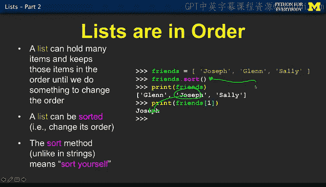

# 每个人的 Python 第二部分 19：列表操作指南 📝


在本节课中，我们将学习Python列表的基本操作。列表是一种可变、有序的数据结构，允许我们存储和操作多个元素。我们将探讨如何创建列表、添加元素、切片、排序以及使用内置函数处理列表数据。

---

## 列表的基本操作

上一节我们介绍了列表的内部结构，本节中我们来看看如何对列表进行实际操作。

列表支持多种操作，包括拼接、切片和使用内置方法。这些操作与字符串处理类似，但列表是可变的，这意味着我们可以直接修改列表内容。

### 列表拼接

列表可以通过加法运算符进行拼接，类似于字符串的拼接操作。拼接操作不会改变原始列表，而是生成一个新的列表。

```python
A = [1, 2, 3]
B = [4, 5, 6]
C = A + B  # C = [1, 2, 3, 4, 5, 6]
```

### 列表切片

列表切片操作与字符串切片类似，使用`[start:end]`语法，其中`start`是起始索引（包含），`end`是结束索引（不包含）。

```python
numbers = [0, 1, 2, 3, 4, 5]
sub1 = numbers[1:4]  # sub1 = [1, 2, 3]
sub2 = numbers[:4]   # sub2 = [0, 1, 2, 3]
sub3 = numbers[3:]   # sub3 = [3, 4, 5]
```

---

## 列表方法

以下是列表对象提供的一些常用方法：

- **append(item)**：在列表末尾添加一个元素
- **count(item)**：返回指定元素在列表中出现的次数
- **extend(iterable)**：将可迭代对象的所有元素添加到列表末尾
- **index(item)**：返回指定元素的第一个匹配项的索引
- **insert(index, item)**：在指定位置插入元素
- **pop([index])**：移除并返回指定位置的元素（默认为最后一个）
- **remove(item)**：移除列表中第一个匹配的指定元素
- **sort()**：对列表进行原地排序

### 使用append方法构建列表

我们可以从空列表开始，使用append方法逐步添加元素。需要注意的是，列表是可变的，append方法会直接修改原始列表。

```python
stuff = list()  # 创建空列表
stuff.append('book')
stuff.append(99)
print(stuff)  # 输出：['book', 99]
```

**重要提示**：由于列表方法是原地操作，不应将返回值赋给原变量。例如，不要写成`x = x.append(item)`，而应直接使用`x.append(item)`。

---

## 成员检查

Python提供了`in`和`not in`运算符来检查元素是否存在于列表中。

```python
numbers = [9, 41, 12, 3, 74, 15]
print(9 in numbers)      # 输出：True
print(15 in numbers)     # 输出：False
print(20 not in numbers) # 输出：True
```



这些运算符可以在任何条件语句中使用，为列表操作提供了便利的检查手段。

---

## 列表排序

列表是有序的数据结构，元素的顺序与添加顺序一致。我们可以使用sort方法对列表进行原地排序。

```python
friends = ['Joseph', 'Glenn', 'Sally']
friends.sort()
print(friends)  # 输出：['Glenn', 'Joseph', 'Sally']
```

排序操作会直接修改原始列表，这是因为列表是可变的。排序后，列表中的元素将按照特定顺序（如字母顺序）重新排列。

---

## 内置函数处理列表

Python提供了一些内置函数来处理列表数据：

- **len(list)**：返回列表长度
- **max(list)**：返回列表中的最大值
- **min(list)**：返回列表中的最小值
- **sum(list)**：返回列表中所有元素的总和

### 计算平均值：两种方法对比

以下是计算数字平均值的两种不同方法：

#### 方法一：使用循环手动计算

这种方法在循环中累加总和和计数，适用于流式数据或内存有限的情况。

```python
total = 0
count = 0
while True:
    inp = input('Enter a number: ')
    if inp == 'done':
        break
    value = float(inp)
    total = total + value
    count = count + 1
average = total / count
print('Average:', average)
```

#### 方法二：使用列表和内置函数

这种方法先将所有数字存储在列表中，然后使用内置函数进行计算。

```python
numlist = list()
while True:
    inp = input('Enter a number: ')
    if inp == 'done':
        break
    value = float(inp)
    numlist.append(value)
average = sum(numlist) / len(numlist)
print('Average:', average)
```

### 两种方法的比较

两种方法都能得到相同的结果，但各有优缺点：

1. **内存使用**：第一种方法只需要两个变量（total和count），无论处理多少数字都占用固定内存。第二种方法需要为每个数字分配内存，当处理大量数据时可能占用较多内存。

2. **代码简洁性**：第二种方法使用内置函数，代码更简洁易读。

3. **适用场景**：如果数据量不大或已经存储在列表中，第二种方法更优雅。如果需要处理大量数据或数据以流式方式到达，第一种方法更合适。

在实际编程中，如果已经将数据存储在列表中，直接使用内置函数（如sum、max、min）是更好的选择，而不是重新编写循环逻辑。

---

## 总结

本节课中我们一起学习了Python列表的基本操作。我们探讨了列表的创建、元素添加、切片、排序和成员检查。同时，我们比较了使用循环手动处理列表与使用内置函数的两种不同方法，理解了它们各自的优缺点和适用场景。

列表是Python中强大而灵活的数据结构，掌握这些基本操作将为后续更复杂的数据处理任务打下坚实基础。下一节课中，我们将探索如何将列表与字符串结合使用，进一步扩展数据处理能力。