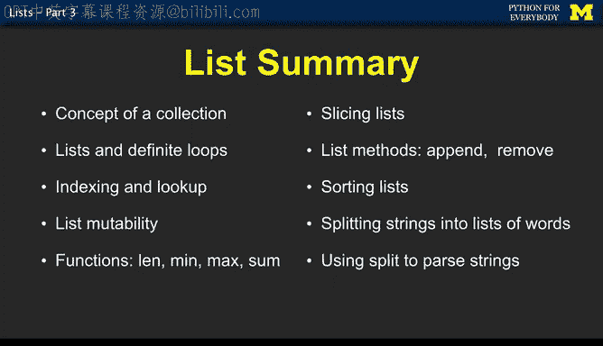

# 2：《Python数据结构》｜P20：列表与字符串 📝


在本节课中，我们将要学习字符串和列表如何协同工作。这是数据处理中非常常见的操作：读取数据、将其分解成片段，并查找其中的特定部分。

## 字符串的 `split` 方法 ✂️

上一节我们介绍了列表的基本操作，本节中我们来看看如何将字符串转换为列表。Python 字符串有一个名为 `split` 的方法，它可以将一个字符串分割成多个部分，并返回一个列表。

**核心概念**：`split` 方法默认根据空白字符（如空格、制表符）来分割字符串，并将多个连续的空白字符视为一个分隔符。

```python
abc = "Hello World It's Beautiful"
stuff = abc.split()
print(stuff)  # 输出：['Hello', 'World', "It's", 'Beautiful']
```

执行上述代码后，`stuff` 变量将成为一个包含四个字符串的列表，原始字符串中的空格已被移除。

## 遍历分割后的列表 🔄

分割字符串后，我们通常需要遍历列表中的每个单词或片段。以下是实现这一目标的简单方法。

以下是遍历列表的代码示例：

```python
abc = "Hello World It's Beautiful"
stuff = abc.split()
for w in stuff:
    print(w)
```

这个循环会运行四次，每次打印列表中的一个单词。这种“先分割，后循环”的模式，是处理文本行数据的常用方法。

## `split` 方法的细节 🔍

`split` 方法的行为有一些值得注意的细节。首先，它会智能地处理多余的空白字符。

```python
line = "A lot      of   spaces"
words = line.split()
print(words)  # 输出：['A', 'lot', 'of', 'spaces']
```

其次，`split` 方法可以指定分隔符。这在处理非空格分隔的数据（如日志文件）时非常有用。

```python
data = "first;second;third"
pieces = data.split(';')
print(pieces)  # 输出：['first', 'second', 'third']
```

当指定分隔符后，`split` 将只根据该字符进行分割，不再处理空白字符。

## 实战应用：解析邮件数据 📧

现在，让我们将 `split` 方法应用于一个实际场景：解析邮件日志文件，提取特定信息。

以下是解析邮件数据并提取星期几的代码：

```python
fhand = open('mbox-short.txt')
for line in fhand:
    line = line.rstrip()
    if not line.startswith('From '):
        continue
    words = line.split()
    print(words[2])
```

这段代码会打开文件，跳过不以“From ”开头的行，然后将符合条件的行按空格分割。由于格式固定，星期几总是位于分割后列表的第三个位置（索引为2）。

## 高级技巧：双重分割 🪓

有时，一次分割不足以提取我们需要的数据。这时可以使用“双重分割”模式：先进行一次分割，再对结果中的某个元素进行第二次分割。

假设我们想从“From ”行中提取电子邮件地址的域名部分。

以下是使用双重分割提取域名的代码：

```python
line = "From stephen.marquard@uct.ac.za Sat Jan 5 09:14:16 2008"
words = line.split()
email = words[1]               # 获取电子邮件地址
pieces = email.split('@')      # 根据 '@' 符号分割电子邮件
host = pieces[1]               # 获取域名部分
print(host)                    # 输出：uct.ac.za
```

这种方法逻辑清晰，代码易于编写和理解，避免了使用 `find` 和字符串切片时可能出现的复杂变量管理。

## 总结 📚

本节课中我们一起学习了字符串与列表的核心交互方式。我们重点掌握了 `split` 方法，它能够将字符串分割成列表，是文本处理的基础工具。我们还探讨了遍历列表、指定分隔符、解析实际数据文件以及使用双重分割模式提取嵌套信息等实用技巧。



列表作为我们的第一个真正的数据结构，它允许我们将多个元素组织在一个变量中，并通过索引进行顺序访问。结合字符串的 `split` 等方法，我们能够高效地处理和分析文本数据。在接下来的章节中，我们将进一步精炼这些技巧，并学习更多操作列表的方法。