# 2：《Python数据结构》｜P22：列表练习题讲解 🐛

在本节课中，我们将学习如何编写代码来解析和处理数据。具体来说，我们将读取一个著名的邮箱数据集，找出所有以“From ”开头的行，并提取出这些行中的第三个单词。我们将从一个存在错误的程序开始，通过调试来修复它，并在这个过程中学习一种重要的编程模式——**守护模式**。

---

## 程序目标与初始代码

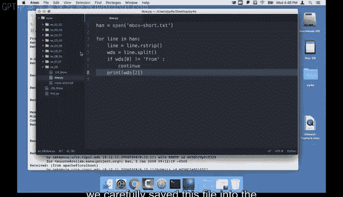

我们的目标是：打开一个文件，逐行读取，找到以“From ”开头的行，并打印出该行的第三个单词。

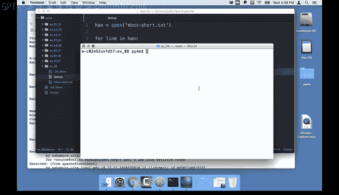

初始代码如下：

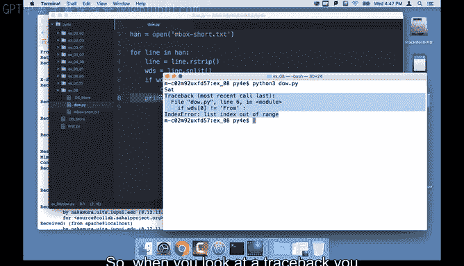

```python
fhand = open('mbox-short.txt')
for line in fhand:
    line = line.rstrip()
    words = line.split()
    if words[0] != 'From':
        continue
    print(words[2])
```

这个程序的基本逻辑是：
1.  打开文件。
2.  遍历文件的每一行。
3.  去除行尾的空白字符。
4.  将行拆分成单词列表 `words`。
5.  检查第一个单词（`words[0]`）是否为“From”。
6.  如果不是，则跳过该行（`continue`）。
7.  如果是，则打印第三个单词（`words[2]`）。

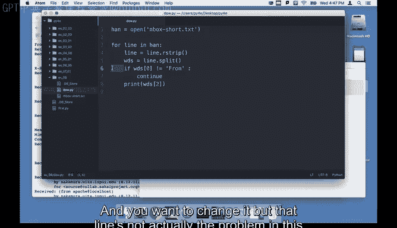

---

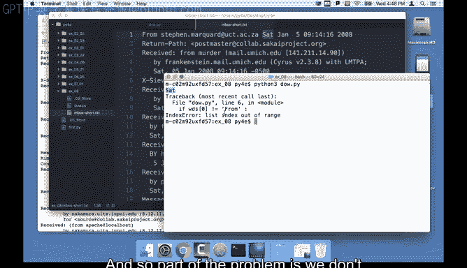

## 第一次运行与错误分析

当我们运行这个程序时，它并没有成功。程序输出了一个错误信息（Traceback）。

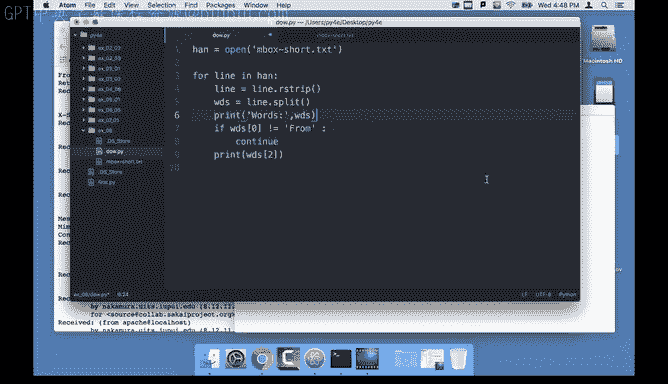

**关键点**：错误信息指向了 `if words[0] != ‘From’:` 这一行。然而，仔细观察会发现，程序实际上成功处理了第一行数据（打印出了“Sat”），然后才在后续的某一行崩溃。这说明问题并不直接出在这行代码的语法上，而是与程序运行时的数据状态有关。

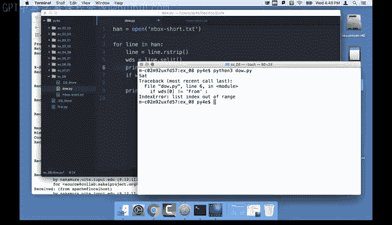

---

## 调试：添加打印语句定位问题

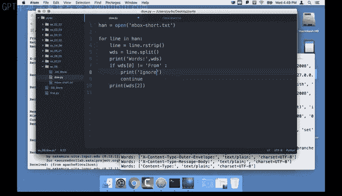

为了找出程序在哪一行数据上崩溃，我们在关键操作前添加打印语句，以观察程序运行时的状态。

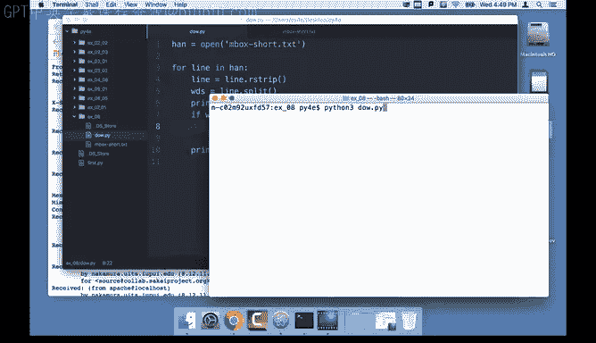

我们修改代码，在拆分单词后立即打印出 `words` 列表：

```python
    words = line.split()
    print('Words:', words)  # 新增的调试语句
```

再次运行程序，我们看到大量输出。程序成功处理了第一行，打印了 `[‘From’, ‘stephen.marquard@uct.ac.za’, ‘Sat’, …]` 和 “Sat”。之后，程序处理了许多其他行，最终在遇到一个 `words` 列表为空（`[]`）时崩溃。

**问题根源**：文件中存在空行。当对空行执行 `line.split()` 时，会得到一个空的单词列表 `[]`。此时，尝试访问 `words[0]` 就会引发“列表索引超出范围”的错误。

---

## 解决方案：引入守护模式

我们需要在访问 `words[0]` 之前，确保 `words` 列表中有足够的元素。这种在危险操作前进行检查的模式，称为“守护模式”。

### 方案一：检查列表长度

最直接的修复方法是在条件判断前，检查单词列表的长度。如果长度小于1（即空行），则直接跳过。

```python
for line in fhand:
    line = line.rstrip()
    words = line.split()
    if len(words) < 1:  # 守护语句：跳过空行
        continue
    if words[0] != 'From':
        continue
    print(words[2])
```

这个修改后，程序就能顺利运行完毕，不再崩溃。

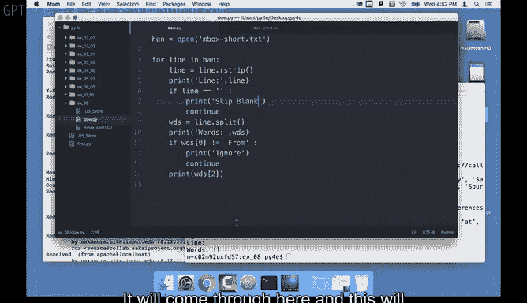

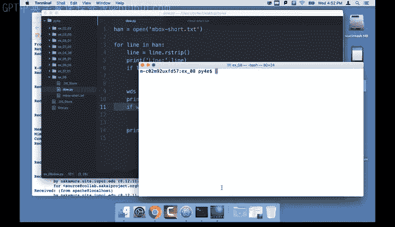

### 方案二：更严格的守护

我们可以让守护条件更严格。既然我们的逻辑需要访问 `words[2]`（第三个单词），那么我们可以要求该行至少要有3个单词。

```python
    if len(words) < 3:  # 更强的守护：确保有足够单词
        continue
```

这能防止因数据格式意外（例如一行只有“From”一个单词）而导致的错误。

---

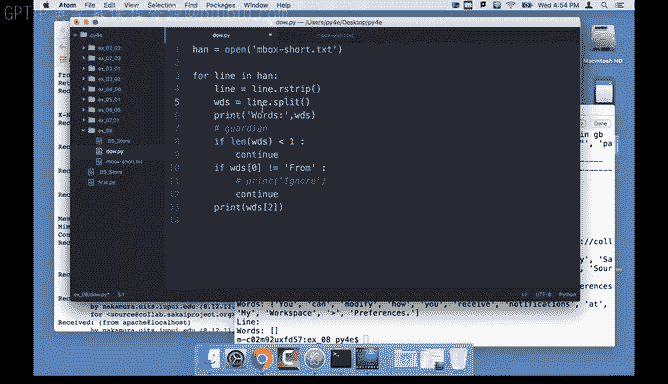

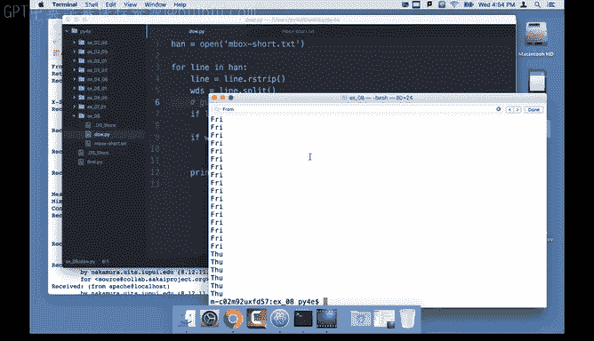

## 进阶：使用复合逻辑的守护模式

上一节我们介绍了通过单独的 `if` 语句实现守护模式。本节中我们来看看如何利用逻辑运算符 `or` 将守护条件与业务逻辑合并。

我们可以将“跳过空行”和“跳过非‘From’开头的行”这两个条件合并：

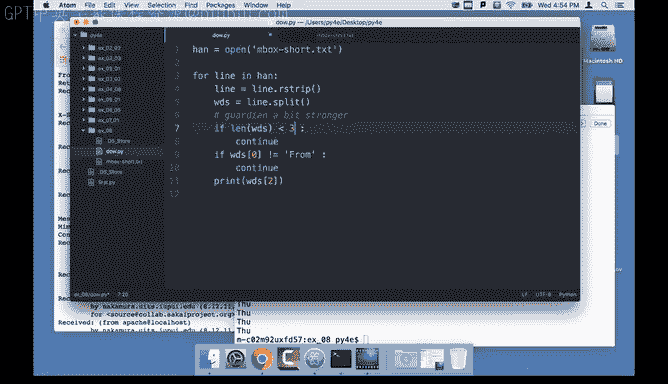

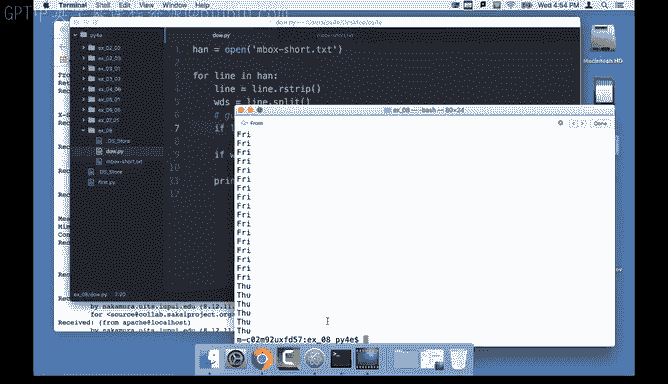

```python
    if len(words) < 3 or words[0] != 'From':
        continue
    print(words[2])
```

**这里有一个至关重要的细节：条件的顺序。**

Python 对 `or` 进行**短路求值**。这意味着，如果 `or` 前面的部分（`len(words) < 3`）为 `True`，Python 将不会再去计算后面的部分（`words[0] != ‘From’`）。

*   **正确顺序**：`if len(words) < 3 or words[0] != ‘From’:`
    *   如果单词数不足3个，条件立即为真，跳过 `words[0]` 的访问，程序安全。
*   **错误顺序**：`if words[0] != ‘From’ or len(words) < 3:`
    *   程序会先尝试执行 `words[0] != ‘From’`。如果 `words` 是空列表，这行代码本身就会引发错误，程序等不到检查 `len(words) < 3` 就崩溃了。

因此，在复合条件中，**守护条件必须放在 `or` 的前面**。

---

## 总结

本节课中我们一起学习了如何调试一个因数据问题而崩溃的程序，并掌握了“守护模式”这一核心技巧。

1.  **调试技巧**：当错误不直观时，通过添加打印语句来观察程序运行时的数据状态，是定位问题的有效方法。
2.  **守护模式**：在执行可能失败的操作（如访问列表特定索引）之前，先检查数据是否满足前提条件。
3.  **实现方式**：
    *   可以使用单独的 `if` 语句进行检查。
    *   也可以利用**短路求值**特性，将守护条件合并到业务逻辑的条件判断中，但务必注意**将守护条件置于 `or` 操作符之前**。

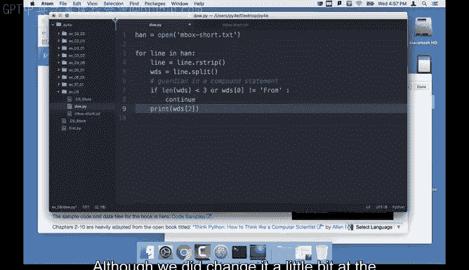

通过本课，你不仅修复了一个程序错误，更学会了一种预防类似错误的稳健编程思想。