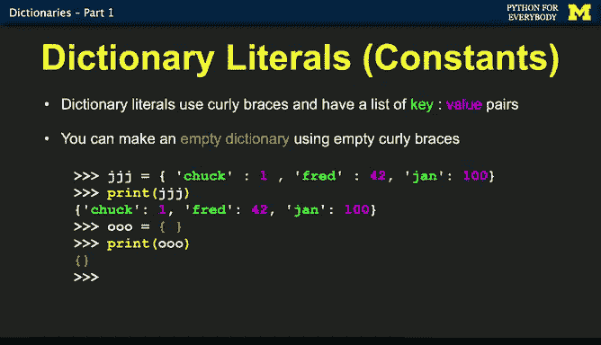

# 密歇根大学《给所有人的Python课》课程2：《Python数据结构》｜P25：字典 🗂️


## 概述

在本节课中，我们将要学习Python中最强大、最受欢迎的数据结构之一：**字典**。我们将了解字典是什么，它与之前学过的列表有何异同，以及如何创建和使用字典来存储和访问数据。

---

## 什么是字典？

上一节我们介绍了列表，它是一种有序的集合。本节中我们来看看字典，它是一种允许我们通过“键”来快速查找“值”的数据结构。

字典是Python中一种核心的数据集合。你可以把它想象成一个文件柜，每个抽屉都有一个独特的标签（键），里面存放着对应的物品（值）。与列表通过数字位置（索引）访问元素不同，字典通过你定义的键来访问值。

**核心概念**：字典由**键值对**组成。
```python
# 字典的基本结构
{key1: value1, key2: value2, key3: value3}
```

---

## 字典与列表的对比

为了更好地理解字典，我们先回顾一下列表，并比较两者的核心区别。

列表就像一个按顺序排列的卡片目录，我们通过数字索引（0, 1, 2...）来查找卡片。字典则更像一个贴了标签的文件柜，我们通过标签（键）来直接找到对应的文件，无需知道它的顺序。

以下是列表和字典在代码上的主要区别：

*   **索引方式**：列表使用整数索引，字典使用键（通常是字符串）索引。
*   **赋值与访问**：两者都可以放在赋值语句的左边（修改）或右边（读取）。
*   **存储方式**：列表通过`.append()`方法顺序添加元素；字典通过为键赋值来添加或修改键值对。

让我们看一个具体的代码示例来对比：

```python
# 列表示例
lst = []
lst.append(21)
lst.append(183)
lst[0] = 23
print(lst)  # 输出: [23, 183]

# 字典示例
dct = {}
dct[‘age’] = 21
dct[‘course’] = 183
dct[‘age’] = 23
print(dct)  # 输出: {‘age’: 23, ‘course’: 183}
```

---

## 字典的特性与历史

字典在Python 3.7版本中发生了一个重要变化：**字典会保持元素插入的顺序**。这意味着，你按照什么顺序添加键值对，打印或遍历时就会看到什么顺序。

需要注意的是，这并不意味着字典会自动按键排序，它只是记录了插入的先后顺序。在Python 3.7之前，字典的条目顺序是不确定的。因此，如果你查阅较旧的资料，可能会看到不同的说法。

这种键值对的数据结构在许多编程语言中都有类似实现，例如Perl和PHP中的“关联数组”，Java中的“HashMap”，C#中的“Property Bag”。它已成为现代编程语言的必备特性。

---

## 如何创建和使用字典

创建字典主要有两种方式：一种是先创建空字典再添加内容，另一种是直接使用字典常量（字面量）定义。

以下是创建和使用字典的几种方法：

*   **创建空字典并添加元素**
    ```python
    cabinet = {}  # 创建一个空字典
    cabinet[‘summer’] = 12
    cabinet[‘fall’] = 3
    cabinet[‘spring’] = 75
    print(cabinet)  # 输出: {‘summer’: 12, ‘fall’: 3, ‘spring’: 75}
    print(cabinet[‘fall’])  # 输出: 3
    cabinet[‘fall’] = cabinet[‘fall’] + 2  # 修改值
    print(cabinet[‘fall’])  # 输出: 5
    ```

*   **使用字典常量（字面量）**
    ```python
    # 直接定义包含键值对的字典
    person = {‘name’: ‘Fred’, ‘age’: 42, ‘city’: ‘Paris’}
    print(person[‘name’])  # 输出: Fred

    # 空字典常量
    empty_dict = {}
    ```

*   **使用`dict()`构造函数**
    ```python
    # 这也是一种创建空字典的方式
    another_dict = dict()
    print(another_dict)  # 输出: {}
    ```

你可以把字典中的键想象成“变量中的变量”。字典`cabinet`是一个大变量，而`cabinet[‘summer’]`、`cabinet[‘fall’]`就像是存储在这个大变量内部的小变量，你可以独立地访问和修改它们。

---

## 总结



本节课中我们一起学习了Python字典。我们了解到字典是一种通过**键**来访问**值**的强大数据结构，它与列表的主要区别在于索引方式。字典使用可读性更高的键（如字符串）而非数字索引，使得数据的存取更加直观和高效。我们还学习了创建字典的几种方法，包括使用花括号`{}`定义字面量，以及如何添加、修改和访问字典中的元素。掌握字典是有效组织和管理数据的关键一步。