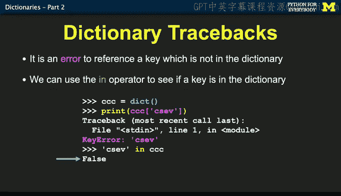

# 课程2：《Python数据结构》｜P26：使用字典计数 📊


在本节课中，我们将学习如何使用Python字典来统计一组数据中各个元素出现的次数，即构建一个“直方图”。我们将从基础方法开始，逐步介绍更简洁高效的实现方式。

---

## 概述

字典是Python中强大的数据结构，其中一个常见应用是进行计数统计。例如，给定一系列姓名，我们可能需要知道每个姓名出现的次数。手动计数容易出错，而通过编程实现则能准确高效地完成此任务。

## 手动计数的局限性

假设我们有以下姓名列表（来自一个真实的开源项目邮件列表）：
*   Mark
*   Gen
*   Chen
*   Stephen
*   Mark
*   Gen
*   Chen
*   Mark
*   Gen
*   Gen
*   Gen

作为人类，我们可能会目测并得出：Mark出现3次，Gen出现5次，Chen出现2次，Stephen出现1次。然而，对于更长的列表，我们很容易出错。更可靠的方法是顺序遍历列表，为每个新出现的姓名创建一个“计分板”，并在后续遇到相同姓名时增加计数。

最终，我们会得到一个类似字典的结构，其中**键（Key）**是姓名，**值（Value）**是该姓名出现的次数。

## 基础实现方法

为了实现上述逻辑，我们需要一个字典来存储计数。核心挑战在于：当我们首次遇到一个姓名时，字典中尚不存在对应的键，直接引用会导致`KeyError`错误。

以下是解决此问题的基础步骤：

首先，我们需要检查一个键是否已存在于字典中，这可以通过`in`运算符完成。

```python
counts = {}
name = "Csev"
if name in counts:
    # 键已存在
else:
    # 键不存在
```

基于此检查，我们可以编写完整的计数循环。

以下是使用`if-else`逻辑的完整代码示例：



```python
names = ['Csev', 'Chen', 'Csev', 'Gen', 'Chen'] # 示例数据
counts = {} # 初始化一个空字典用于计数

for name in names:
    if name not in counts:
        # 首次见到该姓名，初始化计数为1
        counts[name] = 1
    else:
        # 该姓名已存在，计数加1
        counts[name] = counts[name] + 1

print(counts)
# 输出：{'Csev': 2, 'Chen': 2, 'Gen': 1}
```

这段代码可以处理任意长度的列表，并准确生成每个姓名的出现次数统计。

## 使用 `get()` 方法简化代码

上一节我们介绍了使用`if-else`进行计数的基础方法。本节中，我们来看看如何利用字典的内置方法`get()`来更优雅地实现相同功能。

`if-else`模式在计数中非常普遍，因此Python字典提供了一个名为`get()`的方法来简化它。`get()`方法接受两个参数：
1.  要查找的键（Key）。
2.  默认值（Default Value）：如果键不存在，则返回此值。

其工作方式可以概括为：
`x = counts.get(name, 0)` 这行代码意味着：从`counts`字典中获取键为`name`的值；如果找不到，则返回`0`。

利用`get()`方法，我们可以将之前的四行`if-else`逻辑压缩为一行。

以下是使用`get()`方法重写的计数循环：

```python
names = ['Csev', 'Chen', 'Csev', 'Gen', 'Chen']
counts = {}

for name in names:
    counts[name] = counts.get(name, 0) + 1

print(counts)
# 输出：{'Csev': 2, 'Chen': 2, 'Gen': 1}
```

在这行核心代码 `counts[name] = counts.get(name, 0) + 1` 中：
*   当`name`首次出现时，`counts.get(name, 0)`返回`0`，然后`0+1`得到`1`，并将其赋值给`counts[name]`。
*   当`name`再次出现时，`counts.get(name, 0)`返回其当前值（例如1），然后`1+1`得到`2`，并更新`counts[name]`。

这是一种被所有Python开发者熟知的惯用写法（idiom），它使代码更简洁、更易读且更不易出错。

## 总结

本节课中我们一起学习了使用Python字典进行计数的两种方法：
1.  **基础方法**：使用`if-else`语句和`in`运算符，判断键是否存在并分别处理。
2.  **简化方法**：使用字典的`get(key, default)`方法，它能安全地处理键不存在的情况，并用一行代码优雅地完成计数逻辑。

计数是数据处理中的一项基本且重要的任务。正如《芝麻街》里的Count von Count伯爵喜欢计数一样，Python也擅长于此。掌握`get()`方法这一惯用法，将帮助你编写出更简洁、更专业的Python代码。