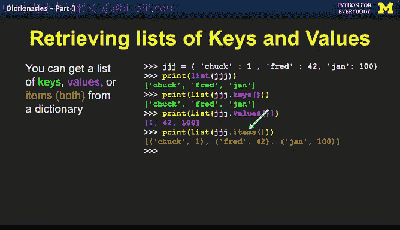

# 密歇根大学《给所有人的Python课》课程2：《Python数据结构》｜P27：字典与文件 📚


在本节课中，我们将学习如何利用字典来处理和分析文本文件。我们将从简单的单词计数开始，逐步深入到如何从文件中读取数据、构建直方图（即词频统计），并最终找出文本中出现频率最高的单词。

---

## 从列表到文本：扩展计数场景 🔄

上一节我们介绍了如何对列表中的元素进行计数。本节中，我们来看看如何对更复杂的文本数据进行计数。

我们将编写一个程序，统计用户输入的一行文本中每个单词出现的次数。

以下是实现步骤：
1.  创建一个空字典。
2.  读取用户输入的一行文本。
3.  使用 `split()` 方法将文本按空格分割成单词列表。
4.  遍历这个单词列表，并使用 `get()` 惯用法来更新字典中的计数。

核心的计数惯用法代码如下：
```python
counts[word] = counts.get(word, 0) + 1
```
这行代码的含义是：从字典 `counts` 中获取键 `word` 对应的值（如果键不存在则返回0），然后将其加1，最后将结果存回字典。

运行这个程序，输入一行文本，程序会输出每个单词及其出现的次数。一旦掌握了这个构建直方图的惯用法，处理更大量的数据也会变得非常简单。

---

## 遍历字典：访问键值对 🔑

我们一直在遍历列表。但为了处理字典中的数据，我们需要学习如何遍历字典。



从一个简单的字典常量开始：
```python
counts = {'chuck': 1, 'fred': 42, 'jan': 100}
```
使用标准的 `for` 循环遍历字典，默认会迭代字典的**键**。
```python
for key in counts:
    print(key, counts[key])
```
在循环内部，我们可以通过键来获取对应的值。字典的底层哈希实现保证了这种查找方式非常高效，即使字典中有数百万个条目。

另一种遍历模式是使用字典的 `items()` 方法，它可以同时获取键和值。
```python
for aaa, bbb in counts.items():
    print(aaa, bbb)
```
这里，`aaa` 和 `bbb` 是两个迭代变量，在每次循环中，`aaa` 会依次是每个键，`bbb` 则是对应的值。在实际编程中，我们通常会将它们命名为 `key` 和 `value`，这样代码更清晰。这种同时为多个变量赋值的特性是Python中非常优雅的设计。

此外，字典还有其他有用的方法：
*   `list(counts)` 或 `counts.keys()`：返回一个由所有键组成的列表。
*   `counts.values()`：返回一个由所有值组成的列表。

---

## 综合应用：在文件中寻找最常出现的单词 📂

现在，让我们回到课程最初的一个承诺：理解当时看起来复杂的代码。我们将编写一个程序，读取一个文件，并找出其中出现次数最多的单词。

以下是完整的代码逻辑和分析：
1.  **打开文件**：首先，要求用户输入一个文件名，然后使用 `open()` 函数打开它。
2.  **初始化字典**：创建一个空字典 `counts`，用于存储单词计数。
3.  **逐行读取并计数**：
    *   使用 `for line in handle:` 循环遍历文件的每一行。
    *   对每一行，使用 `split()` 分割成单词列表。
    *   遍历这个单词列表，再次使用 `counts[word] = counts.get(word, 0) + 1` 这个惯用法来更新每个单词的计数。
4.  **找出最大值**：在构建好完整的单词计数直方图（即 `counts` 字典）后，我们需要找到出现次数最多的单词。
    *   初始化两个变量：`bigcount = None` 和 `bigword = None`。
    *   使用 `for word, count in counts.items():` 遍历字典的所有键值对。
    *   在循环内部，通过一个条件判断来更新最大值：
        ```python
        if bigcount is None or count > bigcount:
            bigword = word
            bigcount = count
        ```
        *   如果 `bigcount` 是 `None`，说明这是第一次迭代，直接将当前单词和计数记录下来。
        *   如果当前计数 `count` 大于已知的最大计数 `bigcount`，则更新 `bigword` 和 `bigcount`。
5.  **输出结果**：循环结束后，`bigword` 和 `bigcount` 就分别是最常出现的单词及其次数，将其打印出来即可。

这段代码融合了文件操作、字典的构建与遍历以及寻找最大值的经典算法，是本章所学知识的一个完美综合应用。

---

## 本章总结 📝

本节课中我们一起学习了Python字典在处理文本数据时的强大功能。我们主要涵盖了以下核心内容：
*   使用字典和 `get()` 方法构建词频直方图的惯用法。
*   如何遍历字典，包括遍历键、遍历键值对，以及使用 `keys()`, `values()`, `items()` 方法。
*   将这些技巧综合运用于文件处理，实现了从文本文件中找出最常出现单词的程序。

理解并掌握这些概念是学习Python数据结构的关键一步。接下来，我们将在下一章中学习**元组（tuples）**，并在此基础上探索如何对数据进行排序。