# 每个人的 Python 第二部分 28：字典练习题讲解 📚

在本节课中，我们将一起学习如何使用Python字典来统计文本文件中单词的出现频率。我们将从一个简单的文件读取程序开始，逐步构建一个完整的单词计数器，并找出出现次数最多的单词。

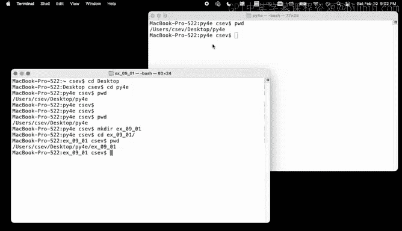

---

## 概述与准备工作 🛠️

上一节我们介绍了字典的基本概念和操作。本节中，我们来看看如何应用字典解决一个实际问题：统计文本中的单词频率。

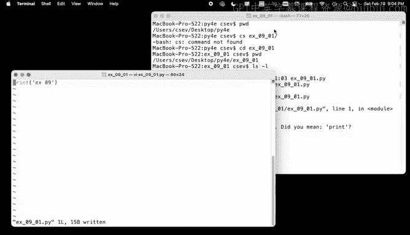

首先，我们需要准备一个工作环境。我们将使用命令行终端来编写和运行代码，并确保所有文件都位于正确的目录中。

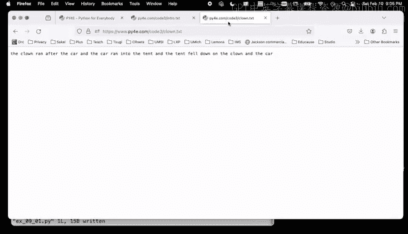

以下是准备工作步骤：

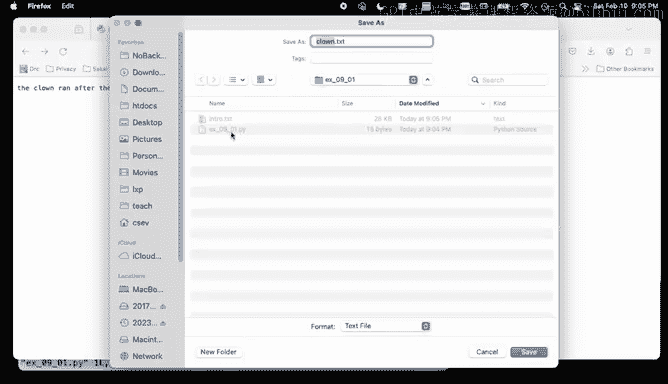

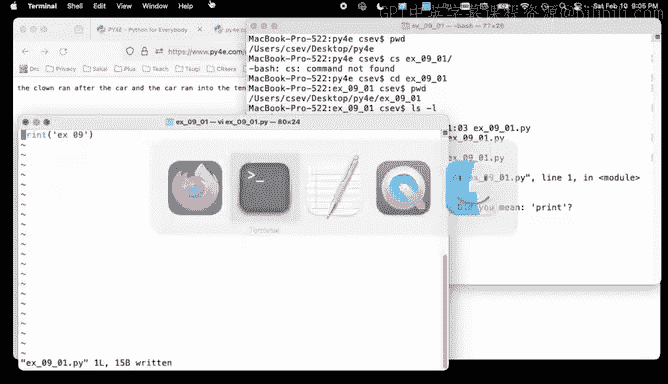

1.  打开终端，使用 `pwd` 命令确认当前工作目录。
2.  使用 `cd` 命令导航到练习文件夹，例如 `cd exercise_09_01`。
3.  创建两个终端窗口：一个用于编写代码，另一个用于运行代码。确保两个窗口位于同一目录下。

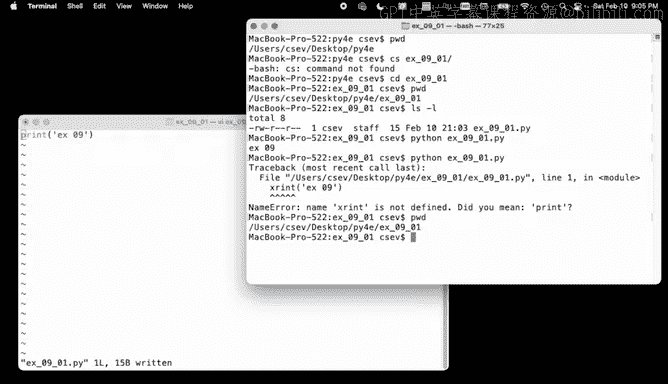

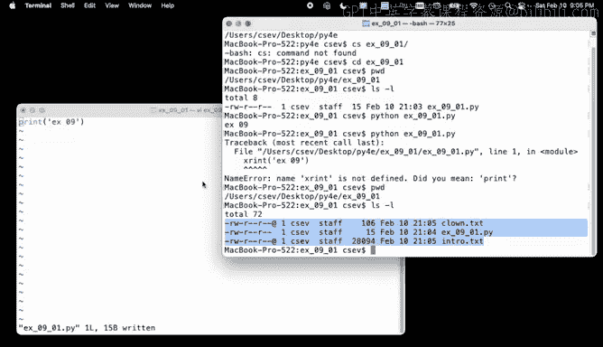

## 第一步：创建并运行基础程序

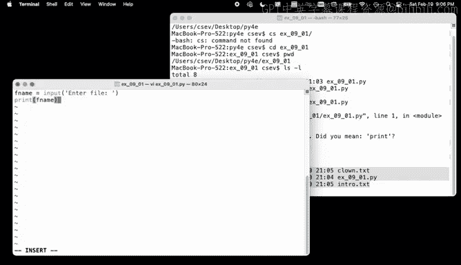

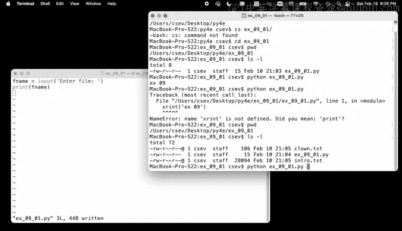

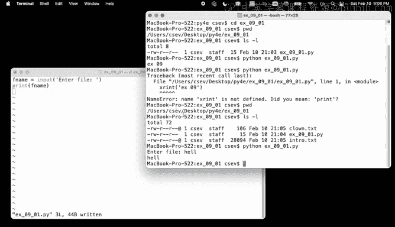

我们将从一个最简单的Python程序开始，以验证环境配置正确。

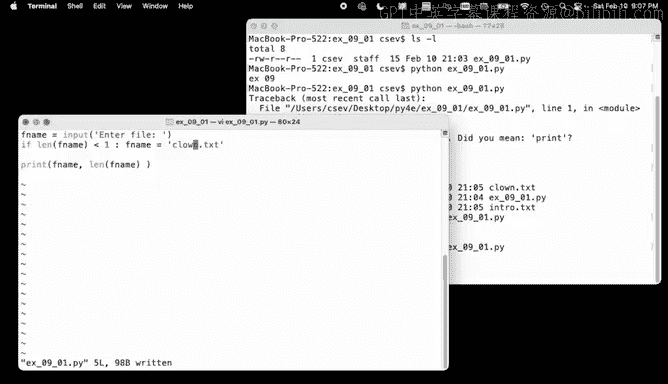

```python
print('ex_09_01')
```

保存文件为 `ex_09_01.py`。在另一个终端窗口中，使用 `python ex_09_01.py` 命令运行它。如果程序成功打印出 `ex_09_01`，说明环境已就绪。

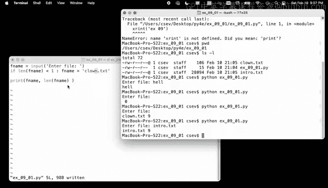

## 第二步：获取并处理输入文件

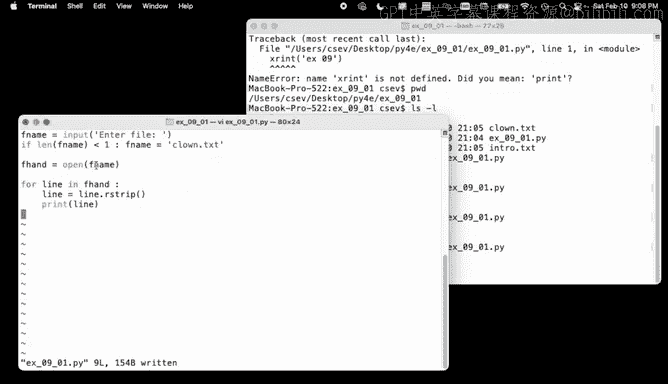

接下来，我们需要处理文本文件。我们将从网络下载两个示例文件：`intro.txt` 和 `clown.txt`，并将它们保存到当前工作目录。

现在，我们的文件夹中应该有三个文件：Python脚本和两个文本文件。使用 `ls -l` 命令可以查看它们。

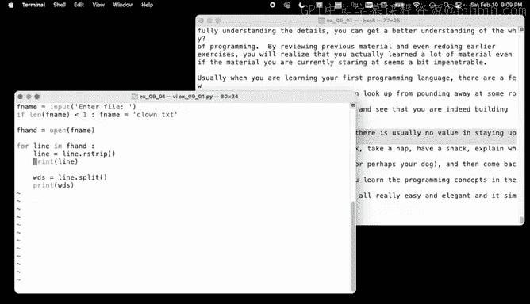

## 第三步：编写文件读取与单词分割逻辑

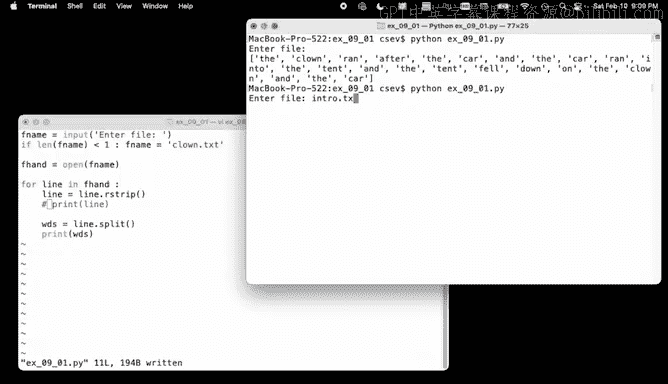

本节我们将编写程序的核心逻辑：读取用户输入的文件名，打开文件，并逐行分割出单词。

首先，我们提示用户输入文件名，并设置一个默认值以便快速测试。

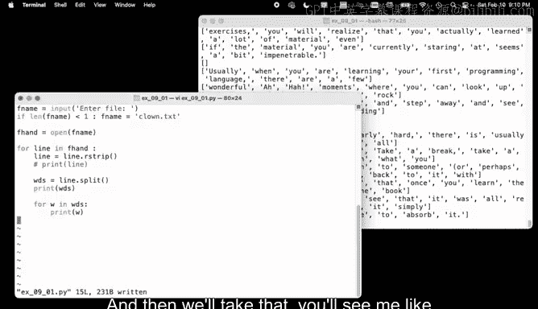

```python
fname = input('Enter file: ')
if len(fname) < 1:
    fname = 'clown.txt'
print(fname)
```

然后，我们打开文件，逐行读取并去除行尾的空白字符。

```python
fhand = open(fname)
for line in fhand:
    line = line.rstrip()
    print(line)
```

为了处理单词，我们需要在行循环内部，使用 `split()` 方法将每一行分割成单词列表。

```python
for line in fhand:
    line = line.rstrip()
    words = line.split()
    print(words)
```

最后，我们使用嵌套循环来遍历文件中的每一个单词。

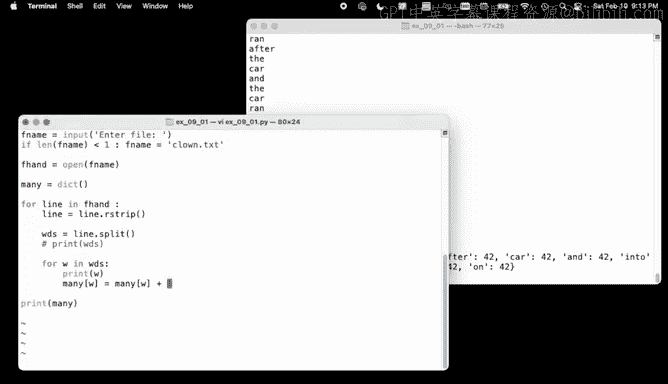

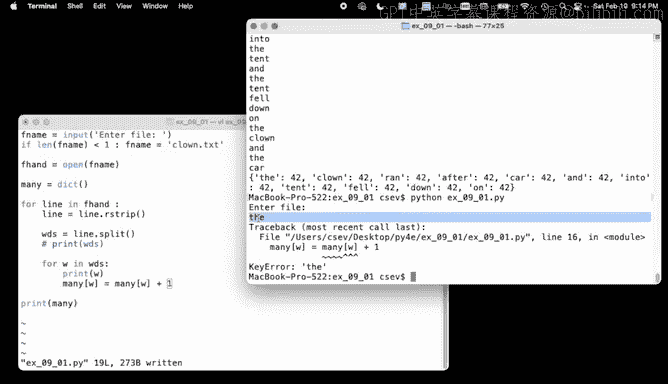

```python
for line in fhand:
    line = line.rstrip()
    words = line.split()
    for w in words:
        print(w)
```

至此，我们已经成功读取了文件中的所有单词。

## 第四步：使用字典进行单词计数 🧮

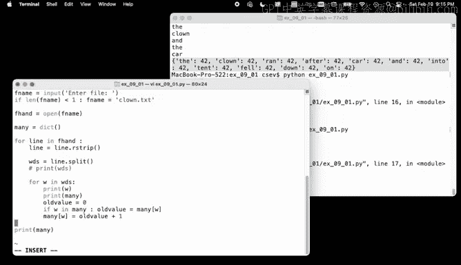

上一节我们遍历了所有单词。本节中，我们来看看如何使用字典来统计每个单词出现的次数。

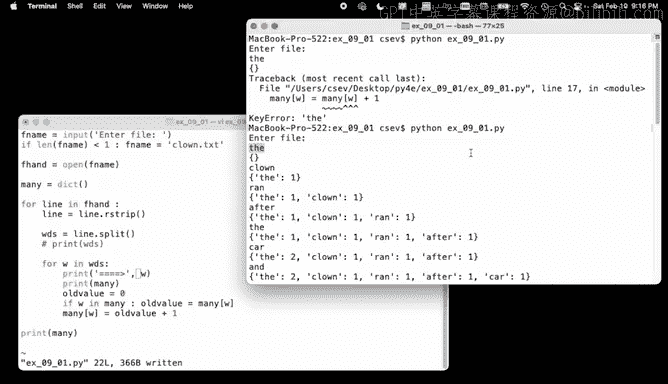

我们首先创建一个空字典。

```python
counts = dict()
```

在遍历每个单词的循环中，我们需要更新该单词在字典中的计数。核心思路是：如果单词不在字典中，则将其计数设为1；如果已在字典中，则将其计数加1。

我们可以使用一个临时变量 `oldval` 来存储当前计数，但Python字典提供了一个更优雅的方法：`get()`。

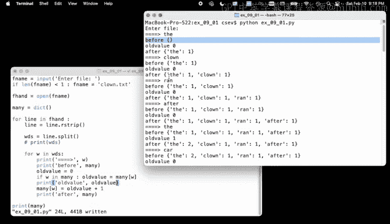

`get()` 方法的语法是：`dict.get(key, default)`。它的作用是：如果键 `key` 存在于字典中，则返回其对应的值；否则，返回指定的 `default` 值。

利用 `get()` 方法，计数逻辑可以简化为一行代码：

```python
for w in words:
    counts[w] = counts.get(w, 0) + 1
```

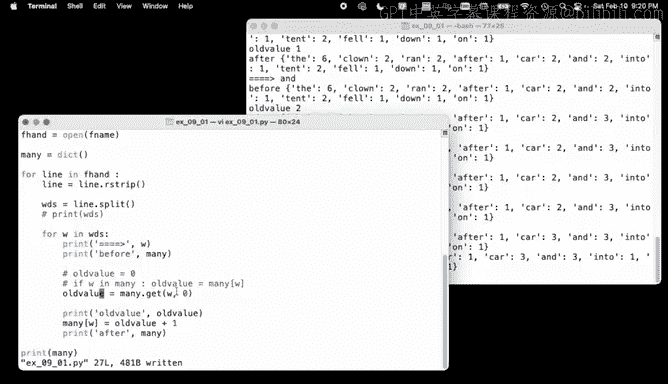

这行代码的意思是：获取单词 `w` 当前的计数（如果不存在则为0），然后加1，并将结果存回字典。这是一种非常高效且地道的Python写法。

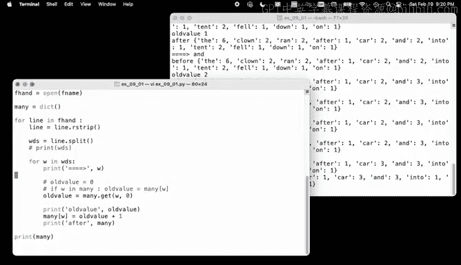

## 第五步：找出出现频率最高的单词 🔍

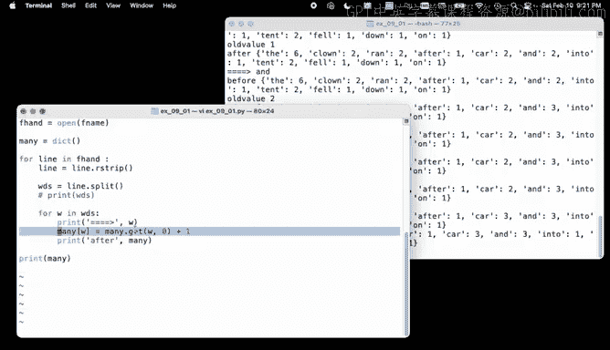

现在，字典 `counts` 中已经存储了每个单词及其出现次数。接下来，我们需要遍历这个字典，找出出现次数最多的单词。

我们将使用一个“最大值循环”模式。初始化两个变量：`bigword` 存储出现最多的单词，`bigcount` 存储对应的最大次数。

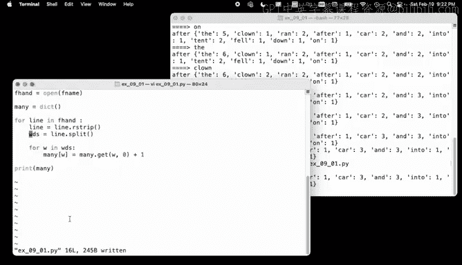

```python
bigword = None
bigcount = None
```

然后，使用 `items()` 方法遍历字典中的每一个键值对。

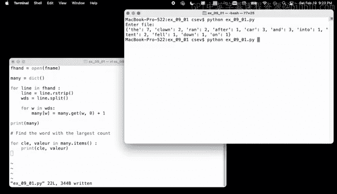

```python
for word, count in counts.items():
    if bigcount is None or count > bigcount:
        bigword = word
        bigcount = count
```

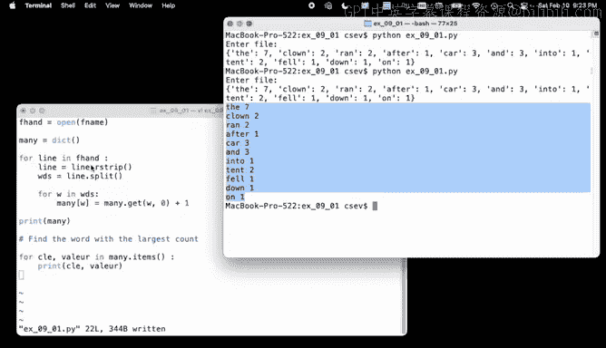

循环结束后，`bigword` 和 `bigcount` 就是我们要找的结果。

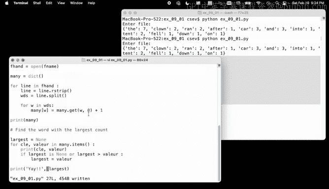

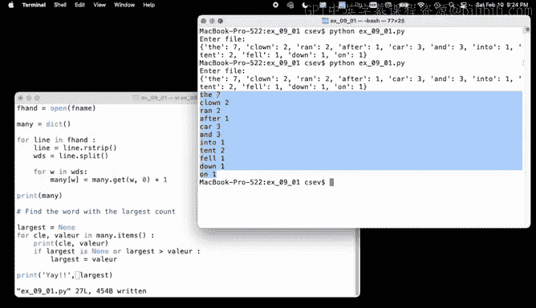

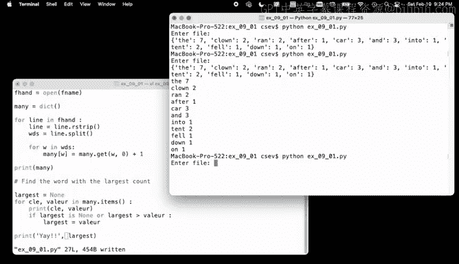

```python
print(bigword, bigcount)
```

运行程序，输入 `clown.txt`，会得到结果 `the 7`。输入更大的文件 `romeo.txt`，会得到 `the 226`。

## 总结 📝

本节课中我们一起学习了如何构建一个完整的单词频率统计程序。我们回顾一下关键步骤：

1.  **环境准备与文件读取**：确保工作目录正确，并能够读取用户指定的文本文件。
2.  **文本处理**：使用嵌套循环遍历文件中的每一个单词。
3.  **字典计数**：利用字典和 `get()` 方法高效地统计每个单词的出现次数。核心公式是：`counts[w] = counts.get(w, 0) + 1`。
4.  **查找最大值**：通过遍历字典的 `items()`，使用循环找出出现频率最高的单词及其次数。

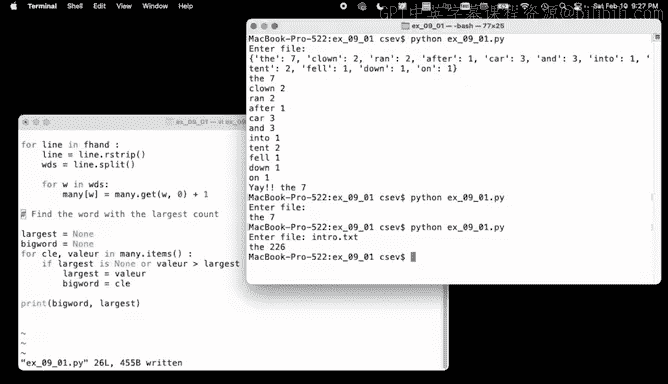

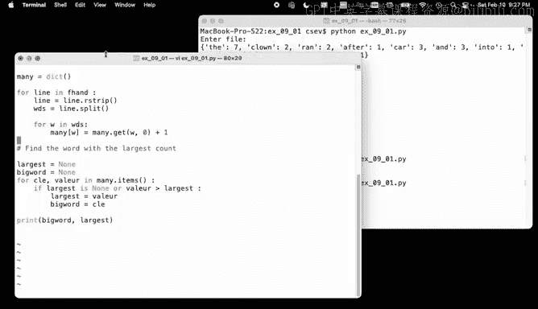

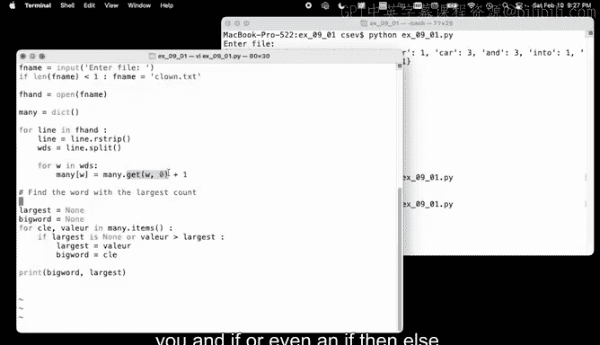

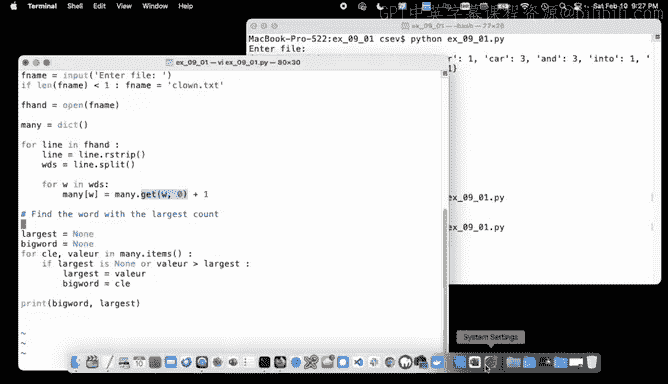

通过这个练习，你将字典从理论概念应用到了实际问题中，掌握了文件处理、字符串分割和字典计数等核心编程技能。这个模式是文本处理和分析的基础，希望你能够熟练掌握。