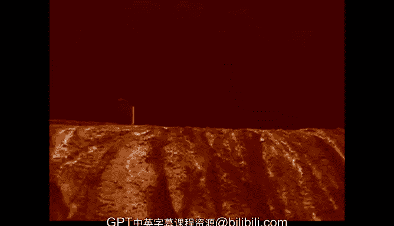

# 每个人的 Python 第二部分 31：趣味-查克博士的摩托车越野赛 🏍️

在本节课中，我们将通过查克博士分享的一段个人经历，来理解如何将现实世界中的场景与编程中的逻辑和数据处理思想联系起来。这段经历虽然不直接涉及代码，但其背后的目标设定、条件判断和结果分析，与编程思维息息相关。

## 概述

查克博士描述了他参加一场复古摩托车越野赛的经历。他的目标并非赢得比赛，而是根据当天的特殊条件（泥泞的场地）设定了不同的策略。我们将通过他的叙述，学习如何将模糊的、多条件的现实目标转化为清晰的逻辑思路。

## 复古摩托车越野赛

这是复古摩托车越野赛。参赛者是骑着老式摩托车的年长车手。今天场地非常泥泞，因此我很可能会摔倒几次。我骑的是1978年的PE 175，这是一辆老摩托车。我是位头发灰白的老车手。

上一段描述了场景，本节中我们来看看查克博士设定的具体目标。

我的全部目标就是摔倒不超过一次。上周我的目标是完全不摔倒。但今天场地如此湿滑，我只希望摔倒少于一次。

## 比赛策略

我希望获得最后一名。因为我不想让任何人把泥浆溅到我脸上。所以整个目标就是获得最后一名，让其他车手尽可能远地领先我，这样我就不会沾到任何泥浆。

基于上述目标，查克博士在比赛中执行了相应的策略。以下是他在比赛中的观察和结果：

*   年长者必须先出发，老式摩托车第二批出发。这意味着可能有人会追上并超过我。
*   我猜我是最后一名吗？不，你是倒数第二。他才是最后一名，就在你后面。哦，太好了！我看到他在推他的摩托车。

## 总结

本节课中我们一起学习了查克博士的摩托车越野赛经历。这就是查克博士越野赛的结尾。我没有摔倒。我认为我没有获得最后一名。现在我得去把他车牌上的一些泥巴弄掉。

通过这个生动的例子，我们看到了如何根据环境条件（泥泞）调整核心目标（从“不摔倒”变为“少摔倒”并“获得最后一名”），并在过程中根据实时情况（被他人超过）评估结果。这种**定义目标 -> 执行策略 -> 观察反馈 -> 评估结果**的流程，是编程和解决问题中至关重要的思维模式。