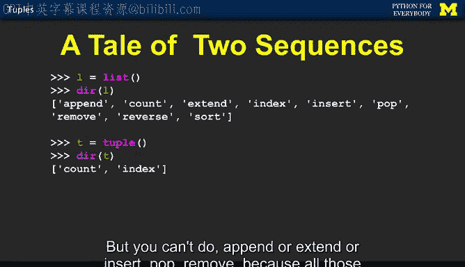
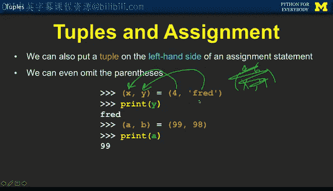
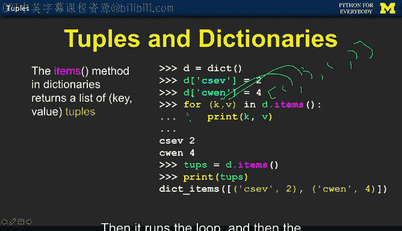
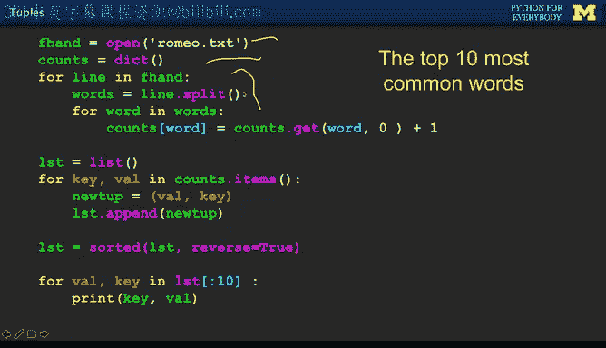
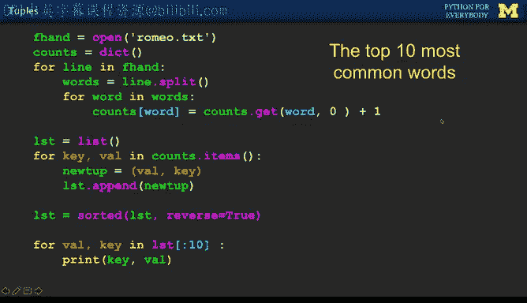
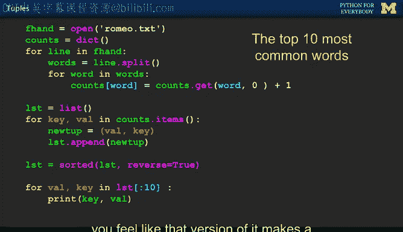
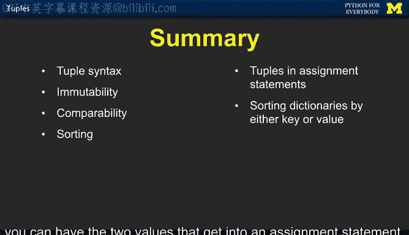

# 📚 课程2：《Python数据结构》｜ P32：元组（Tuples）详解


在本节课中，我们将学习Python中的元组（Tuples）。元组是一种与列表相似但不可变的数据结构。我们将探讨其基本概念、语法、特性以及如何利用元组进行高效的数据处理和排序。

---

## 🧩 元组的基本概念与语法

元组可以看作是列表的一个“精简版”或“不可变版”。从本质上讲，元组是一种更高效、但创建后无法修改的列表。

元组的语法与列表非常相似，主要区别在于使用圆括号 `()` 而非方括号 `[]` 来定义。

**示例：创建一个包含三个字符串的元组**
```python
x = ('a', 'b', 'c')
print(x[2])  # 输出: 'c'
```

元组（Tuple）这个词来源于数学，例如“二元组”、“三元组”。一个三元组就是包含三个元素的集合。在上面的例子中，`x` 就是一个包含三个字符串的三元组。

我们可以像使用列表一样使用索引操作符访问元组中的元素，也可以使用 `for` 循环遍历元组。

**示例：遍历元组**
```python
for item in x:
    print(item)
```




像 `max()` 这样的函数同样适用于元组，因为它能处理任何“序列”（Sequence）。列表、元组和字符串都属于序列。

---

## 🔒 元组的不可变性（Immutability）



元组与列表的一个核心区别在于**不可变性**。这意味着一旦创建，元组的内容就无法被修改、添加或删除。字符串也具有同样的特性。

**示例：列表是可变的，而元组和字符串不可变**
```python
# 列表是可变的
my_list = [9, 8, 7]
my_list[2] = 6  # 成功，列表变为 [9, 8, 6]

# 字符串是不可变的
my_str = 'abc'
# my_str[2] = 'd'  # 这行代码会引发 TypeError


# 元组是不可变的
my_tuple = (5, 4, 3)
# my_tuple[2] = 0  # 这行代码会引发 TypeError
```

因为元组不可变，Python可以更高效地存储它们，不需要预留额外的内存空间来应对可能的修改。这也意味着许多用于修改列表的方法（如 `append()`, `extend()`, `reverse()`, `sort()`）在元组上不可用。



如果你查看列表和元组的内置方法（使用 `dir()` 函数），会发现元组的方法列表是列表方法的一个子集，仅包含 `count()` 和 `index()` 这类不改变自身的方法。

**核心要点**：当你需要一个不会被改变的序列时，使用元组更高效。如果数据需要频繁修改，则应使用列表。

---

## 🤝 元组赋值与解包

元组有一个非常实用的特性：可以出现在赋值语句的右侧，用于同时给多个变量赋值。这被称为“元组解包”或“同时赋值”。

**示例：元组解包**
```python
# 将元组 (4, ‘Fred‘) 解包并赋值给 x 和 y
(x, y) = (4, ‘Fred‘)
print(x)  # 输出: 4
print(y)  # 输出: Fred
```
这等同于分别执行 `x = 4` 和 `y = ‘Fred‘`。

需要注意的是，赋值语句两侧的结构必须匹配。如果右侧是一个元组，左侧也必须是一个包含相同数量变量的元组结构。
```python
# 这会引发错误，因为左右结构不匹配
# (a, b) = 9
```

我们在遍历字典的 `.items()` 方法时，已经不知不觉地使用了这个特性。`.items()` 返回一个由 (键, 值) 元组组成的列表。

**示例：在循环中使用元组解包**
```python
my_dict = {‘csev‘: 2, ‘cwen‘: 4}
for key, value in my_dict.items():
    print(key, value)
```
在每次循环迭代中，`(key, value)` 都执行了一次元组赋值，从而方便地获取键值对。


---

## 📊 元组的比较与排序

元组支持比较操作（如 `<`, `>`, `==`）。比较规则是**从左到右逐元素比较**，类似于字符串的比较或数字最高位的比较。

**比较逻辑**：
1.  首先比较第一个元素。如果分出大小，则立即返回结果，不再比较后续元素。
2.  如果第一个元素相等，则比较第二个元素，依此类推。

**示例：元组比较**
```python
print((0, 1, 2) < (5, 1, 1))  # 输出: True，因为 0 < 5
print((‘Jones‘, ‘Sally‘) < (‘Jones‘, ‘Sam‘))  # 输出: True，在 ‘Sally‘ 和 ‘Sam‘ 中，‘l‘ < ‘m‘
print((‘Jones‘, ‘Sally‘) > (‘Adams‘, ‘Sam‘))  # 输出: True，因为 ‘J‘ > ‘A‘
```

这种可比较的特性使得元组可以被排序。`sorted()` 函数可以接收一个元组序列，并返回一个按规则排序后的**列表**。

---

## 🗂️ 使用元组对字典进行排序

元组的排序能力在数据处理中非常有用，特别是用于对字典按键或按值排序。

### 按键排序字典
由于字典的 `.items()` 方法返回 (键, 值) 元组列表，而排序时默认按元组的第一个元素（即键）进行，因此可以轻松实现按键排序。

**示例：按键顺序遍历字典**
```python
d = {‘a‘: 10, ‘b‘: 1, ‘c‘: 22}
# 对 items() 的结果排序，得到一个按键排序的 (键, 值) 列表
for key, value in sorted(d.items()):
    print(key, value)
# 输出顺序将是 a, b, c
```



### 按值排序字典
要按值排序，我们需要创建一个新的数据结构：一个由 (值, 键) 元组组成的列表。然后对这个列表排序，因为排序会基于元组的第一个元素（值）进行。

**示例：按值从大到小排序并输出字典项**
```python
d = {‘a‘: 10, ‘b‘: 1, ‘c‘: 22}

# 步骤1：创建 (值, 键) 元组列表
temp = list()
for key, value in d.items():
    new_tuple = (value, key)  # 注意顺序：值在前，键在后
    temp.append(new_tuple)
# 此时 temp 是 [(10, ‘a‘), (1, ‘b‘), (22, ‘c‘)]

# 步骤2：排序，reverse=True 表示降序
temp = sorted(temp, reverse=True)
# 排序后 temp 是 [(22, ‘c‘), (10, ‘a‘), (1, ‘b‘)]

# 步骤3：遍历并输出，注意顺序又变回了 (键, 值)
for value, key in temp:
    print(key, value)
# 输出顺序将是 c, a, b
```

---

## 💡 实战应用：查找文本中出现频率最高的10个单词

让我们综合运用字典、列表和元组，解决一个实际问题：查找一个文本文件中出现频率最高的10个单词。


**思路**：
1.  读取文件，用字典统计每个单词出现的次数（构建词频直方图）。
2.  将字典转换为 (次数, 单词) 元组列表。
3.  对该列表进行降序排序。
4.  使用列表切片取出前10个元素并输出。

**示例代码**：
```python
# 1. 构建词频字典
fhand = open(‘romeo.txt‘)
counts = dict()
for line in fhand:
    words = line.split()
    for word in words:
        counts[word] = counts.get(word, 0) + 1

# 2. 转换为 (次数, 单词) 列表并排序
lst = list()
for key, val in counts.items():
    newtup = (val, key)  # 创建 (值, 键) 元组
    lst.append(newtup)

lst = sorted(lst, reverse=True)  # 降序排序

# 3. 使用切片获取前10个，并格式化输出
for val, key in lst[:10]:  # lst[:10] 获取前10个元素
    print(key, val)
```



**代码进阶（使用列表推导式）**：
上述转换和排序过程可以用一行“列表推导式”更简洁地完成。列表推导式是创建列表的一种强大而简洁的方式。
```python
# 与上面代码块中第2、3步等效的一行代码
print(sorted([(v, k) for k, v in counts.items()], reverse=True)[:10])
```
这行代码做了以下几件事：
*   `[(v, k) for k, v in counts.items()]`：遍历字典，为每个键值对生成一个 (值, 键) 元组，并直接组成一个新列表。
*   `sorted(..., reverse=True)`：对这个新列表进行降序排序。
*   `[:10]`：用切片取出排序后列表的前10个元素。
*   `print(...)`：打印结果。

对于初学者，理解分步的代码更为重要。当你对Python更加熟悉后，可以尝试使用列表推导式来编写更简洁的代码。

---

## 📝 课程总结





本节课我们一起深入学习了Python中的元组（Tuples）。

*   **基本概念**：元组是一种**不可变**的序列，使用圆括号 `()` 定义，在需要数据不被修改时比列表更高效。
*   **核心操作**：我们学习了元组的索引、遍历、比较以及利用 `sorted()` 函数进行排序。
*   **高级技巧**：
    *   **元组解包**：可以同时为多个变量赋值。
    *   **字典排序**：通过创建 (值, 键) 元组列表，我们可以轻松实现对字典按值排序。
    *   **实战应用**：综合运用字典、列表和元组，解决了“查找文本高频词”的实际问题。




元组作为Python基础数据结构之一，与列表、字典和字符串协同工作，能帮助我们更有效地组织和处理数据。理解何时使用元组（追求效率与不变性）而非列表（需要灵活性），是编写优秀Python代码的关键一步。