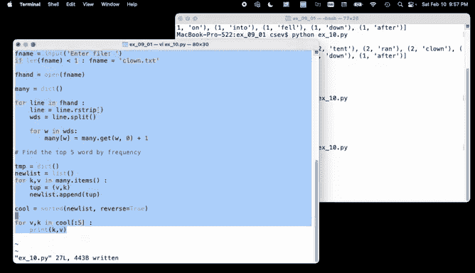

# 每个人的 Python 第二部分 33：元组与排序练习题讲解 🧩


在本节课中，我们将学习如何对一个字典进行排序，并找出其中出现频率最高的前五个单词。我们将使用元组和Python的`sorted`函数来实现这个目标。


---


上一节我们介绍了字典的基本操作，本节中我们来看看如何对字典中的键值对进行排序。


首先，我们有一个字典`many`，它存储了单词及其出现的频率。我们的目标是找出出现频率最高的前五个单词。


当我们直接使用`sorted`函数对字典进行排序时，它默认只对字典的键进行排序，并返回一个排序后的键列表，但会丢失对应的值。


```python
print(sorted(many))
```


为了同时保留键和值，我们需要使用字典的`.items()`方法。这个方法会返回一个由键值对组成的元组列表。


```python
print(sorted(many.items()))
```


然而，这样排序的结果仍然是基于键（单词）的字母顺序，而不是基于值（频率）的大小。


为了按值进行排序，我们需要创建一个新的元组列表，其中每个元组的顺序是`(值, 键)`。这样，当Python比较元组时，会首先比较第一个元素（即频率）。


以下是实现这一步骤的代码：


```python
new_list = []
for k, v in many.items():
    new_tuple = (v, k)
    new_list.append(new_tuple)
```


现在，我们可以对这个新的列表`new_list`进行排序。由于我们想要频率最高的项，我们需要使用`reverse=True`参数进行降序排序。


```python
cool = sorted(new_list, reverse=True)
```


最后，我们遍历排序后列表`cool`的前五个元素，并将元组中的顺序重新调整为`(键, 值)`进行输出。


```python
for v, k in cool[:5]:
    print(k, v)
```


通过以上步骤，我们就能成功找出并打印出字典中出现频率最高的前五个单词及其频率。


---




本节课中我们一起学习了如何利用元组和`sorted`函数对字典进行排序。核心方法是先将字典的键值对转换为`(值, 键)`形式的元组列表，然后对该列表进行排序，从而实现对字典按值排序的目标。这个方法在处理需要根据值来筛选数据的场景中非常有用。