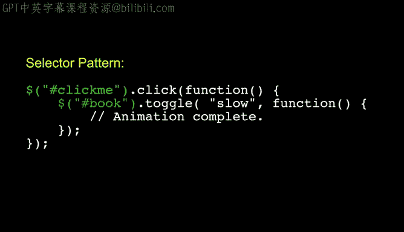

# 每个人的 Python 第二部分 35：35_06_02_福利-约翰·雷西格发明jQuery 🧩

在本节课中，我们将跟随jQuery的创造者约翰·雷西格，了解这一革命性JavaScript库的诞生背景、设计初衷与发展历程。我们将看到，一个成功的开源项目不仅仅是代码的集合，更是社区、文档和用户体验共同作用的结果。

---

## jQuery的诞生背景

上一节我们介绍了课程的整体框架，本节中我们来看看jQuery诞生的具体时代背景。

我于2005年开始着手开发jQuery。在此之前，它甚至不是一个正式的项目，只是我编写的一系列工具的集合。

这主要是因为我当时创建了许多网站和相关资源，一直希望拥有一些特定的工具来简化我的开发工作。其中一个重要原因是为了解决当时存在的浏览器兼容性问题，例如Internet Explorer和Firefox之间的差异。

同时针对所有这些不同的浏览器进行开发非常困难，这是一个主要问题。另一个问题是，我觉得当时已有的开发工具，尤其是JavaScript开发工具，可以做得更好。

## 灵感来源与设计初衷

上一节我们了解了jQuery诞生的背景，本节中我们来看看其设计灵感和核心目标。

当时最流行的库是Prototype JavaScript库，它被捆绑在Ruby on Rails框架中，并随着Rails的流行而兴起。

我发现这个库极具启发性。那是我第一次看到一个以优美、清晰、面向对象的方式编写的JavaScript库，其中内置了许多优秀的功能范式。

我那时并未意识到JavaScript可以如此优美和优雅。看到Prototype后，它激励我想构建更好的东西。我意识到Prototype主要专注于JavaScript语言本身，而很少有工具专门关注浏览器环境中的JavaScript，特别是操作HTML和DOM。

这里存在一个空白，一个巨大的可用性鸿沟。因此，我开始构建不同的工具和库，最终所有这些逐渐融合成一个单一的库，我将其命名为jQuery。我原本打算叫它JSelect，但那个域名已被占用，所以我最终选择了jQuery。

我于2006年1月发布了它。需要说明的是，当时我还在上大学，所有这些工作都是我大学期间的副业项目，jQuery正是从这些副业项目中衍生出来的。

可以说，其他那些项目都已不复存在，只有jQuery留存至今。

## 核心功能与模式演化

上一节我们看到了jQuery的设计灵感，本节中我们深入探讨其核心功能模式是如何形成的。

选择器模式至少来自英国开发者Simon Willison编写的一个库。他创建了一个名为`getElementsBySelector`的方法，允许你编写简单的CSS选择器来查找元素，但它非常原始，只能进行最基本的查询，不支持完整的CSS2和CSS3等功能。

因此，我想要的东西之一是那个库的更好、更全面的版本。此外，我还想优化在页面中附加事件的过程。因为当你构建交互式JavaScript应用时，需要监听用户执行某些操作，所以找到元素并为其附加事件这个过程，我想彻底优化。

这确实是jQuery最初的全部内容。直到后来，我才开始添加其他功能，比如动画。甚至在我发布之后，才添加了Ajax等功能，那是因为其他人需要它，我个人当时并没有使用。我确实受到了其他开发者及其库的启发，但它们还不够完美，我想把它们整合得更好一点。

## 项目的成长与关键决策

上一节我们探讨了jQuery的核心功能，本节中我们来看看它是如何从一个个人项目成长起来的，以及其中的关键决策。

它感觉花了很长时间才拥有了自己的生命力。我于2006年1月发布了它，从一开始我就做了几个设计决策，这些决策帮助很大。

以下是我早期做出的关键决策：
*   **明确的插件架构**：我提供了一个明确的插件架构，让人们可以编写插件并将其添加到jQuery库中，从而充分利用这个框架的优势。
*   **完善的文档**：在发布的第一天，我就编写了文档。我坐下来，遍历每个方法，记录其工作原理并提供小示例。我认为有趣的是，从2006年1月我们发布库到2007年1月，jQuery是唯一一个有文档的JavaScript库。其他库都只是“阅读源代码”或查看版本控制记录。这总是让我很惊讶，我想这只是开发者的副作用——你想写代码，不想做写文档这类枯燥的事情。

就库的发展而言，我做了很多决策。在其历史进程中，许多决策与代码无关。我一直试图强调的一点是，当你试图管理一个好项目，尤其是一个好的开源项目时，代码只是整个方程中很小的一部分。

你必须花费大量时间和精力来创造人们愿意学习、易于学习的东西，并且确保他们学会后不会因为受挫而离开。你必须确保整个流程的每一步都让人们感到满意，确保他们正在学习。这通常涉及以下方面：
*   确保你有一个清晰的网站，可以轻松下载你提供的内容。
*   确保文档非常清晰，有一个非常好的入门指南。
*   此外，还要围绕此建立一个社区。

我邀请加入jQuery团队的第一个人，实际上是一个帮助管理社区的人，而不仅仅是另一个开发者（尽管他本身也是开发者）。我这样做的原因是，我想确保任何人在任何地方遇到问题，他们的需求都能得到考虑，并且我们能够帮助解决他们遇到的任何问题。因此，我们在修复浏览器问题、发现库中的一般性问题方面都非常积极主动。

## 个人发展与项目成熟

上一节我们看到了项目成长中的关键决策，本节中我们来看看创造者个人发展与项目成熟之间的关系。

从2006年夏天到2006年底，我实际上在Y Combinator，这是Paul Graham在波士顿运营的创业加速器。当时我和一些朋友搬到了波士顿，尝试创业，但最终失败了，我们没有获得足够的资金，创业没有成功。

创业失败后，我加入了Mozilla。在那里，我主要担任了多年的JavaScript布道师。我的工作是推广JavaScript，让人们了解规范、工具等方面的新进展。但同样，我并不是在工作时间内开发jQuery，它仍然主要是我在业余时间做的事情，比如处理邮件列表、修复漏洞等所有必须做的事情。

直到我在Mozilla的最后一年，大约是2010年到2011年，他们才说：“好吧，你可以全职从事jQuery工作。”于是我开始全职投入，这很棒，因为在那段时间里，我投入了大量精力来确保有适当的基础设施，这样即使我不再每天参与工作，它也能继续存在。

这部分工作包括建立一个非营利组织，并确保有足够的人员负责其各个方面。这样，当我最终加入可汗学院时，我实际上从jQuery项目中退了下来，而此后一切运行都非常良好。现在，我可以仅仅作为一个快乐的用户来使用jQuery了。

---

## 总结

本节课中我们一起学习了jQuery库的完整诞生与发展故事。我们了解到，一个成功的开源项目源于解决实际开发痛点（如浏览器兼容性、DOM操作繁琐），并受到现有优秀项目（如Prototype）的启发。其成长不仅依赖于优雅的代码和核心功能（如强大的选择器、事件处理优化），更离不开一系列关键的非代码决策：完善的文档、清晰的插件架构、积极的社区管理以及可持续的项目基础设施。约翰·雷西格的经历表明，伟大的工具是开发者需求、持续改进和社区共建的结晶。