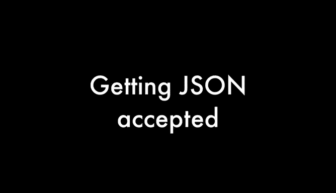
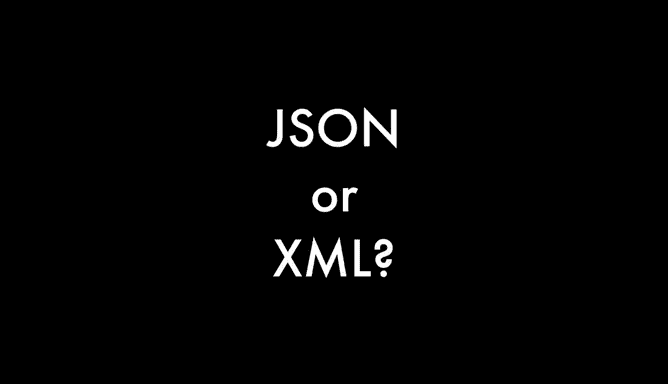

# 每个人的 Python 第二部分 36：JSON - JavaScript对象表示法 🗂️

在本节课中，我们将学习JSON（JavaScript Object Notation），这是一种轻量级的数据交换格式。我们将了解它的起源、设计理念以及它为何在Web开发中变得如此重要。

## 概述：什么是JSON？

JSON是一种基于文本的数据格式，它使用人类可读的文本来存储和传输由属性值对和数组组成的简单数据结构。它源于JavaScript，但现已独立于语言，成为Web应用中数据交换的事实标准。

## JSON的发现与命名

上一节我们了解了JSON的基本概念，本节中我们来看看它的起源故事。

JSON并非由某个人凭空发明。道格拉斯·克罗克福德在2001年发现了它。他并不声称自己发明了JSON，因为它已经以某种形式存在于自然界中。他只是看到了它，认识到了它的价值，并为其命名和描述，展示了它的优点。

他也不是第一个发现它的人。后来他发现，在2000年已有其他人产生了同样的想法。他发现的最早将JavaScript用作数据交换格式的实例是在1996年的网景公司。

所以，这是一个已经存在了一段时间的想法。如果你看看其他的数据表示法，比如在NeXT公司使用、后来在苹果公司使用的属性列表，除了几个表面上的变化，它们本质上也是JSON的表示法。因此，它似乎是一种不可避免的数据表示形式，至少对于旨在被编程语言消费的数据来说是这样。最终，所有数据都是如此。

## JSON的设计哲学：简单与独立

上一节我们追溯了JSON的历史，本节中我们来看看它的核心设计目标。

克罗克福德最初从JavaScript开始，但他的第一个应用是促进用JavaScript编写的程序和用Java编写的服务器之间的通信。因此他认识到，尽管JSON诞生于JavaScript，但它可以且应该是独立于编程语言的。

他尽可能地简化它，去掉尽可能多的东西，试图为如何构建数据并通过网络传输制定最简单的规范。这最终被称为JSON。

## 从想法到“标准”的推动

上一节我们了解了JSON的设计初衷，本节中我们来看看它是如何被推广开来的。

2001年，克罗克福德在一家名为State Software的公司工作。他们开发了一个平台，用于创建可以通过未经修改的Web浏览器交付的应用程序，即今天所谓的Ajax。但在2001年，这是一个相当激进的想法，没有多少人相信它是可行的，或者即使可行也是个好主意。

他们制作了一些出色的演示，并开始努力说服潜在客户采用这种应用和开发风格。作为描述的一部分，他们会说：“然后我们使用这个JSON想法来来回回地通信这些内容。”客户会问：“JSON，那是什么？”他会解释说：“这是我们在JavaScript中发现的一个东西，非常棒。”但客户通常会说：“哦，我们不能用那个，我们刚刚承诺使用XML。”他们会争论说XML有诸多问题，成本高昂，使用起来困难得多。但客户会说：“我们不能用你做的那个东西，因为它不是标准。”

克罗克福德反驳说它是标准，是ECMA-262标准的一个真子集。但客户不认可。于是他决定，如果他想使用这个东西，就需要让它成为一个标准。所以他购买了 `json.org` 域名，建立了一个网页，并宣布它是一个标准。这就是他所做的一切。他没有到处去说服行业、政府等所有人都应该这样做。他只是建立了一个网站，基本上是一个单页网站。多年来，人们发现了它，并意识到：“哦，是的，这容易多了，我就要用这个。”

## JSON vs. XML：核心优势

上一节我们看到了JSON如何被确立，本节中我们来探讨它相对于XML的核心优势。

克罗克福德一直不理解XML用于数据交换的方式。通常的模式是：你发送一个查询到服务器，服务器交给数据库，然后你得到一个XML格式的东西。接着你必须向这个XML发送查询才能从中提取数据。他说：“为什么你不能直接给我一个我知道它是什么、并且可以立即使用的形式呢？”他认为这就是JSON的主要好处。

这并不是说花括号比尖括号好得多，这些形式上的东西最终都不重要。重要的是，JSON喜欢表示的数据结构，与编程语言表示的数据结构完全相同。

当Ajax被提出时，其中的“X”原本代表XML。但聪明的开发者很快意识到，用XML处理太困难了，他们不想这么做。其中一些人发现，嘿，你可以在这里用JSON代替，而且容易得多，也快得多。于是他们开始这样做。有一段时间存在一场辩论，一些人（比如Jesse James Garrett）争辩说“X代表XML，所以你只能用XML”，但这种说法没有持续多久。当时还有其他一些XML的替代方案被考虑，但JSON是唯一一个专门为Ajax设计的。

## JSON的“不变性”：最大胆的设计决策

上一节我们比较了JSON和XML，本节中我们来看看JSON一个独特而关键的特性。

在设计JSON时，克罗克福德做出的最大胆的设计决定是不给它加上版本号。因此，没有修订它的机制。所以，JSON就是它现在的样子，我们只能接受它。这结果成了它最好的特性，因为它希望成为一个底层的东西，是基础架构，是你在其上堆砌一切的基础。这有点像语言中的字母表。我们可以创造很多单词和很多造句的方式，但创造新字母是非常罕见的。JSON就处在这个位置。所以，它不会改变是件好事。

他预计也许有一天，我们会发现JSON确实无法处理一些非常重要的事情，比如循环结构（图在JSON中不容易表示，虽然可以，但需要更直接的交互和更多的工作）。有一天，当我们可能决定不想做那些额外工作时，我们可能会用其他东西取代JSON，而不是扩展JSON来实现那些功能。即使在我们做了那个替换之后，所有曾经开发的、仍然使用JSON的东西将继续工作，因为JSON永远不会改变。

## 总结

本节课中我们一起学习了JSON。我们了解到JSON是一种源于JavaScript但语言无关的轻量级数据交换格式。它的核心优势在于其数据结构与编程语言原生数据结构的天然契合，使得数据可以立即被使用，无需复杂的解析。JSON通过其极简的设计和“永不改变”的承诺，成为了Web数据交换的稳定基石。它的成功并非源于复杂的标准制定过程，而是源于其简单、实用和高效的本质。