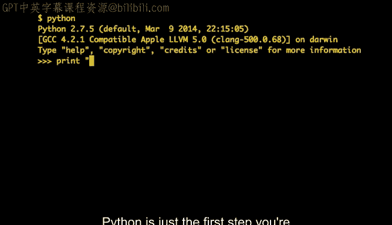
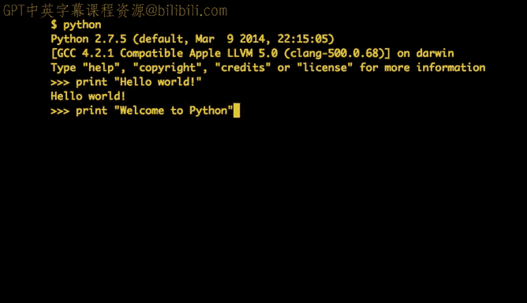
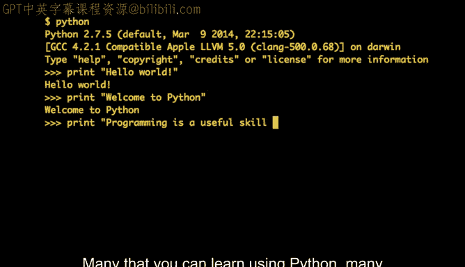

# 密歇根大学《给所有人的Python课》课程3：《使用Python访问Web数据》｜python-network-data｜ - P2：02_01_01_欢迎使用Python_Guido_van_Rossum

## 🎤 课程概述

在本节课中，我们将跟随Python语言的创始人吉多·范罗苏姆（Guido van Rossum）的欢迎致辞，开启《使用Python访问Web数据》这门课程的学习之旅。我们将了解Python的背景、社区以及学习编程的意义。

---

## 👨‍💻 吉多·范罗苏姆的欢迎致辞

我是吉多·范罗苏姆，我创造了Python这门编程语言。

我在Python上已经工作了25年，当然，我也与Python社区中许多其他贡献者一起合作。

看到你们所有人都来上这门课，我感到非常兴奋。你们使用我创造的语言来学习，这让我感到非常自豪。

学习Python只是你们踏上编程之路的第一步。

---

## 🚀 编程学习的广阔天地

编程领域有许多令人兴奋的知识等待你们去学习，其中很多都可以通过Python来掌握。

当然，也有很多知识可以通过其他工具或语言来学习。在学习这条路上，你们并不孤单。

将有数以百万计的人走在你们前面，或者与你们同时学习Python。

你们可以互相帮助，共同学习。

---

## 📝 课程总结

本节课中，我们一起聆听了Python创始人吉多·范罗苏姆的欢迎致辞，了解了Python语言的起源及其背后庞大的学习社区。这为我们后续深入学习如何使用Python访问和处理网络数据奠定了良好的开端。