# 3：《使用Python访问Web数据》｜P3：Windows 10 安装Python并编写程序 🖥️

在本节课中，我们将学习如何在 Windows 10 系统上安装 Python 编程语言，安装一个简单的文本编辑器，并运行你的第一个 Python 程序。

---

## 概述

我们将分步完成以下任务：首先从官方网站下载并安装 Python，然后验证安装是否成功。接着，我们将下载并安装一个名为 Brackets 的文本编辑器，用于编写代码。最后，我们将创建一个简单的 Python 程序并运行它。

---

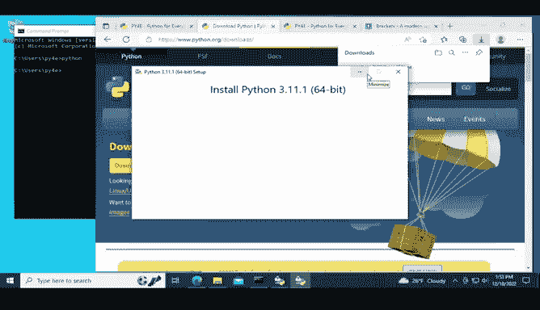

## 第一步：下载并安装 Python

首先，我们需要访问 Python 的官方网站以下载适用于 Windows 的安装程序。

1.  打开浏览器，访问 `python.org`。
2.  导航到网站的“Downloads”（下载）部分。
3.  下载适用于 Windows 的 Python 安装程序。

下载完成后，运行安装程序。请注意，在 Windows 系统上进行安装时，你可能需要使用管理员账户。


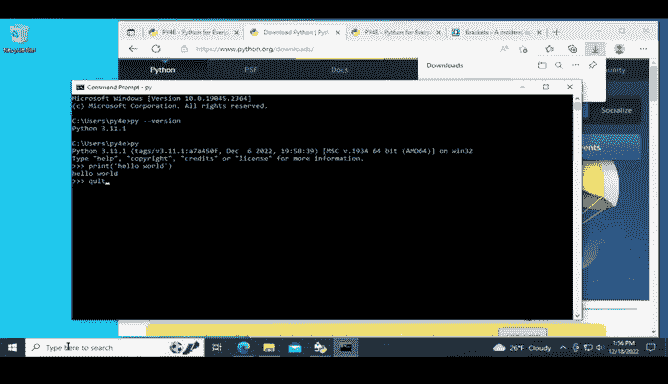

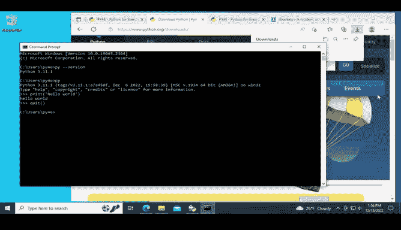

安装过程现在开始。

---

## 第二步：验证 Python 安装

安装完成后，我们需要验证 Python 是否已成功安装到系统中。

1.  打开“命令提示符”（Command Prompt）。
2.  在命令提示符中输入以下命令并按回车键：
    ```bash
    python --version
    ```
    这个命令会显示已安装的 Python 版本号，确认安装成功。
3.  你还可以输入 `python` 直接启动 Python 交互式解释器。
4.  在解释器中，输入你的第一行代码：
    ```python
    print("Hello World")
    ```
5.  输入后按回车，屏幕上应显示“Hello World”。输入 `quit()` 或按 `Ctrl+Z` 再按回车即可退出解释器。


验证无误后，可以关闭命令提示符窗口。

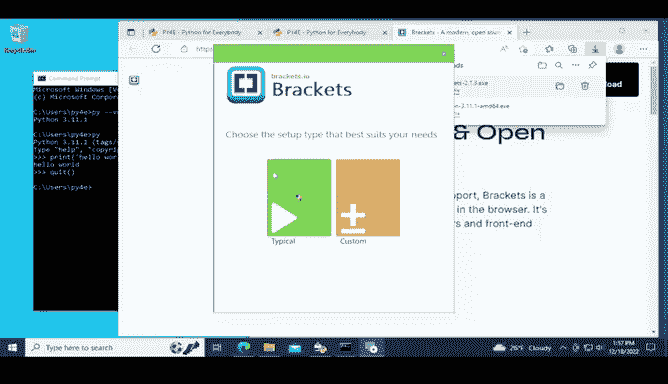

---

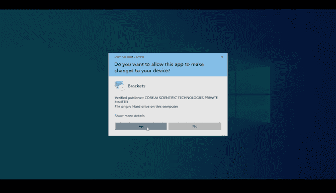

## 第三步：安装文本编辑器

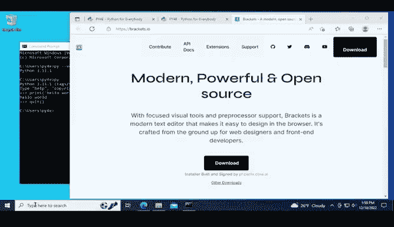

为了编写 Python 代码，我们需要一个文本编辑器。不应使用 Microsoft Word 或系统自带的记事本（Notepad），因为它们不是为编程设计的。

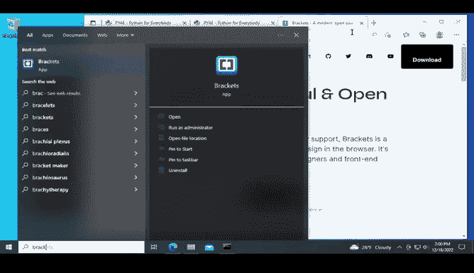

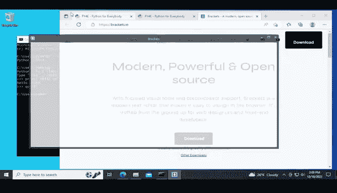

市面上有许多优秀的编辑器，例如 VS Code。本教程将使用 Brackets，因为它简单、开源，且兼容 Windows、Mac 和 Linux 系统。

1.  访问 Brackets 官方网站进行下载。
2.  运行下载的安装程序。
3.  在安装向导中，选择“Typical”（典型）安装选项即可。


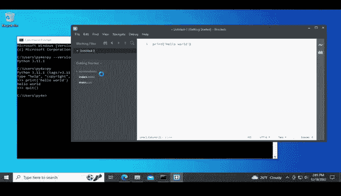

安装完成后，启动 Brackets。

---

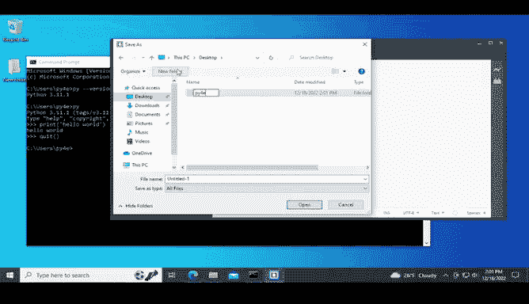

## 第四步：创建并运行第一个 Python 程序

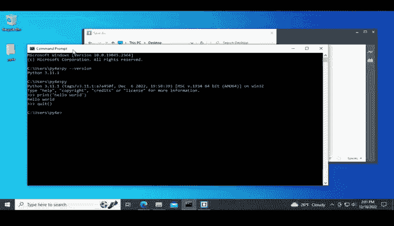

现在，我们将使用 Brackets 创建你的第一个 Python 程序文件。

1.  在 Brackets 中，点击 `File`（文件）菜单，选择 `New`（新建）创建一个新文件。
2.  在文件中输入以下代码：
    ```python
    print("Hello World")
    ```
3.  点击 `File` 菜单，选择 `Save`（保存）来保存这个文件。

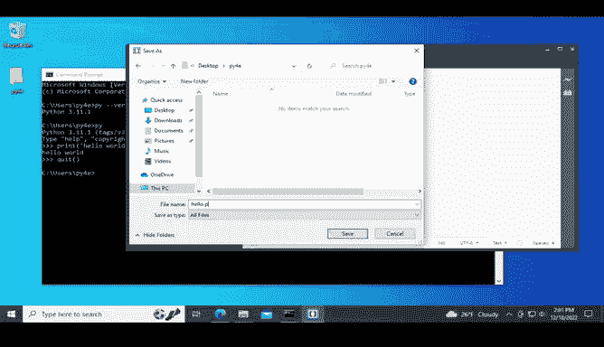


在保存时，请遵循以下步骤选择合适的保存位置和文件名：

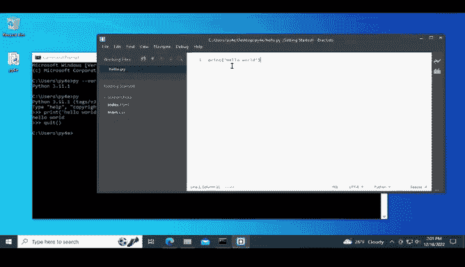

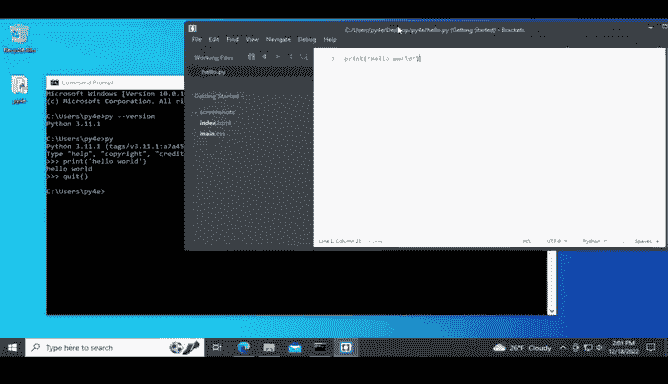

以下是保存文件的具体步骤：

1.  在保存对话框中，导航到你的“桌面”（Desktop）。
2.  在桌面上，创建一个新文件夹，将其命名为 `Py4E`（代表 Python for Everybody）。
3.  进入这个新创建的 `Py4E` 文件夹。
4.  将你的文件命名为 `hello.py`。注意，`.py` 扩展名非常重要，它告诉系统和编辑器这是一个 Python 文件。

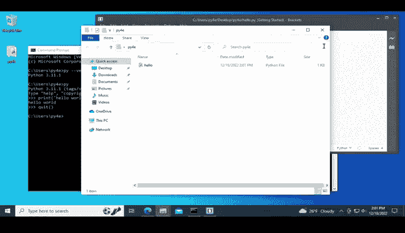


保存后，Brackets 会识别 `.py` 后缀并自动进行语法高亮显示，使代码更易读。


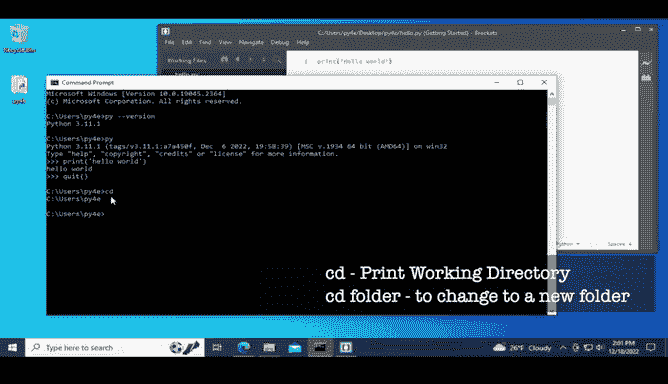

现在，通过文件管理器查看 `Py4E` 文件夹，你应该能看到 `hello.py` 文件。


---

## 第五步：在终端中运行程序

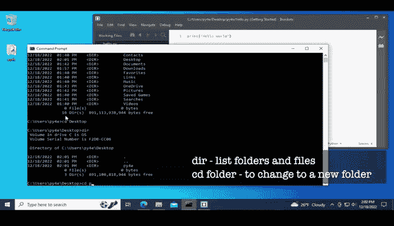

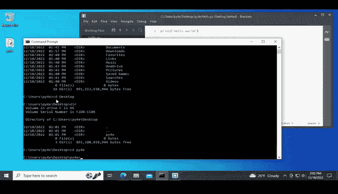

最后一步是打开终端（命令提示符），导航到程序所在的目录并运行它。

以下是导航和运行命令的步骤：

1.  打开“命令提示符”。
2.  使用 `cd` 命令切换到桌面上的 `Py4E` 文件夹。例如，如果你的用户名是 `user`，路径可能类似于：
    ```bash
    cd C:\Users\user\Desktop\Py4E
    ```
3.  如果你不确定当前所在目录，可以输入 `cd` 命令单独查看，或使用 `dir` 命令列出当前目录下的文件和文件夹。
4.  确认 `hello.py` 文件在当前位置后，输入以下命令来运行程序：
    ```bash
    python hello.py
    ```

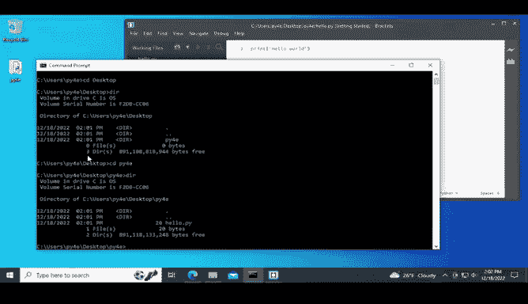

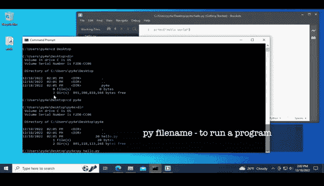


运行后，命令提示符窗口应该会显示输出结果：`Hello World`。

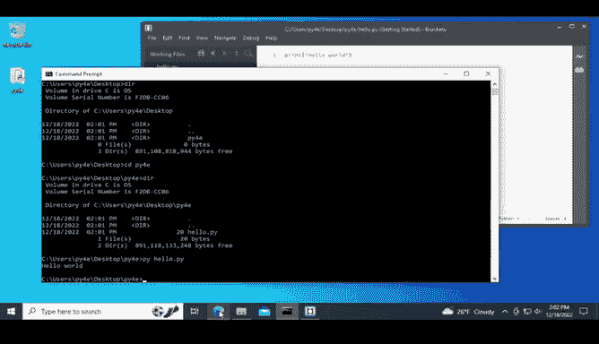
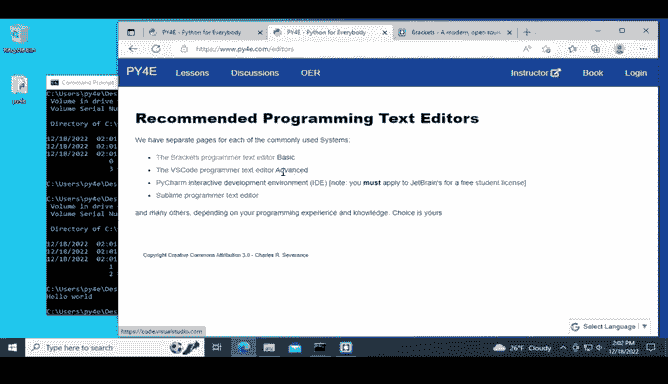

---

## 总结


在本节课中，我们一起完成了在 Windows 10 上搭建 Python 开发环境的全过程。我们首先从官网下载并安装了 Python，并通过命令提示符验证了安装。接着，我们安装并熟悉了 Brackets 文本编辑器。最后，我们创建了第一个 Python 程序 `hello.py`，并在终端中成功运行了它，看到了“Hello World”的输出。


你现在已经拥有了一个可以开始编写和运行 Python 代码的基本环境。记住，你可以选择任何你喜欢的编辑器，Brackets 只是一个推荐的起点。祝你编程愉快！