# 3：《使用Python访问Web数据》｜课程资源｜P4：04_01_02_Windows截取屏幕截图教程 📸

在本节课中，我们将学习如何在Windows操作系统中使用内置的“截图工具”来捕获屏幕图像。这是获取屏幕内容图像最简单的方法之一，对于记录操作步骤或分享屏幕信息非常有用。

## 概述

我们将从启动截图工具开始，逐步介绍如何选择截图区域、保存截图文件，以及使用工具内置的编辑功能进行简单标注。本教程基于Windows 8系统演示，但其核心步骤在其他版本的Windows系统中也基本适用。

## 启动截图工具

首先，我们需要找到并启动Windows系统自带的“截图工具”。

点击屏幕左下角的Windows图标（开始菜单），在搜索框中输入“sn”（即Snipping的前两个字母）。系统通常会立即搜索并显示出“截图工具”应用程序。

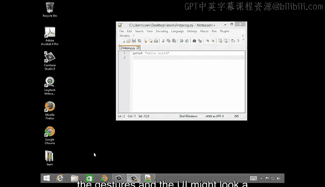

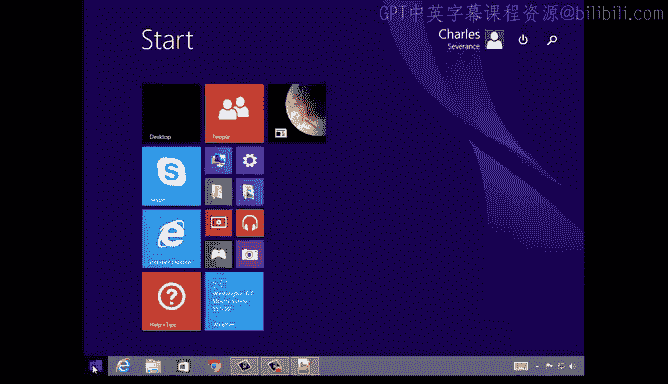

从搜索结果中点击“截图工具”即可启动该程序。

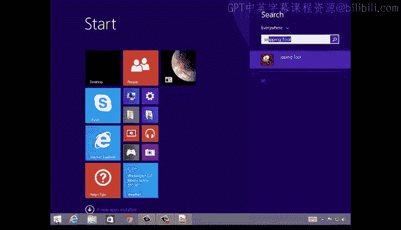

## 进行屏幕截图

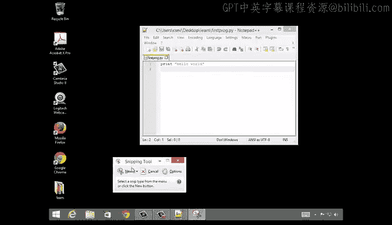

启动截图工具后，程序界面会变小，整个屏幕会蒙上一层灰白色，表示已进入截图模式。

在截图工具窗口中，点击“新建”按钮开始一次新的截图操作。

此时，鼠标光标会变成一个十字线。按住鼠标左键并拖动，框选出你想要截取的屏幕区域。松开鼠标后，被选中的区域图像就会被捕获到截图工具的编辑窗口中。

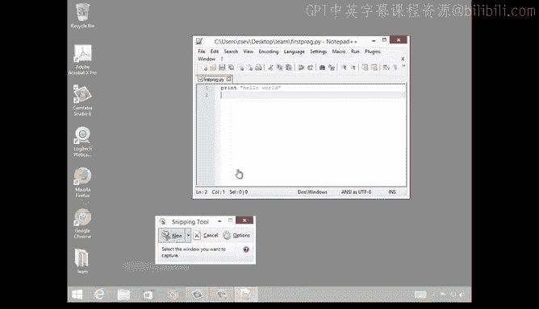

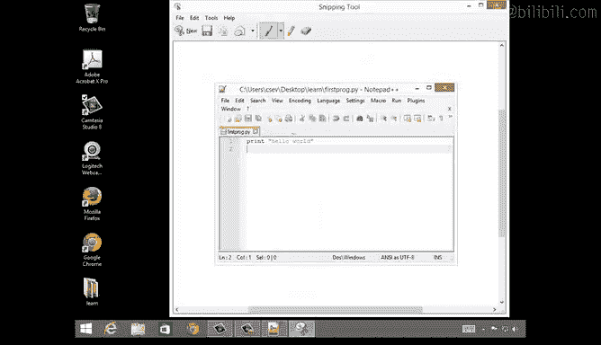

**核心操作**可以概括为以下步骤：
1.  点击 `新建`
2.  拖动鼠标 `框选区域`
3.  松开鼠标 `完成捕获`

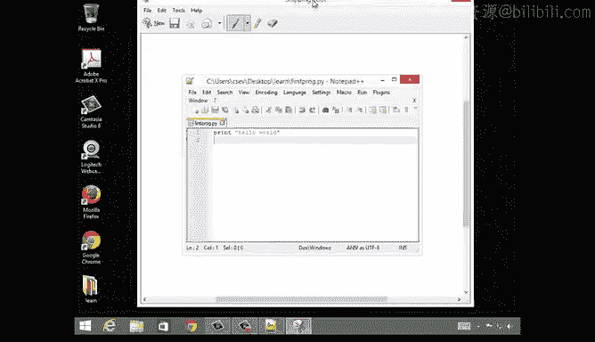

捕获完成后，原窗口（例如你正在浏览的网页或文档）仍然存在且不受影响。截图工具窗口内显示的是刚刚捕获的静态图像副本。

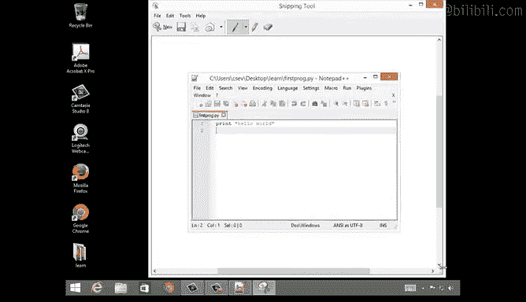

## 编辑与标注截图

截图工具不仅用于捕获图像，还提供了一些简单的绘图工具，可以对截图进行标注或遮盖敏感信息。

例如，如果你的截图路径中包含了不希望展示的个人姓名，可以使用工具内的“笔”或“荧光笔”功能将其涂掉。

在截图工具的工具栏中，选择笔刷工具，然后在需要遮盖的区域进行涂抹即可。

## 保存截图文件

编辑完成后，下一步就是将截图保存为图像文件。

点击截图工具菜单栏中的“文件”，然后选择“另存为”。

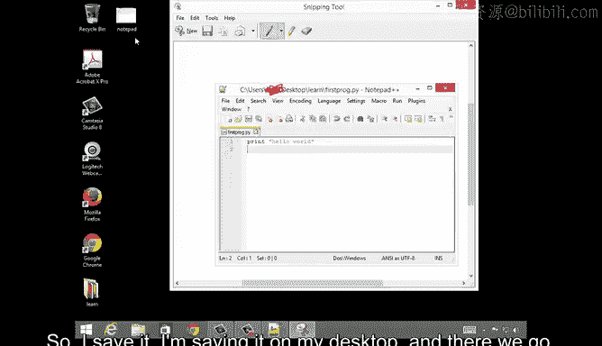

在弹出的保存对话框中，选择你想要保存文件的位置（例如桌面），并为文件命名。

**一个重要的建议是**：在文件名后手动添加文件扩展名，例如 `.png` 或 `.jpg`。虽然Windows系统通常能识别文件类型，但添加明确的扩展名有助于在不同操作系统间传输文件时（例如通过电子邮件发送或上传到网站），其他系统能正确识别其格式。

例如，你可以将文件命名为 `mynote.png`。

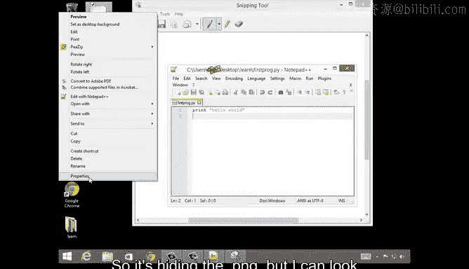

点击“保存”按钮，截图就被保存为一个独立的图像文件了。你可以在保存的位置找到它，并确认文件类型是否正确。

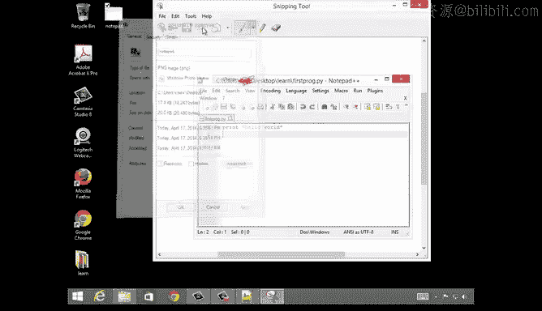

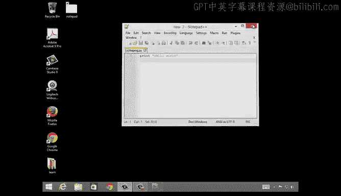

## 完成操作

保存完毕后，你可以关闭截图工具窗口。之前被截图的原始窗口（如下面的记事本窗口）仍然保持原样，而编辑并保存后的截图文件则独立存在。

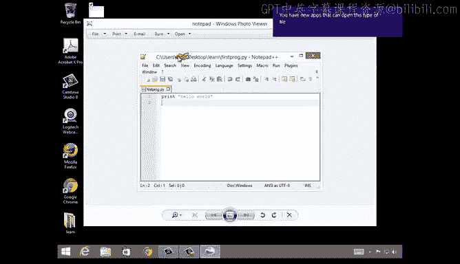

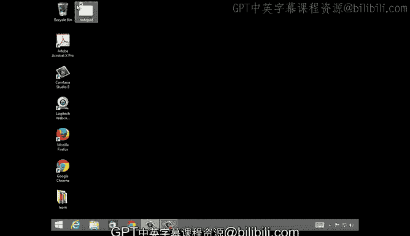

## 总结

本节课我们一起学习了在Windows系统中使用内置截图工具的全过程。我们掌握了如何启动工具、捕获指定区域的屏幕图像、使用绘图工具进行简单编辑（如遮盖信息），以及最终将截图保存为带有正确扩展名（如.png）的图像文件。这是一个非常基础且实用的技能，能帮助你在后续的学习或工作中有效地记录和分享屏幕信息。