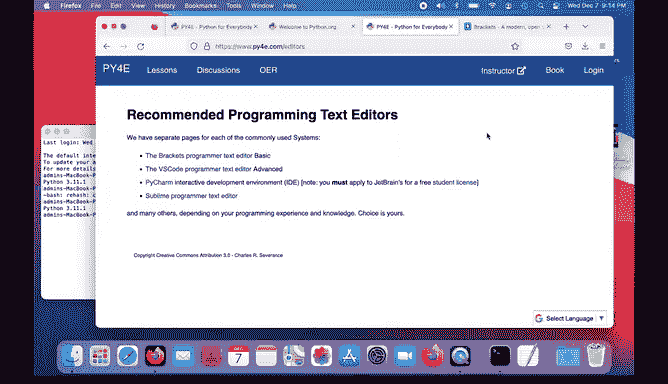
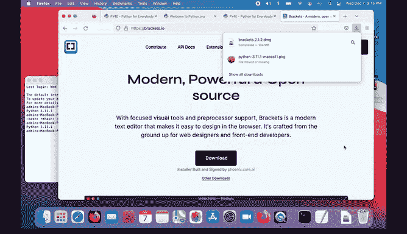
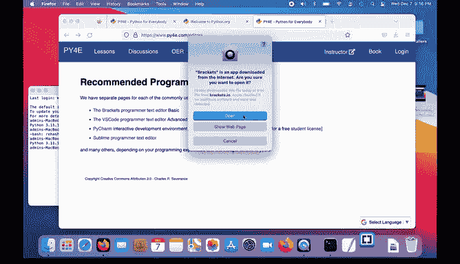
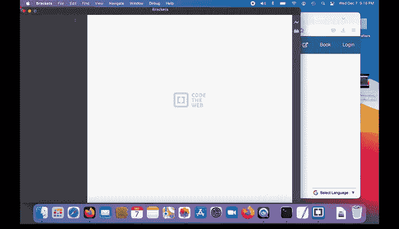
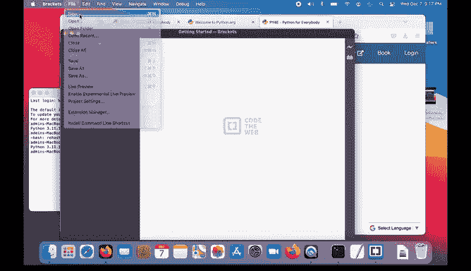
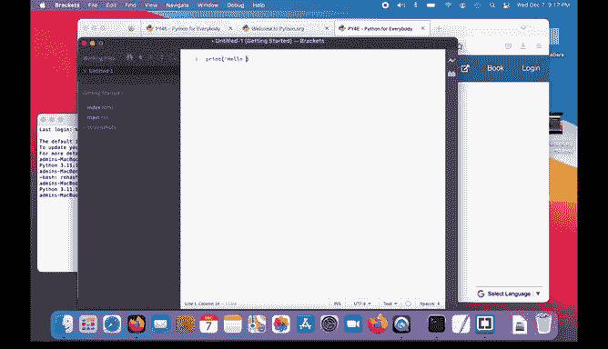
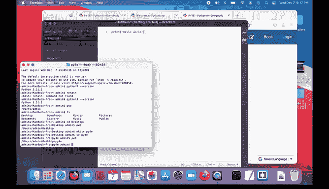
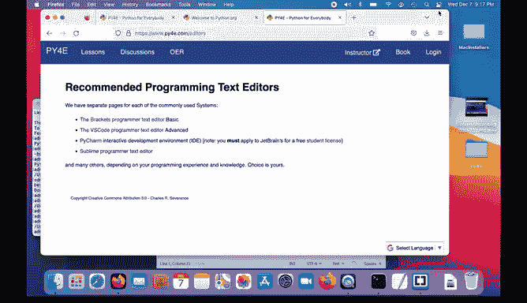
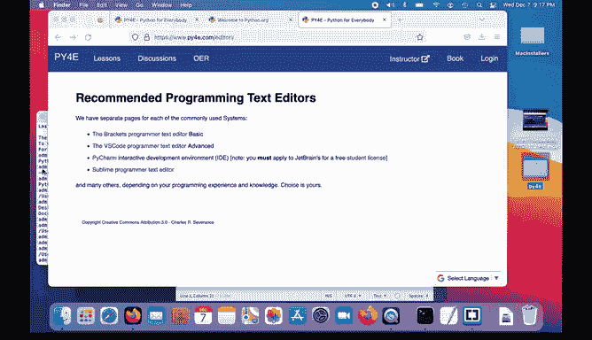
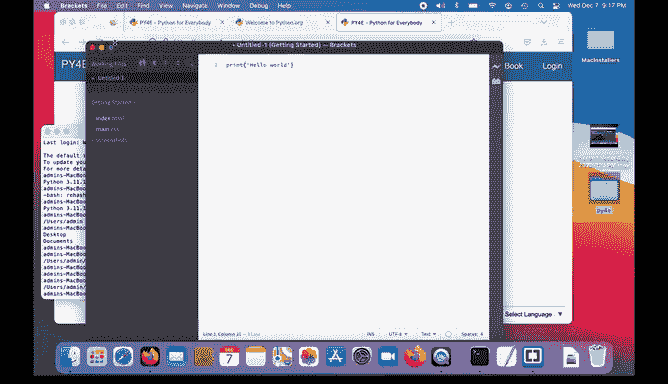

# 课程3：《使用Python访问Web数据》｜第5课：在Macintosh上安装Python并编写程序 🍎💻

## 概述

在本节课中，我们将学习如何在Macintosh电脑上安装Python 3，并配置一个合适的代码编辑器来编写和运行你的第一个Python程序。我们将从检查现有Python版本开始，逐步完成安装和配置。

## 检查现有Python版本

首先，我们需要打开终端应用程序。你可以通过搜索“Terminal”来找到并打开它。终端提供了一个命令行界面，其操作方式与Linux系统类似，而大多数服务器都运行Linux，因此熟悉终端对后续学习很有帮助。

打开终端后，我们首先检查系统是否已经安装了Python。输入以下命令：

```bash
python --version
```

如果系统返回类似 `Python 2.7` 的版本信息，说明你的Mac预装了Python 2。但请注意，Python 2目前已停止官方支持。如果你直接输入 `python` 命令，可能会进入Python 2的交互式Shell，并看到一些警告信息。要退出这个Shell，只需输入 `quit()` 或按下 `Control + D`。

由于Mac操作系统内部使用了Python 2，我们需要单独安装Python 3以供学习使用。

## 安装Python 3

接下来，我们将从Python官方网站下载并安装最新版本的Python 3。

1.  访问 [python.org](https://www.python.org)。
2.  点击“Downloads”选项卡，网站通常会自动识别你的操作系统并推荐Mac版本。
3.  下载最新的Python 3安装包（例如Python 3.11）。
4.  下载完成后，打开 `.pkg` 安装文件。
5.  按照安装向导的提示，依次点击“继续”、“同意”等按钮完成安装。

安装完成后，建议将安装器移至废纸篓。为了让终端识别新安装的Python 3，你需要**关闭当前终端窗口并重新打开一个新的**。然后，输入以下命令验证安装：

```bash
python3 --version
```

如果终端正确显示了Python 3的版本号（例如 `Python 3.11.4`），说明安装成功。

## 选择并安装代码编辑器

系统自带的“文本编辑”（TextEdit）应用不适合编写代码，因为它默认以RTF格式保存文件。我们需要一个专为编程设计的编辑器。

对于初学者，我们推荐使用 **Brackets** 编辑器。它免费、开源、界面简洁，并且支持Windows、Mac和Linux系统。



以下是安装Brackets的步骤：



1.  访问 [brackets.io](http://brackets.io)。
2.  下载适用于Mac的版本。
3.  下载完成后，打开 `.dmg` 文件。
4.  将Brackets图标拖拽到“应用程序”（Applications）文件夹中，完成安装。
5.  在启动台或Spotlight搜索中打开Brackets应用。

## 创建并运行第一个Python程序

现在，我们将使用Brackets创建你的第一个Python程序，并在终端中运行它。

首先，我们需要在终端中创建一个专门存放代码的目录（文件夹），并进入该目录：





```bash
# 切换到桌面目录
cd ~/Desktop





# 创建一个名为“py4e”的文件夹
mkdir py4e

# 进入新创建的文件夹
cd py4e
```

此时，你的终端工作目录就是桌面上的 `py4e` 文件夹。接下来，打开Brackets编辑器：

1.  点击“文件” -> “新建”，创建一个新文件。
2.  在文件中输入你的第一行代码：
    ```python
    print("Hello World")
    ```
3.  点击“文件” -> “另存为”，将文件保存到刚才创建的 `py4e` 文件夹中，并将文件命名为 `hello.py`。确保文件扩展名为 `.py`。





保存后，回到终端窗口。确保你仍在 `py4e` 目录下（可以使用 `pwd` 命令查看当前目录）。使用以下命令运行你的程序：





```bash
python3 hello.py
```

如果一切顺利，终端将输出 `Hello World`。恭喜你，你已经成功安装了Python 3，配置了编辑器，并运行了第一个程序！

## 总结

本节课中，我们一起学习了在Mac电脑上搭建Python开发环境的完整流程。我们检查了系统自带的Python 2，从官网安装了Python 3，选择了适合初学者的Brackets代码编辑器，并最终创建并运行了一个简单的Python程序。掌握这些基础步骤，是开启你Python编程之旅的关键第一步。