# 每个人的 Python 第三部分 6：在Macintosh上截取屏幕截图 📸

在本节课中，我们将要学习如何在Macintosh电脑上使用内置工具截取屏幕截图。这是一个非常实用的技能，尤其是在需要提交作业或分享屏幕内容时。

---

## 概述

Macintosh操作系统内置了一个名为“预览”的应用程序，它不仅能查看PDF文件，还具备强大的屏幕截图功能。本节教程将详细介绍如何使用“预览”应用截取窗口、选区或整个屏幕，并对截图进行简单的编辑和保存。

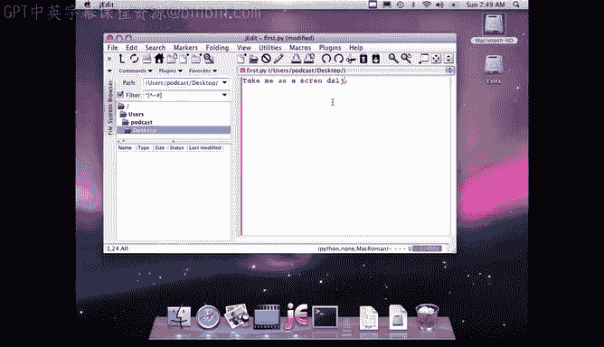

---

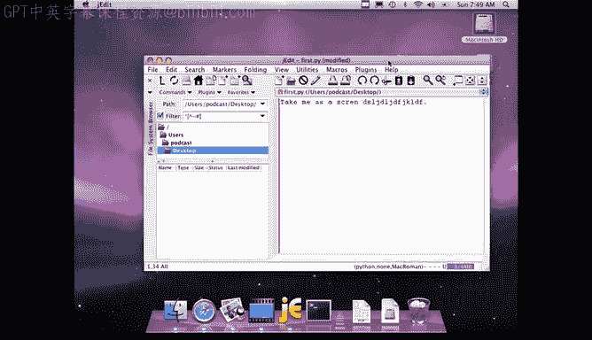

## 使用“预览”应用程序

上一节我们介绍了课程目标，本节中我们来看看具体的操作步骤。首先，我们需要找到并打开“预览”应用。

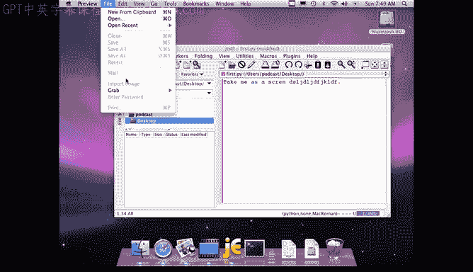

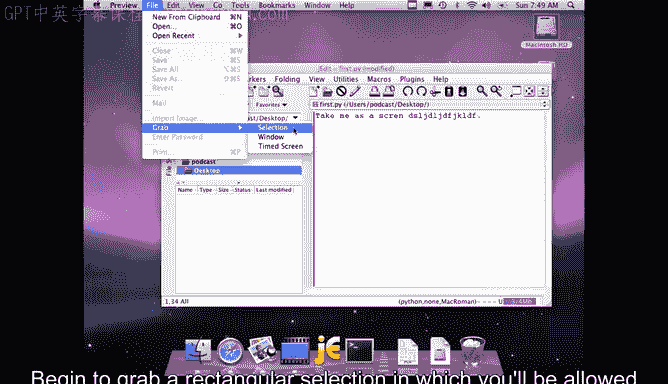

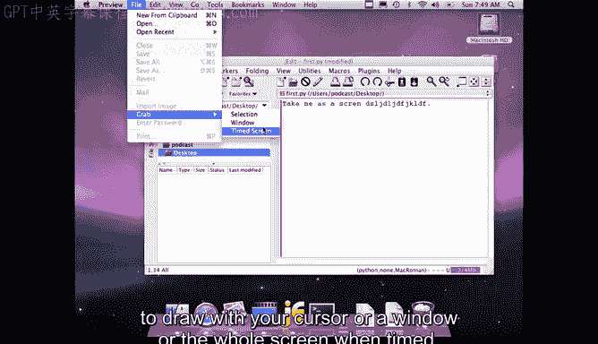

1.  打开Macintosh的硬盘驱动器。
2.  进入“应用程序”文件夹。
3.  在应用程序列表中搜索并找到“预览”应用。

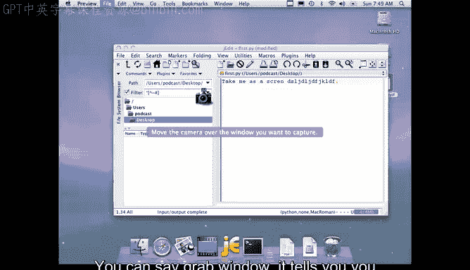

“预览”应用最初是为在Macintosh上查看PDF文件而设计的，但它也包含了一系列屏幕捕捉功能。建议将“预览”应用常驻在程序坞中以便快速访问。

---

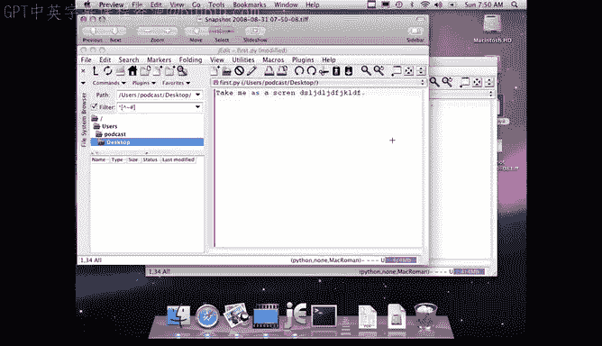

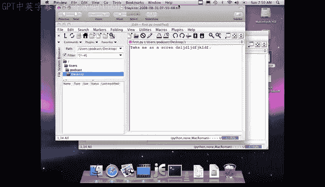

## 截取屏幕截图

以下是截取屏幕截图的具体步骤。我们将以一个示例窗口（如一个文本编辑器）作为目标进行演示。

1.  打开你想要截图的窗口或程序。
2.  启动“预览”应用程序。
3.  在“预览”的菜单栏中，点击“文件”。
4.  在下拉菜单中选择“拍摄屏幕截图”。这里会提供几个选项：
    *   **所选部分**：允许你用光标绘制一个矩形选区。
    *   **窗口**：截取某个特定窗口。
    *   **整个屏幕**：截取整个屏幕（可设置延时）。

大多数情况下，我们选择“窗口”进行截图。选择“窗口”后，光标会变成一个相机图标，移动到不同窗口上会有高亮提示。点击你想要截取的目标窗口即可完成截图。

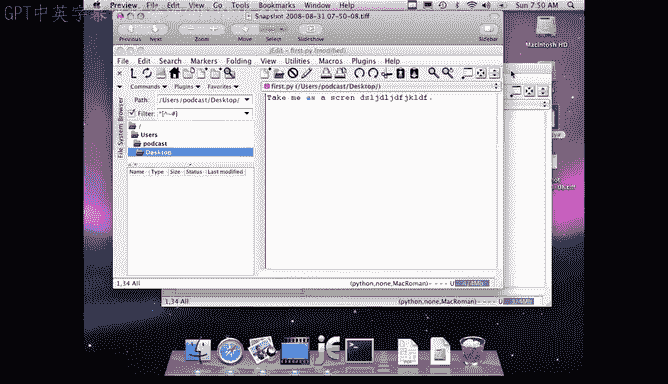

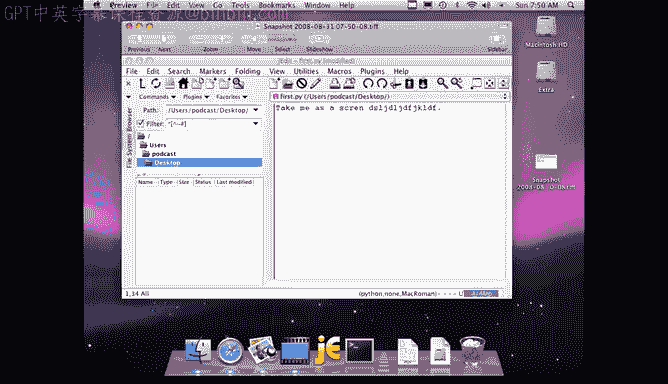

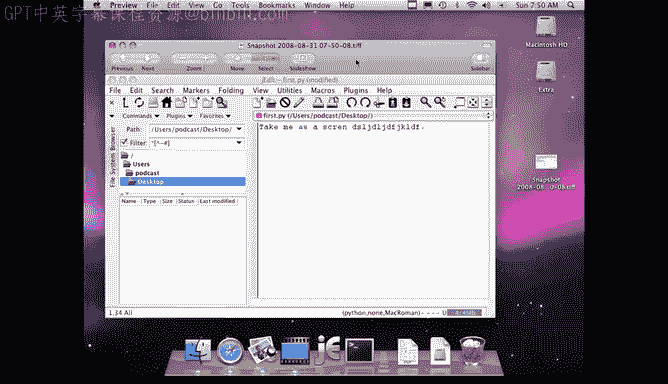

截图完成后，图像会立即在“预览”应用中打开。此时，原窗口的内容会被“冻结”在图片中，无法再与之交互。

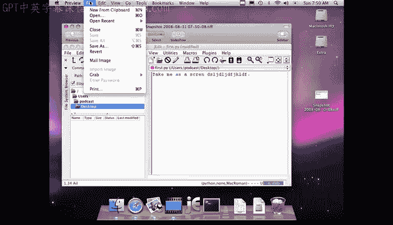

---

## 保存与编辑截图

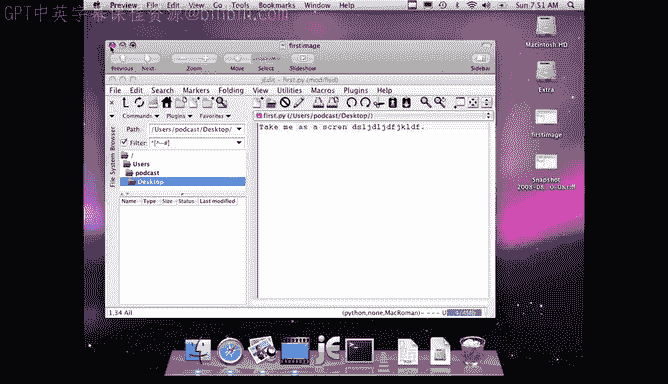

默认情况下，截图会以`快照 [日期].tiff`的格式自动保存到桌面。为了便于管理和使用，我们通常需要将其转换为更通用的格式（如JPEG）并重命名。

1.  在“预览”中，对截图选择“文件” -> “导出...”。
2.  在格式选项中，选择“JPEG”。
3.  为文件起一个更具描述性的名字（例如：`first_image.jpg`），然后选择保存位置（如桌面）。

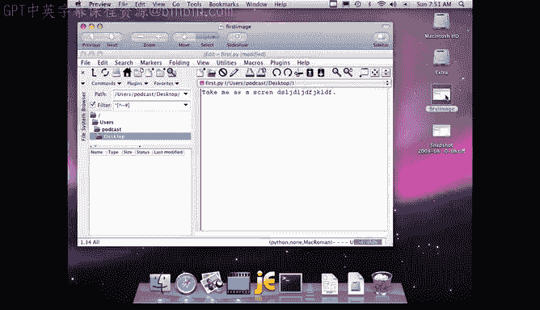

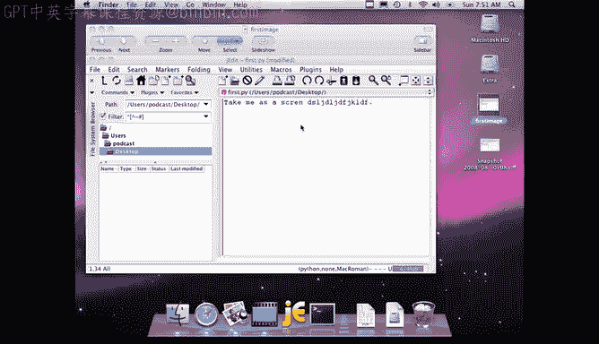

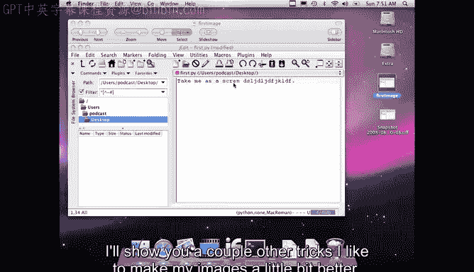

“预览”还提供了简单的编辑工具，例如裁剪。如果你只想保留图片的某一部分，可以这样做：

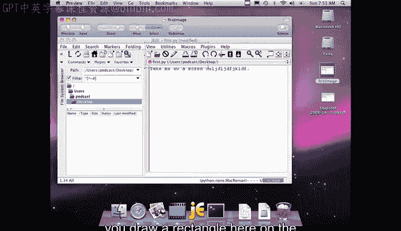

1.  使用矩形选择工具，在图片上框选出你想要保留的区域。
2.  点击菜单栏中的“工具”，然后选择“裁剪”。
3.  裁剪后，图片就只保留你选中的部分了。最后，记得使用“导出”功能保存编辑后的图片。

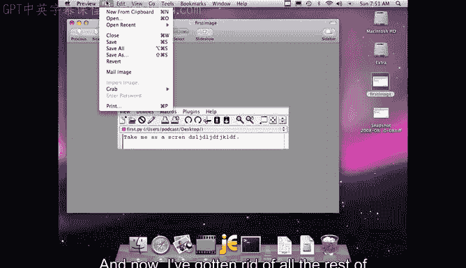

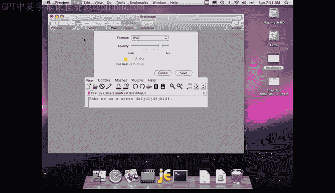

---

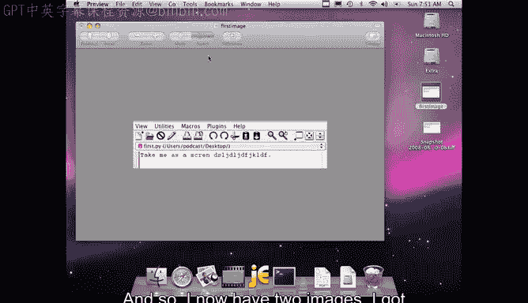

## 实用技巧与总结

本节课中我们一起学习了在Mac上使用“预览”应用截图的完整流程。这里还有一些实用技巧：

*   使用 `Command (⌘) + W` 可以快速关闭当前“预览”窗口。
*   定期清理桌面上自动生成的截图文件，保持工作区整洁。
*   当你需要提交作业或上传截图时，使用上述方法生成的JPEG文件就是你需要上传的文件。

总而言之，使用“预览”应用中的“拍摄屏幕截图”功能（特别是“窗口”选项）是截取屏幕内容的高效方法。通过导出和简单的裁剪，你可以轻松获得符合要求的图片文件。