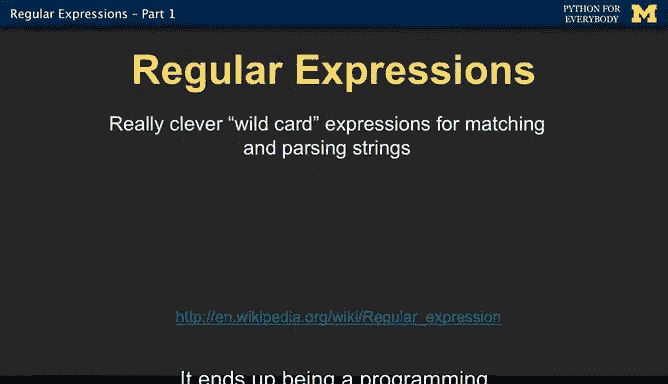
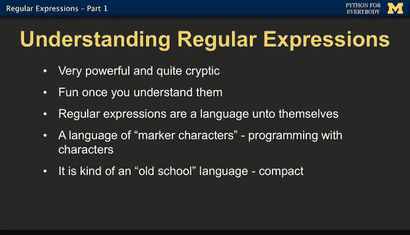
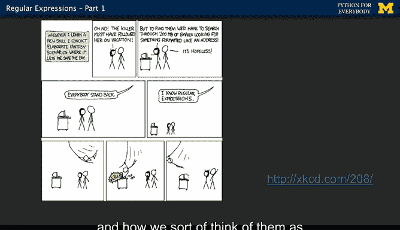
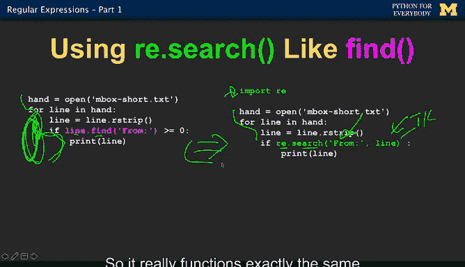
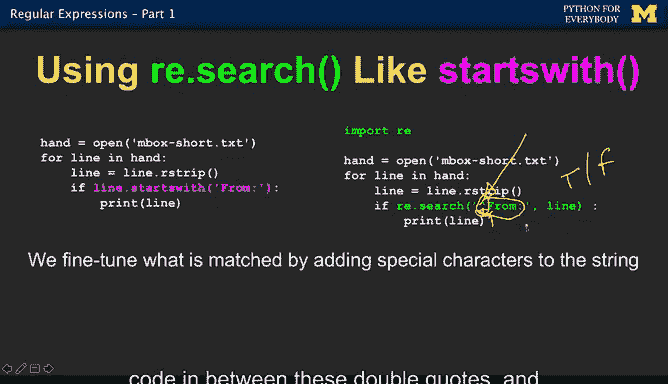
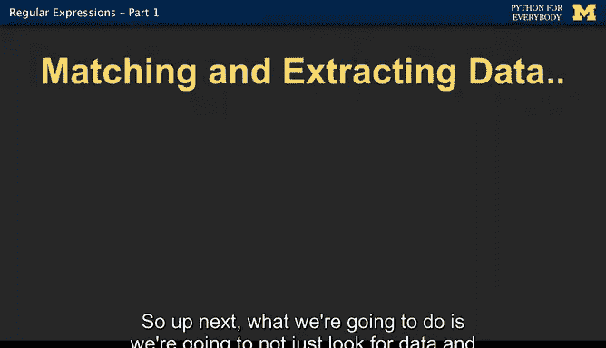

# 课程3：《使用Python访问Web数据》｜第11章：正则表达式入门 🧩


在本节课中，我们将学习正则表达式的基本概念及其在Python中的应用。正则表达式是一种强大的文本匹配工具，能够帮助我们更智能地搜索和处理字符串数据。


---

## 什么是正则表达式？ 🤔

上一节我们介绍了课程概述，本节中我们来看看正则表达式的定义。

正则表达式是一个古老的概念，源于语言学研究。它并非专指计算机编程语言，而是描述语言和语法的一种形式。正则表达式用于定义一组字符串是否符合某种模式。

从20世纪60年代至今，许多操作系统都使用正则表达式作为更智能的搜索方式。与简单搜索“hello”不同，正则表达式可以描述更复杂的模式，例如“H后跟一个字母，然后是LL，再后跟一个元音”。正则表达式就像一种小型通配符编程语言，专注于字符串匹配。

---



## 正则表达式的特点 💪


正则表达式功能强大但略显晦涩。一旦掌握，你会发现它们非常有用。使用正则表达式可以大幅减少代码量，完成复杂的文本匹配任务。虽然学习曲线可能比`if`语句陡峭，但掌握后能极大提升处理文本的效率。

正则表达式被视为一种神秘而强大的工具，掌握它的人常被认为具备特殊技能。

---

## 正则表达式快速指南 📖



正则表达式的核心在于对字符进行编程，而非整行代码。以下是一些基本元字符及其含义：



*   `^`：匹配行的开头。
*   `$`：匹配行的结尾。
*   `.`：匹配任意单个字符。
*   `[]`：定义一个字符集合的开始。
*   `()`：开始和结束一个提取组。

这些符号共同构成了一种用于字符串匹配的编程语言。Python、Java、JavaScript等许多语言都支持正则表达式，其语法大体相似，但存在一些细微差别。

---

## 在Python中使用正则表达式 🐍

在Python中，正则表达式功能并非内置，需要通过`import`语句导入`re`库。

以下是两个我们将要使用的重要函数：

*   `re.search()`：用于搜索字符串，返回匹配对象（若找到）或`None`（若未找到）。它类似于更智能的`find`操作。
*   `re.findall()`：用于提取所有匹配的子字符串，功能比简单的字符串切片强大得多。

接下来，我们将通过代码示例来了解如何使用这些功能。

---


## 使用 `re.search()` 进行搜索 🔍

我们将从`re.search()`函数开始，演示如何进行基本的模式匹配。

首先，我们看一段使用字符串方法`find()`的代码：

```python
# 使用字符串的 find 方法
if line.find('From:') >= 0:
    print(line)
```

这段代码会打印所有包含“From:”的行。

现在，我们使用正则表达式实现相同的功能：

```python
import re

# 使用正则表达式的 search 方法
if re.search('From:', line):
    print(line)
```



在这个简单的例子中，正则表达式模式`'From:'`没有使用任何特殊元字符，因此其行为与`find()`方法完全相同。对于如此简单的任务，我们可能不会使用正则表达式，但随着学习深入，你会发现正则表达式能实现更强大的匹配。


---

## 匹配行首：使用 `^` 元字符 🚀

上一节我们介绍了基本的搜索，本节中我们来看看如何匹配行的开头。

我们可以使用字符串的`startswith()`方法来检查行首：

```python
# 使用字符串的 startswith 方法
if line.startswith('From:'):
    print(line)
```

使用正则表达式实现相同功能，我们需要修改匹配模式：

```python
import re

# 使用正则表达式匹配行首
if re.search('^From:', line):
    print(line)
```




这里的`^`是一个特殊字符，它表示“匹配行的开始”。因此，模式`^From:`意味着“匹配以`From:`开头的行”。如果`From:`出现在行中其他位置，则不会匹配。

正则表达式的核心技巧就在于，我们通过在这些引号内编写越来越复杂的模式，来实现我们想要的功能。

---

## 使用 `.` 和 `*` 进行通配匹配 🌟

我们可以使用`.`和`*`元字符来构建更灵活的模式。

*   `.`（点）：匹配**任意单个**字符。
*   `*`（星号）：匹配前面的字符**零次或多次**。

例如，模式`^X.*:`可以解释为：
> 寻找以`X`开头，后跟任意数量（包括零个）的任意字符，然后是一个冒号`:`的行。

这个模式会匹配以下行：
```
X-Sieve: CMU Sieve 2.3
X-DSPAM-Result: Innocent
X-DSPAM-Confidence: 0.8475
```
但也会匹配我们可能不想要的行，例如：
```
X-Plane is behind schedule: two weeks
```

---

## 精细调整匹配模式：使用 `+` 和 `\S` 🎯

为了更精确地匹配，我们可以对模式进行微调。

*   `+`（加号）：匹配前面的字符**一次或多次**（至少一次）。
*   `\S`：匹配**任何非空白**字符（与空白字符`\s`相反）。

改进后的模式`^X-\S+:`可以解释为：
> 寻找以`X-`开头，后跟**一个或多个**非空白字符，然后是一个冒号`:`的行。

这个模式会匹配：
```
X-Sieve: CMU Sieve 2.3
X-DSPAM-Result: Innocent
X-DSPAM-Confidence: 0.8475
```
但不会匹配`X-Plane is behind schedule: two weeks`，因为`X-`和冒号`:`之间包含了空白字符（空格），违反了`\S+`（一个或多个非空白字符）的规则。

通过添加更多细节，我们可以确保只命中我们真正想要匹配的行。

---

## 总结 📝

本节课中我们一起学习了正则表达式的基础知识。我们了解了正则表达式是一种用于描述字符串模式的强大语言，掌握了`^`、`$`、`.`、`*`、`+`、`\S`等基本元字符的含义，并学会了在Python中通过`re`库的`search()`函数进行基本的模式匹配。



下一节，我们将学习如何不仅查找数据，还能从匹配的文本中提取出特定的部分，这是正则表达式另一个非常强大的功能。