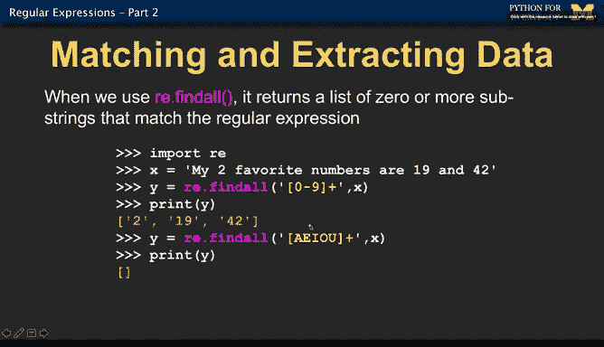
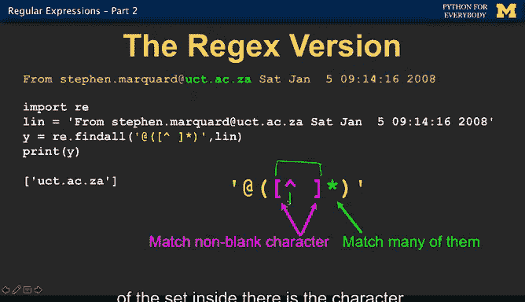

# 每个人的 Python 第三部分 8：数据提取 📊


## 概述

在本节课中，我们将学习如何使用正则表达式从文本中提取数据。我们将从基础的字符匹配开始，逐步深入到更复杂的模式匹配和数据提取技巧。

---

## 数据提取基础

上一节我们介绍了如何使用正则表达式进行搜索匹配。本节中我们来看看如何从匹配的文本中提取出我们需要的具体数据。

我们将从一个新的正则表达式符号开始：方括号 `[]`。方括号用于定义一个字符集合，它匹配集合中的任意一个字符。

例如，`[AEIOU]` 匹配任意一个大写元音字母。`[0-9]` 匹配任意一个数字。因此，`[0-9]` 代表一个单个的数字。


为了匹配一个或多个数字，我们可以在后面添加加号 `+`。所以 `[0-9]+` 表示匹配一个或多个连续的数字。如果使用星号 `*`，则表示匹配零个或多个数字，但通常我们更常用 `+` 来确保至少有一个匹配项。



现在，我们将使用正则表达式库中的一个函数 `findall`。

```python
import re
x = '我的号码是：123-4567，请拨打。'
y = re.findall('[0-9]+', x)
print(y)  # 输出: ['123', '4567']
```

这段代码的含义是：在字符串 `x` 中，查找匹配“一个或多个数字”这个模式的所有子串。`findall` 函数会遍历整个文本，检查每个位置是否符合模式，并返回一个包含所有匹配项的列表。

它可能找到零个、一个或多个匹配项。这个函数将提取出所有匹配的片段。这就像把分割字符串、循环遍历和条件判断等多个操作整合在一个简洁的程序里。

如果 `findall` 没有找到任何匹配项，它会返回一个空列表。在上面的例子中，它返回了三个字符串：`‘123’` 和 `‘4567’`。请注意，返回的是字符串，而不是数字。

---

## 贪婪匹配与非贪婪匹配

当你思考正则表达式时，可以把它想象成一个印章，在文本上不断盖章，检查每一段是否匹配。

这里存在一个概念叫“贪婪匹配”。除非特别说明，正则表达式库会尝试返回尽可能长的匹配字符串。

考虑这个模式：`^F.+:`。它表示以字符 `F` 开头，后跟一个或多个任意字符，最后以冒号 `:` 结尾。

如果我们在文本 `‘From: using the:’` 上应用这个模式，理论上 `‘From:’` 已经是一个匹配。但贪婪匹配会促使引擎匹配更长的部分，比如 `‘From: using the:’`。因此，默认情况下，我们会得到更长的匹配结果。

贪婪匹配意味着 `*` 和 `+` 这样的量词会尽可能向外扩展，匹配尽可能多的字符。

但就像正则表达式中的所有特性一样，你可以通过添加另一个字符来改变这种行为。我们可以在 `+` 或 `*` 后面添加一个问号 `?`。

例如，`^F.+?:` 表示以 `F` 开头，后跟一个或多个任意字符（但非贪婪），最后以冒号结尾。非贪婪匹配偏好最短的可能匹配。

因此，应用 `^F.+?:` 到同样的文本上，我们会得到 `‘From:’`。

当你编写使用正则表达式的代码时，测试代码以发现这类异常非常重要。有时你需要添加 `?` 来指定“不要贪婪”。这是一个非常简洁的表达方式，用一个字符就传达了复杂的逻辑。

---

## 提取电子邮件地址

一个常见的任务是提取电子邮件地址。我们可以使用以下模式：`\S+@\S+`。

`\S` 代表任何非空白字符。`+` 表示一个或多个。因此，这个模式匹配的是：一个或多个非空白字符，后跟一个 `@` 符号，再后跟一个或多个非空白字符。

这个模式会贪婪地匹配，因此对于字符串 `‘d@u’` 和更多文本，它会尝试匹配尽可能长的部分，最终可能提取出整个电子邮件地址，如 `‘d@u.xxx’`。在这种情况下，贪婪匹配通常是我们想要的。

如果我们使用非贪婪版本 `\S+?@\S+?`，则可能只匹配 `‘d@u’`。这有助于理解贪婪与非贪婪行为的区别。

---

## 使用括号进行精确提取

我们可以通过使用括号 `()` 来调整 `findall` 的工作方式，从而更精确地提取数据。括号允许我们匹配一个模式，但只提取其中的一部分。

例如，假设我们只想提取以 `‘From ’` 开头的行中的电子邮件地址。我们可以这样写：`^From (\S+@\S+)`。

这个模式要求行必须以 `‘From ’` 开头，后跟我们的电子邮件模式 `\S+@\S+`。但是，只有括号 `()` 内的部分（即电子邮件地址本身）会被提取出来。

这样，我们使用匹配部分来精确锁定我们想要的行（以 `‘From ’` 开头），然后使用括号只提取我们真正需要的部分（电子邮件地址）。这是一种精细调整数据提取的方法。

---


## 对比：传统方法与正则表达式

让我们回顾一下之前不使用正则表达式提取数据的方法。例如，从字符串中提取 `@` 符号后的部分。

**传统方法（使用字符串查找和切片）：**
```python
s = 'From stephen.marquard@uct.ac.za Sat Jan 5'
atpos = s.find('@')
sppos = s.find(' ', atpos)
host = s[atpos+1:sppos]
print(host)  # 输出: uct.ac.za
```



**使用双重分割：**
```python
words = s.split()
email = words[1]
pieces = email.split('@')
host = pieces[1]
print(host)  # 输出: uct.ac.za
```

**使用正则表达式：**
```python
import re
y = re.findall('@([^ ]*)', s)
print(y)  # 输出: ['uct.ac.za']
```
模式 `@([^ ]*)` 的解释：寻找 `@` 符号，然后开始提取（括号开始）。`[^ ]` 表示“任何非空格字符”，`*` 表示零个或多个。所以它提取从 `@` 之后到下一个空格之前的所有非空格字符。

我们可以进一步优化，确保只处理以 `‘From ’` 开头的行：`^From .*@([^ ]*)`。这既过滤了行，又精确提取了我们需要的数据。

---

## 实战：解析数据行

以下是一个使用正则表达式同时筛选行和提取数据的代码示例。这类似于某些作业，你需要查找具有特定格式的行，例如：`‘X-DSPAM-Confidence: 0.8475’`。

```python
import re
hand = open('mbox-short.txt')
for line in hand:
    line = line.rstrip()
    stuff = re.findall('^X-DSPAM-Confidence: ([0-9.]+)', line)
    if len(stuff) != 1:
        continue
    num = float(stuff[0])
    print(num)
```

代码解析：
1.  `‘^X-DSPAM-Confidence: ’` 匹配行开头。
2.  `‘([0-9.]+)’` 开始提取，匹配一个或多个数字或点号（用于浮点数）。
3.  `findall` 返回一个匹配列表。对于符合格式的行，这个列表的长度应为 1。
4.  如果长度不是 1（可能是 0 或大于1），我们就跳过这行。
5.  如果长度是 1，我们将提取的字符串转换为浮点数并处理。

通过这种方式，正则表达式可以让程序更简洁。但当你看到别人的正则表达式时，可能需要花点时间理解。建议不要过度使用，并添加适当的注释来帮助读者（包括未来的自己）理解。

---

## 转义特殊字符

我们有很多具有特殊含义的字符，如 `$`、`^` 等。有时我们确实想匹配这些字符本身。这时我们需要使用转义字符：反斜杠 `\`。

反斜杠可以放在任何有特殊含义的字符前，使其失去特殊含义。例如，`\$` 就表示真正的美元符号。

假设我们想提取以美元符号开头的金额：
```python
x = 'We just received $10.00 for cookies.'
y = re.findall('\$[0-9.]+', x)
print(y)  # 输出: ['$10.00']
```
模式 `\$[0-9.]+` 匹配一个美元符号，后跟一个或多个数字或点号。这就是转义字符的用法，当你真正想匹配 `*`、`+`、`.` 或 `[]` 等字符时，就需要用到它。

---

## 总结

本节课中我们一起学习了如何使用正则表达式进行数据提取。


我们介绍了：
*   使用 `findall()` 函数提取所有匹配项。
*   字符集合 `[]` 和量词 `+`、`*` 的用法。
*   **贪婪匹配**与**非贪婪匹配**（通过 `?` 实现）的核心概念。
*   使用括号 `()` 精确指定要提取的部分。
*   如何编写正则表达式来同时**筛选**特定行和**提取**其中的数据。
*   使用反斜杠 `\` 来**转义**特殊字符，以匹配它们本身。

正则表达式功能强大，使用得当可以使代码非常优雅。建议不要过度使用，以免代码难以理解，但在数据验证、搜索和提取等场景中，它们通常是完美的工具。