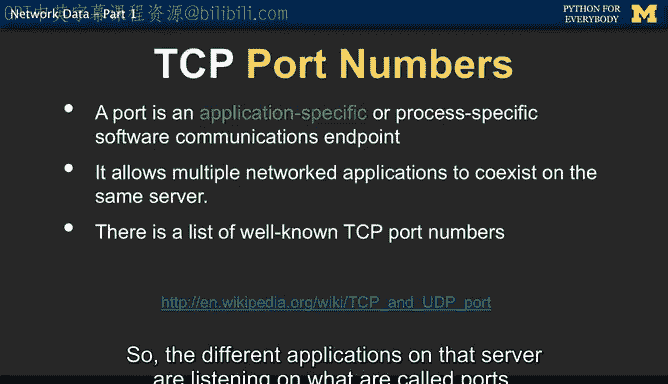
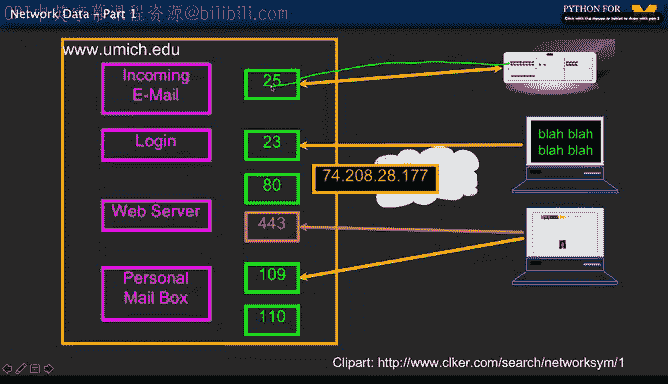
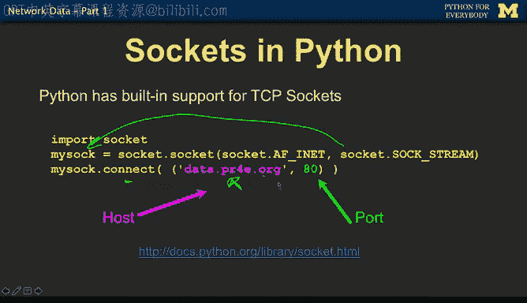
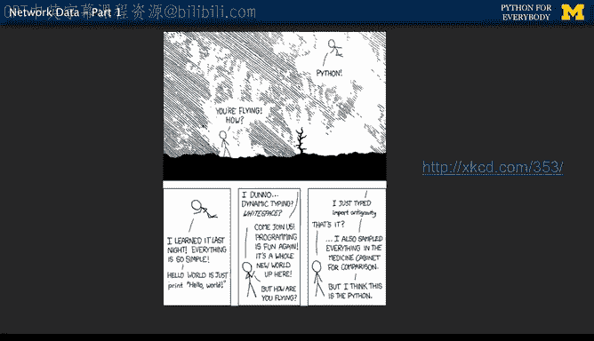

# 每个人的 Python 第三部分 11：网络技术基础 🌐


## 概述

在本节课中，我们将学习如何使用Python程序与互联网进行通信，而不仅仅是与本地磁盘驱动器交互。我们将介绍网络架构的基本概念，并重点讲解如何使用Python的`socket`库建立网络连接，实现应用程序之间的通信。

---

## 网络架构简介

上一节我们介绍了课程的整体目标。本节中，我们来看看互联网通信背后的基本架构。

互联网通信遵循一种分层架构模型，它代表了两个计算机之间的连接。这个模型通常包括应用层、传输层、网络层和链路层。数据从你的应用程序出发，经过这些层，通过Wi-Fi或以太网等物理连接，穿越网络上的多个节点（可能10到15个），最终到达目标计算机（例如一台网络服务器）。数据再经过同样的路径返回，最终呈现在你的屏幕上。

虽然网络架构的细节非常丰富，但为了专注于Python编程，我们将进行简化。我们假设存在一个从端到端的“管道”，当你的程序向管道发送信息时，另一端的程序能够接收到；当另一端程序回复时，你的程序也能接收到。这是一种简化的理解方式。

---

## 套接字：应用程序间的通信桥梁

上一节我们简化了网络通信模型。本节中我们来看看实现这种通信的核心技术：套接字。

我们称这种通信为两个应用程序之间的通信。它就像你的Python程序与另一台服务器上的网络服务（可能用PHP、Java甚至Python编写）在“打电话”。计算机可以每秒建立成百上千次这样的连接。我们称这种短暂的、用于一次对话的连接为**套接字**。


套接字的工作方式是：如果你想建立一个套接字，你需要指定想要对话的特定服务器（通过名称或IP地址）以及服务器上的特定应用程序。服务器上的不同应用程序通过**端口**进行监听。你可以把端口想象成电话分机号。例如，你拨打一家公司的总机后，需要输入分机号才能联系到具体的人。

以下是常见的TCP端口：
*   **端口80**：HTTP协议端口，也是我们本课程主要使用的端口。
*   **端口443**：HTTPS（安全）协议端口。
*   **端口25**：电子邮件（SMTP）服务器端口。

因此，当浏览器想要连接网络服务器时，它会连接到目标主机的端口80。如果该主机上运行着网络服务器，双方就能开始“对话”。有时你会在URL中看到类似`:8080`的部分，这表示网络服务器运行在8080端口，而非默认的80端口。

---

## 用Python创建套接字连接

上一节我们了解了套接字和端口的概念。本节中我们来看看如何用Python代码实现它。



Python的强大之处在于，它用极简的代码封装了底层数百万行的网络通信逻辑。建立一个套接字连接只需要三行Python代码。

首先，我们需要导入`socket`库。

```python
import socket
```

接着，我们创建一个套接字对象。这行代码在你的计算机内部创建了一个尚未连接、但已准备好向外连接的端点。

```python
mysock = socket.socket(socket.AF_INET, socket.SOCK_STREAM)
```



最后，我们调用`connect`方法来建立实际的连接。我们需要传入两个参数：想要连接的主机（域名）和端口号。这就像拨打电话。

```python
mysock.connect(('data.pr4e.org', 80))
```

至此，套接字连接就建立好了。这仅仅是“拨通了电话”，还没有发送任何数据。Python用如此简洁的代码实现复杂的网络功能，这正是我们热爱它的原因之一。

---

## 通过套接字发送与接收数据

上一节我们成功建立了套接字连接。本节中我们来看看如何通过这个连接与远程应用程序进行实际的数据交换。

建立连接后，我们可以通过套接字发送请求和接收响应。这通常涉及按照应用层协议（如HTTP）的格式构造请求字符串，然后通过套接字发送。服务器处理请求后，会将数据通过同一个套接字连接发送回来。

在Python中，我们可以使用套接字对象的`send()`和`recv()`方法来实现数据的发送和接收。由于网络数据是以字节流形式传输的，我们发送时需要将字符串编码为字节，接收后可能需要将字节解码为字符串。

以下是一个简化的流程：
1.  发送请求：`mysock.send(request.encode())`
2.  接收数据：`data = mysock.recv(512)`
3.  解码数据：`text = data.decode()`

通过这样的“发送-接收”循环，我们就可以与网络另一端的应用程序进行完整的对话，获取所需的数据。



---



## 总结


本节课中我们一起学习了网络通信的基础知识。我们首先简要了解了互联网的分层架构，然后重点学习了**套接字**作为应用程序间通信桥梁的核心概念，包括**端口**的作用。接着，我们实践了如何使用Python的`socket`库，仅用三行代码就建立了一个到远程服务器的套接字连接。最后，我们概述了通过已建立的连接发送和接收数据的基本方法。掌握这些知识，你就迈出了使用Python访问网络数据的第一步。