# 每个人的 Python 第三部分 12：超文本传输协议（HTTP）🌐


## 概述

在本节课中，我们将要学习超文本传输协议（HTTP）。我们将了解HTTP作为互联网上主导的应用层协议是如何工作的，以及如何使用Python通过套接字（socket）发送HTTP请求并接收响应。通过本课，你将理解浏览器与服务器通信背后的基本原理。

---

## 从传输层到应用层

上一节我们介绍了传输层协议（TCP/IP栈中的底层），并使用Python程序通过套接字连接到远程计算机的特定端口。现在，我们将开始实际发送和接收数据。

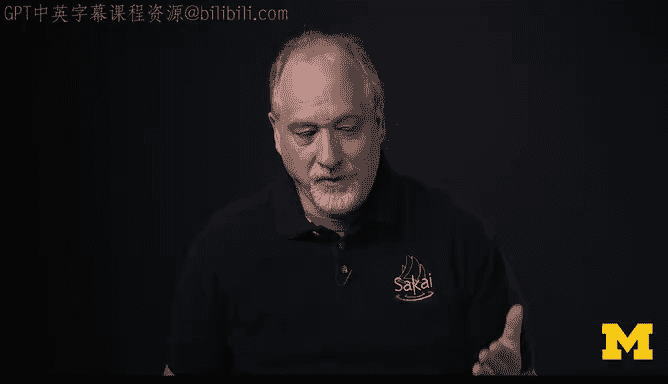

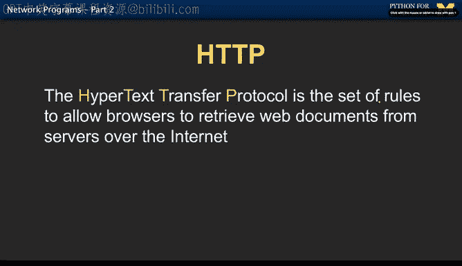

既然连接已经建立，我们就从传输层上升到了应用层。应用层意味着，与邮件服务器通信的规则和与Web服务器通信的规则是不同的。这些规则就是“道路规则”，规定了我们如何与它们对话。

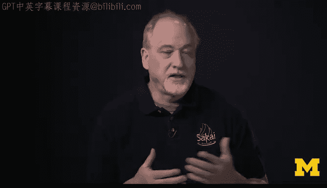

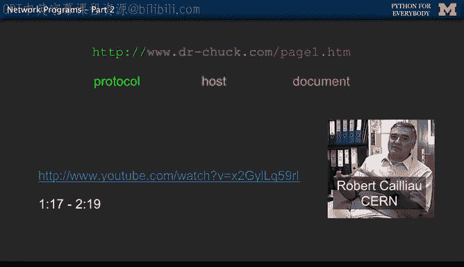

## 什么是应用协议？📞

这类似于电话通话中的礼仪。在西方文化中，接电话的人通常会先说“你好”，然后对方回应“你好”，之后才开始真正的交谈。这种启动对话的方式就是一种应用协议。

在本节中，我们将要使用的协议被称为**超文本传输协议**。它是互联网上主导的应用层协议，最初是为了检索网页而发明的。虽然诞生之初并不被认为是最伟大的协议，但它已经演变成一个非常出色的协议。它的简单性使得我们可以在其基础上不断叠加新的想法。

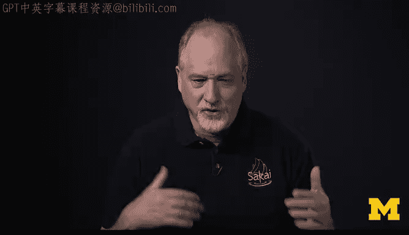

HTTP是一套规则，允许浏览器从网络检索文档。如果你想编写一个浏览器或一个服务器，都需要阅读HTTP的规范。它规定了通信的语法、生产者和消费者应遵循的格式，确保了不同厂商的软件可以协同工作，这是一种标准化的形式。

## 统一资源定位符（URL）🔗

HTTP标准化了一个非常酷的东西：**统一资源定位符**。我们经常输入URL，以至于认为它理所当然，但实际上它内部包含了许多信息。

一个URL的示例：
```
http://www.chuck.com/page1.html
```
*   `http://` 表示使用HTTP协议。
*   `www.chuck.com` 表示连接到这个主机（服务器）。
*   `/page1.html` 表示获取这个文档。

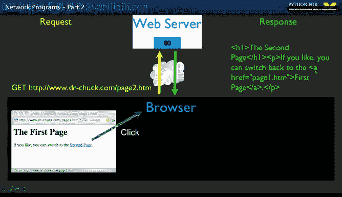

在90年代，你需要分别知道这些信息。后来，我们把它们拼接在一起，形成了URL。用户每次点击链接，浏览器都会解析这个URL，以确定连接哪个服务器、哪个端口以及获取哪个文档。

## 请求-响应周期 🔄

当你在网页上点击一个链接时，浏览器会向服务器发送一个 **GET请求** 来获取文档，然后接收、解析并显示该文档。

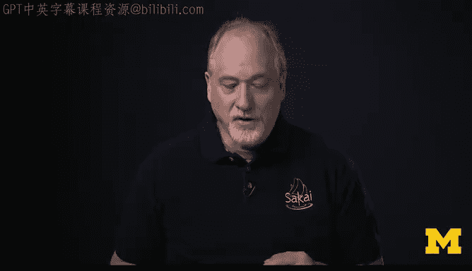

以下是其工作原理的简要说明：
1.  你点击一个链接（例如，指向“第二页”）。
2.  浏览器（运行在你电脑上的软件）拦截这次点击。
3.  浏览器查看当前页面的HTML，确定要连接哪个Web服务器、端口以及要检索的文档。
4.  浏览器通过套接字连接到服务器的**80端口**（HTTP默认端口）。
5.  浏览器发送一个 **GET请求**。
6.  Web服务器解析该请求，确定你要查找的文档（可能会运行一些软件）。
7.  服务器通过同一个套接字发送**响应**。
8.  响应内容通常是**HTML**（超文本标记语言），其中包含标签（如 `<h1>`, `<p>`, `<a>`）。
9.  浏览器接收HTML，解析它，并根据规则（如添加空行等）将其渲染成你看到的页面。

这个过程被称为**请求-响应周期**。虽然你只看到“点击 -> 新页面”，但背后发生了很多事情。

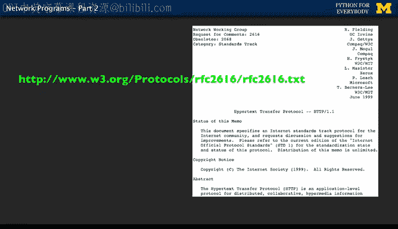

## HTTP标准：RFC

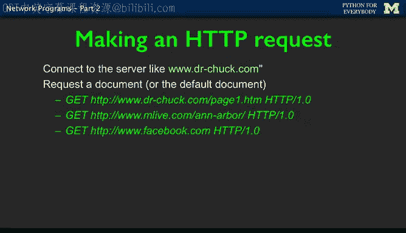

所有关于发送什么、如何发送、字符串如何组合的规则都有标准。这些标准是一系列**请求评议**文档。RFC编号代表“请求评议”，这略带调侃地意味着，即使这些标准指导着数百万浏览器与数十万服务器协同工作，并且是非常可靠的想法，但始终有改进的空间。

例如，RFC 2616就详细描述了HTTP协议。如果你要编写一个浏览器，就需要阅读这份长达数百页的文档。

以下是客户端发送给服务器的请求语法示例。请求的第一行包括：要应用于资源的方法、资源标识符以及使用的协议版本。

一个GET请求的示例：
```
GET /page1.html HTTP/1.0
```

## 使用Telnet模拟HTTP请求 🖥️

你可以使用一个名为 `Telnet` 的古老工具来手动模拟HTTP请求。它允许你连接到任何服务器的任何端口并以不安全的方式发送数据。

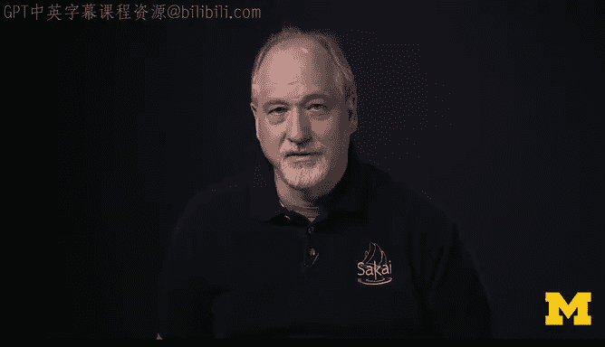

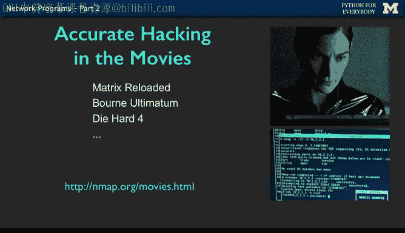

以下是使用Telnet获取网页的步骤：
1.  在命令行中输入：`telnet <主机> 80` （例如 `telnet www.chuck.com 80`）。
2.  快速输入以下内容（包括最后的两个换行）：
    ```
    GET /page1.html HTTP/1.0

    ```
3.  服务器将返回两部分信息：
    *   **头部**：关于文件的元数据（例如，`Content-Type: text/html`）。
    *   **一个空行**：分隔头部和内容。
    *   **内容**：文件的实际内容（HTML）。
4.  随后连接关闭。

## 使用Python实现HTTP请求-响应 🔧

现在，让我们用Python来实现同样的功能。我们可以创建一个套接字，连接到服务器的80端口，发送GET请求，然后接收数据。

以下是实现此功能的Python代码：

```python
import socket

# 每个人的 Python 第三部分 创建套接字（一个“门”）
mysock = socket.socket(socket.AF_INET, socket.SOCK_STREAM)
# 每个人的 Python 第三部分 连接到服务器的80端口
mysock.connect(('data.pr4e.org', 80))
# 每个人的 Python 第三部分 准备并发送GET请求字符串，注意末尾有两个换行符 \n\n
cmd = 'GET http://data.pr4e.org/page1.htm HTTP/1.0\r\n\r\n'.encode()
mysock.send(cmd)

# 每个人的 Python 第三部分 循环接收数据
while True:
    data = mysock.recv(512)  # 每次最多接收512字节
    if len(data) < 1:        # 如果没有数据，表示传输结束
        break
    print(data.decode(), end='')  # 解码并打印数据

# 每个人的 Python 第三部分 关闭套接字，释放资源
mysock.close()
```

代码解析：
1.  `socket.socket()`：创建一个套接字对象，就像打开一扇“门”。
2.  `.connect()`：将这扇“门”连接到远程服务器的指定端口（这里是80）。如果服务器不存在，连接会失败。
3.  `.encode()`：将字符串（我们的请求）转换为字节，以便通过网络发送。我们将在下一节详细讨论编码。
4.  `.send()`：通过套接字发送请求。根据HTTP协议规则，客户端先发送。
5.  `while` 循环和 `.recv()`：持续从套接字接收数据，每次最多512字节。当接收不到数据时（`len(data) < 1`），表示服务器已发送完所有数据，循环结束。
6.  `.decode()`：将接收到的字节数据转换回字符串，以便我们阅读。
7.  `.close()`：关闭套接字。这很重要，因为它释放了你电脑和远程服务器上的资源。

运行这段代码，你将看到与使用Telnet时相同的输出：先是HTTP头部（元数据），然后是一个空行，接着是HTML内容。

## 总结

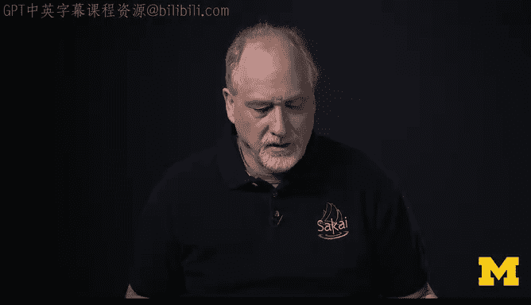

本节课中，我们一起学习了超文本传输协议的核心概念。我们了解了HTTP作为应用层协议的角色，URL的构成，以及浏览器与服务器之间的请求-响应周期。我们不仅使用Telnet工具手动模拟了HTTP请求，更重要的是，我们使用Python的 `socket` 库编写了一个简单的程序，实现了完整的HTTP GET请求和响应接收过程。这展示了Python在网络编程中的强大能力和简洁性。在下一节，我们将深入探讨网络数据传输中至关重要的编码（encode）和解码（decode）过程。