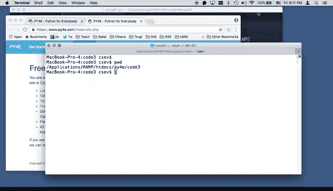
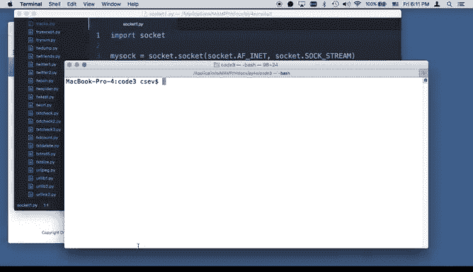
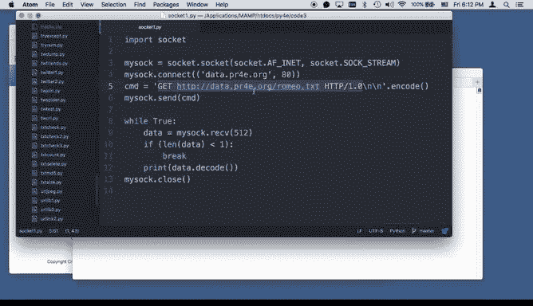
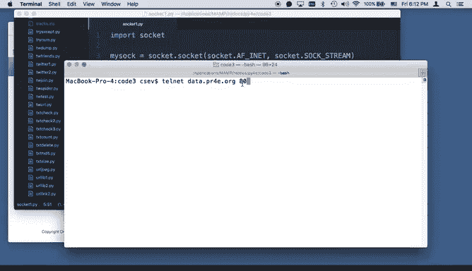
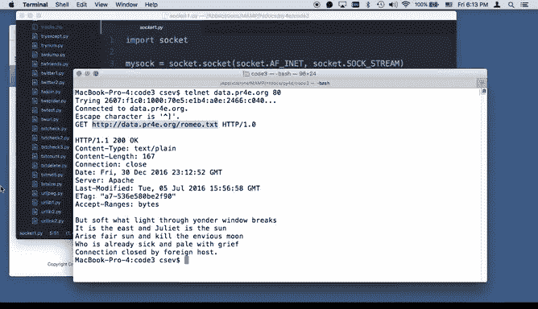
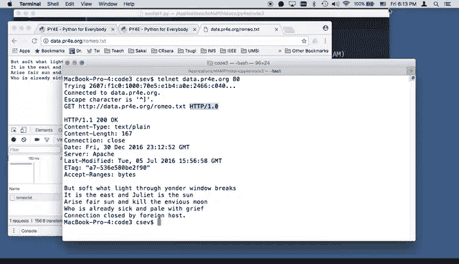
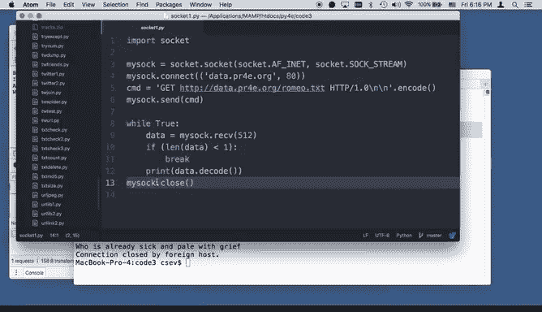
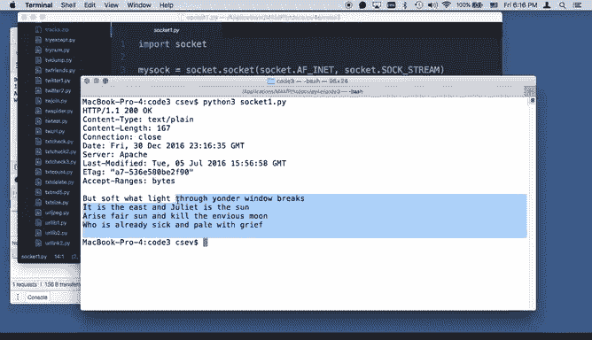
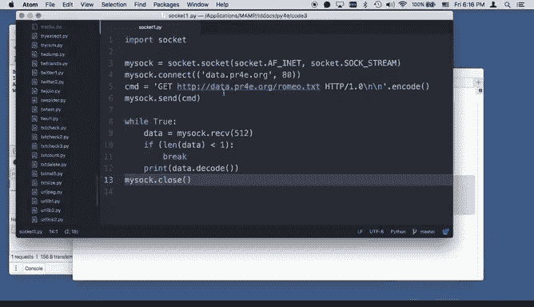

# 每个人的 Python 第三部分 13：13_03_03_实战示例_套接字 🖥️

在本节课中，我们将要学习如何使用Python的`socket`库来手动模拟浏览器，通过HTTP协议从网络服务器获取数据。我们将通过一个具体的代码示例，展示如何建立网络连接、发送HTTP请求以及接收响应数据。





---

## 概述



上一节我们介绍了网络数据访问的基本概念。本节中我们来看看如何通过Python的底层套接字（Socket）功能，手动实现一个简单的HTTP客户端。我们将模拟浏览器向服务器发送请求并获取文档的过程。

## 准备工作




如果你对源代码感兴趣，可以从课程资料中下载示例代码的ZIP文件。解压后，你会看到一个名为`code3`的文件夹，其中包含本课程的所有示例代码文件。

我们本次要使用的文件是`socket1.py`。

## 手动模拟HTTP协议



在编写代码之前，我们可以先通过命令行工具手动模拟HTTP请求，以理解其工作原理。使用`telnet`工具连接到服务器的80端口（HTTP标准端口），然后手动输入HTTP命令。

以下是手动发送HTTP请求的步骤：
1.  连接到目标服务器和端口：`telnet data.pr4e.org 80`
2.  在连接建立后，输入HTTP GET请求：`GET http://data.pr4e.org/romeo.txt HTTP/1.0`
3.  按两次回车键（一次结束命令，一次发送空行表示请求头结束）。



服务器将返回响应，其中包含HTTP头信息、一个空行，以及文档的主体内容。这个过程清晰地展示了HTTP协议“请求-响应”的基本交互模式。

## 使用Python实现套接字通信

理解了手动过程后，我们现在用Python的`socket`库来自动化这一流程。核心思路是：创建一个套接字，连接到服务器，发送格式正确的HTTP请求，然后循环接收服务器返回的数据。

以下是实现此功能的关键代码步骤：

```python
import socket

# 每个人的 Python 第三部分 创建一个套接字对象
mysock = socket.socket(socket.AF_INET, socket.SOCK_STREAM)
# 每个人的 Python 第三部分 连接到目标服务器的80端口
mysock.connect(('data.pr4e.org', 80))
# 每个人的 Python 第三部分 准备HTTP GET命令，并进行编码
cmd = 'GET http://data.pr4e.org/romeo.txt HTTP/1.0\r\n\r\n'.encode()
# 每个人的 Python 第三部分 通过套接字发送命令
mysock.send(cmd)

# 每个人的 Python 第三部分 循环接收服务器返回的数据
while True:
    data = mysock.recv(512) # 每次最多接收512字节
    if len(data) < 1: # 如果接收不到数据，说明传输结束
        break
    print(data.decode(), end='') # 将接收的字节数据解码为字符串并打印

# 每个人的 Python 第三部分 关闭套接字连接
mysock.close()
```

## 代码解析

以下是上述代码中几个核心概念和步骤的详细说明：

1.  **创建套接字**：`socket.socket()`函数创建了一个通信端点。此时它还未连接到任何网络资源，就像一个尚未打开的文件句柄。
2.  **建立连接**：`mysock.connect()`方法将套接字连接到指定的服务器（`data.pr4e.org`）和端口（`80`）。
3.  **编码与发送请求**：HTTP协议要求通过网络发送字节流。`.encode()`方法将Unicode字符串转换为UTF-8字节序列。请求字符串末尾的`\r\n\r\n`分别代表换行和标志头结束的空行。
4.  **接收与解码数据**：`mysock.recv(512)`从套接字读取最多512字节的数据。`.decode()`方法则将接收到的UTF-8字节数据转换回Python内部使用的Unicode字符串格式，以便我们处理或打印。
5.  **循环与结束判断**：通过`while`循环持续接收数据。当`recv()`方法返回空数据（`len(data) < 1`）时，表示服务器已关闭连接，数据接收完毕。



运行这段代码，Python将自动完成我们之前手动执行的所有步骤，并打印出从服务器获取的`romeo.txt`文件内容及其HTTP头信息。

## 总结





本节课中我们一起学习了如何使用Python的`socket`库进行低层网络通信。我们通过手动和编程两种方式，实践了通过HTTP协议从Web服务器获取数据的过程。关键步骤包括：**创建套接字**、**建立连接**、**发送编码后的HTTP请求**以及**循环接收并解码响应数据**。虽然实际应用中我们更多使用更高级的库（如`urllib`或`requests`），但理解套接字的工作原理对于深入掌握网络编程至关重要。