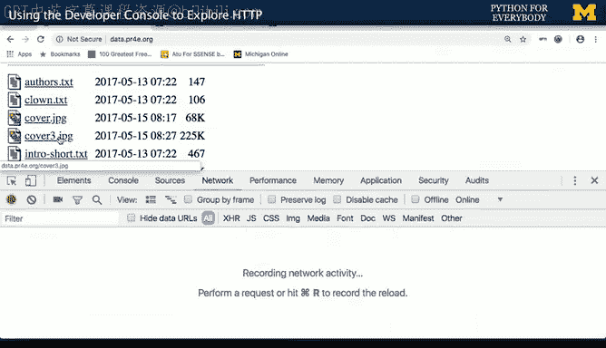
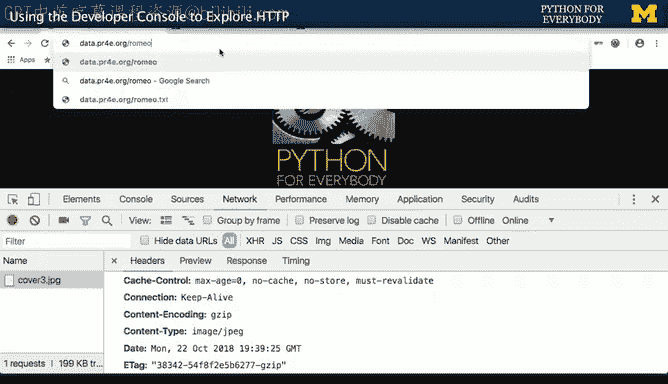
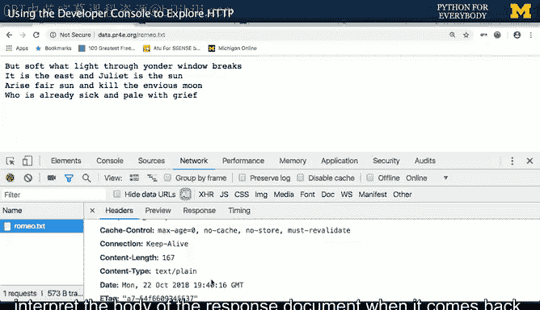

# 每个人的 Python 第三部分 14：使用开发者控制台探索HTTP 🔍

在本节课中，我们将学习如何使用浏览器中的开发者控制台来探索HTTP请求与响应的过程。虽然本课程主要使用Python程序与网络交互，但开发者控制台是一个强大的工具，可以帮助我们调试和理解网页的实际工作原理。我们将通过几个实例，观察请求头、响应头、状态码以及内容类型等关键信息。

## 基础请求响应周期

上一节我们介绍了网络通信的基本概念，本节中我们来看看如何使用开发者控制台观察一个简单的HTTP请求响应周期。

我们以访问 `page1.htm` 页面为例。在浏览器中打开该页面，然后打开开发者控制台的“网络”选项卡并刷新页面。控制台会显示请求响应周期中的所有请求。

`page1.htm` 是请求的文档。点击这个请求，可以看到详细信息。

以下是请求的主要组成部分：

*   **预览**：显示服务器返回的HTML内容被浏览器渲染后的样子。
*   **请求头**：浏览器发送给服务器的信息。例如，`Accept-Language: en` 表示浏览器优先接受英文内容。
*   **响应头**：服务器返回的元数据。关键信息包括：
    *   **状态码**：`200` 表示请求成功。
    *   **内容类型**：`Content-Type: text/html` 告诉浏览器将响应体解析为HTML。
*   **响应体**：服务器返回的实际数据，即HTML源代码。

通过这个例子，你可以清晰地看到浏览器如何发起一个GET请求，以及服务器如何用状态码200和HTML文档进行响应。

## URL参数与GET请求

理解了基础请求后，我们来看看如何通过URL传递参数。这在交互式网页应用中非常常见。

我们以一个猜数字游戏页面为例。在URL后添加 `?guess=12`，这表示向服务器传递一个名为“guess”、值为“12”的参数。

以下是关于URL参数的关键点：

*   参数以问号 `?` 开始，附加在基础URL之后。
*   格式为 `key=value`，多个参数用 `&` 连接，例如 `?guess=12&x=14&abc=22`。
*   在开发者控制台中，你可以在请求的“标头”部分看到完整的请求URL，其中包含了这些查询字符串参数。
*   服务器端程序会接收并解析这些参数，用于生成动态内容。

## HTTP状态码详解

状态码是服务器响应的重要组成部分，它用三位数字表明请求的结果。我们已经看到了表示成功的200，现在来了解其他常见的状态码。

以下是几个重要的HTTP状态码：

*   **200 OK**：请求成功，服务器返回了请求的资源。
*   **404 Not Found**：服务器无法找到请求的资源。当你访问一个不存在的URL时，就会收到此状态码。
*   **302 Found (重定向)**：服务器告诉客户端请求的资源暂时位于另一个URL。浏览器会自动向这个新URL发起新的GET请求。这在页面跳转中很常见。

通过观察不同请求的状态码，你可以快速判断请求是成功、失败还是发生了重定向。

## 内容类型（Content-Type）的作用

响应头中的 `Content-Type` 字段至关重要，它指示了响应体的媒体类型，告诉浏览器应该如何解析接收到的数据。

我们通过几个例子来说明：

1.  **图片文件**：请求一个 `.jpg` 图片时，响应头中包含 `Content-Type: image/jpeg`。浏览器据此将接收到的二进制数据渲染为图片。
2.  **纯文本文件**：请求一个 `.txt` 文件时，响应头中包含 `Content-Type: text/plain`。浏览器会将其作为纯文本显示。
3.  **HTML文档**：请求 `.htm` 文件时，响应头中包含 `Content-Type: text/html`。浏览器会解析其中的HTML标签并渲染页面。

简而言之，服务器先发送响应头（元数据），再发送响应体（数据）。浏览器根据头信息中的 `Content-Type` 来决定如何处理紧随其后的数据体。

## 总结

本节课中我们一起学习了如何使用浏览器的开发者控制台来探索HTTP协议。我们观察了基本的请求响应周期，了解了如何通过URL传递GET参数，认识了200、404、302等关键HTTP状态码的含义，并明白了 `Content-Type` 响应头在决定浏览器如何解析内容时的重要作用。

掌握使用开发者控制台分析网络请求的技能，无论是对于Web应用开发，还是在使用Python调用API进行数据抓取时进行调试，都极具价值。它让你能够直观地看到客户端与服务器之间的每一次交互，是理解和解决网络编程问题的重要工具。