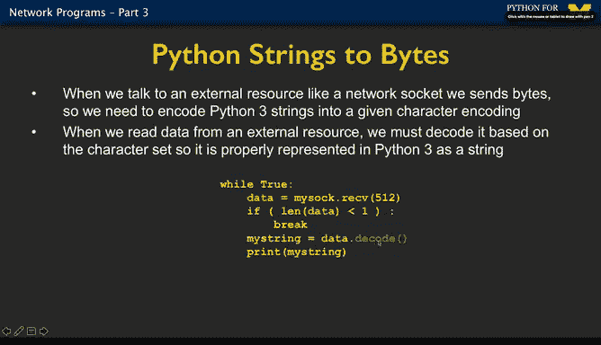
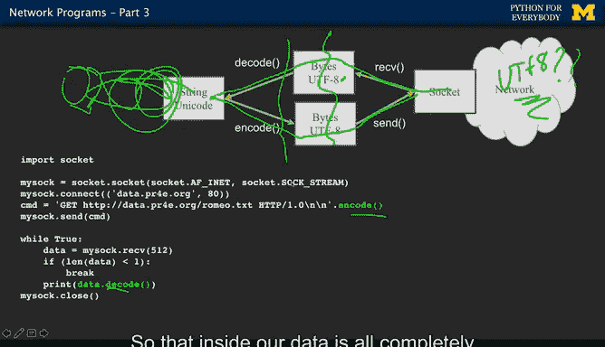

# 密歇根大学《给所有人的Python课》课程3：《使用Python访问Web数据》｜P19：Unicode字符与字符串 🧩


## 概述

在本节课中，我们将要学习计算机如何表示文本，特别是字符编码的概念。我们将从简单的ASCII编码开始，探讨其局限性，然后了解Unicode如何解决多语言字符表示的问题。最后，我们将学习在Python 3中如何处理来自网络等外部世界的字节数据，以及如何通过编码（encode）和解码（decode）操作在Unicode字符串和字节之间进行转换。

---

## 从“Hello World”说起

我们整个课程以打印“Hello World”开始。在早期计算时代，这很简单，因为当时基本只有一种字符集。甚至在1970年代，我们只有大写字母，没有小写字母。

计算机面临的问题是：它们实际上只理解数字。因此，我们需要建立字母与数字之间的映射关系。

---

## ASCII编码：早期的映射标准

历史上出现过多种映射方案，其中20世纪80年代最常见的是**ASCII**（美国信息交换标准代码）。它定义了数字与字母的对应关系。

例如，对于“Hello World”：
*   大写字母 `H` 对应的数字是 **72**。
*   小写字母 `e` 对应的数字是 **101**。
*   换行符 `\n` 对应的数字是 **10**。

计算机内部存储的是这些数字。ASCII编码只定义了128个字符，这意味着它无法容纳世界上所有的字符。

Python中有一个 `ord()` 函数，可以返回一个字符的**序数值**（即对应的数字）。

```python
print(ord('H'))  # 输出：72
print(ord('e'))  # 输出：101
print(ord('\n')) # 输出：10
```

在ASCII编码中，所有大写字母的序数值都小于小写字母。因此，`‘A’ < ‘a’` 成立。

早期，每个字符被存储在一个**字节**（8位）的内存中。所以，`ord()` 函数告诉我们一个简单ASCII字符的数值。

---

## 现实世界的挑战与Unicode的诞生

现实世界充满了各种字符（如中文、阿拉伯文等）。ASCII无法满足需求，于是出现了许多互不兼容的字符集（如拉丁字符集、阿拉伯字符集）。这导致日本电脑可能无法与美国或欧洲电脑交换文本数据。

为了解决这个问题，**Unicode** 应运而生。它是一个通用编码标准，旨在为全球数百万种字符提供唯一的数字代码，涵盖了数百种字符集。

---

## 字符在计算机中的表示：UTF编码

Unicode定义了字符的抽象代码点，但还需要具体的方法在计算机中表示这些代码点。这就是各种**UTF**（Unicode转换格式）编码的作用。

以下是几种常见的UTF编码：

*   **UTF-32**：使用固定的4个字节（32位）表示每个字符。虽然能表示所有字符，但非常浪费空间。
*   **UTF-16**：使用2个或4个字节（可变长度）表示字符，是UTF-32和UTF-8之间的折中方案。
*   **UTF-8**：使用1到4个字节的可变长度表示字符。它是目前**最佳实践**和**最常用**的编码。


UTF-8有一个关键优势：它与ASCII编码完全兼容。纯ASCII文本在UTF-8中的表示与在ASCII中完全相同。当需要表示其他字符时，UTF-8会使用特殊的标记字符来切换到多字节模式。这种设计使其在存储效率和兼容性上取得了最佳平衡，特别适合在系统间（如通过网络）传输数据。

---

## Python 2 与 Python 3 的字符串处理

字符串处理是Python 2到Python 3的一个重要变化。

在Python 2中，有两种字符串：
1.  常规字符串（`str`），本质上是字节串。
2.  Unicode字符串（`unicode`），需要前缀 `u` 来创建。
开发者经常需要在两者之间进行转换，这很麻烦。

在Python 3中，情况得到了简化：
1.  所有常规字符串（`str`）在内部都是**Unicode**。
2.  引入了一个新的 **`bytes`** 类型，用于表示原始的、未编码的字节序列。

这意味着在Python 3内部，你可以无忧地混合使用来自不同语言的字符。但当你与“外部世界”（如网络、文件、数据库）交换数据时，数据通常以字节形式存在，这时就需要处理编码问题。

---

## 编码与解码：连接内外世界的桥梁

与外部资源（如网络套接字）通信时，我们接收和发送的是**字节**（`bytes`）。为了在Python内部将其作为字符串（`str`）处理，我们需要进行转换。

以下是核心的两个操作：



*   **解码（Decode）**：将来自外部的**字节**（`bytes`）转换为Python内部的**Unicode字符串**（`str`）。我们使用 `.decode()` 方法。
*   **编码（Encode）**：将Python内部的**Unicode字符串**（`str`）转换为准备发送到外部的**字节**（`bytes`）。我们使用 `.encode()` 方法。

默认情况下，这两个方法都假设使用 **UTF-8** 编码，这涵盖了绝大多数情况。

```python
# 示例：网络通信中的编码与解码
# 假设我们从网络接收到字节数据
data_from_network = b'Hello World'  # 这是一个 bytes 对象

# 1. 解码：将字节转换为内部字符串 (bytes -> str)
internal_string = data_from_network.decode('utf-8') # 通常可省略 'utf-8'
print(internal_string)  # 输出：Hello World
print(type(internal_string)) # 输出：<class 'str'>

# 2. 编码：准备发送字符串到网络 (str -> bytes)
message_to_send = "你好，世界"
external_bytes = message_to_send.encode('utf-8') # 通常可省略 'utf-8'
print(external_bytes)  # 输出：b'\xe4\xbd\xa0\xe5\xa5\xbd\xef\xbc\x8c\xe4\xb8\x96\xe7\x95\x8c'
print(type(external_bytes)) # 输出：<class 'bytes'>
```

你可以这样理解整个过程：
1.  **发送数据时**：内部字符串 -> **编码** -> 字节 -> 发送到外部世界（网络）。
2.  **接收数据时**：从外部世界（网络）接收字节 -> **解码** -> 内部字符串。


编码和解码就像是程序内部（Unicode净土）与外部世界（各种编码的字节数据）之间的屏障。它们确保了程序内部数据的一致性，让我们可以无忧地混合处理来自不同来源的字符串。

---

## 总结




本节课中我们一起学习了：
1.  **字符编码的历史**：从简单的ASCII到支持全球字符的Unicode。
2.  **UTF-8的优势**：作为可变长编码，它与ASCII兼容且高效，是网络数据传输的**最佳实践**。
3.  **Python 3的字符串模型**：所有内部字符串（`str`）都是Unicode，与外部交换时使用 `bytes` 类型。
4.  **编码与解码的核心操作**：
    *   `.encode()`：将字符串（`str`）转换为字节（`bytes`），用于**输出**到外部。
    *   `.decode()`：将字节（`bytes`）转换为字符串（`str`），用于从外部**输入**。
5.  **核心思想**：在与网络、文件等外部系统交互时，记得在边界处进行编码和解码，从而在程序内部维持一个纯净、统一的Unicode工作环境。