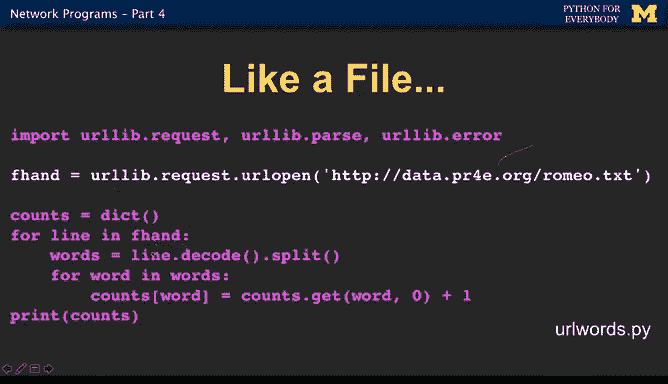
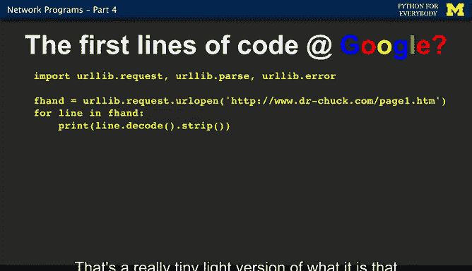

# 课程3：《使用Python访问Web数据》｜P20：使用urllib获取网页 🌐


## 概述

在本节课中，我们将学习如何使用Python的`urllib`库来获取网页内容。我们将看到，通过几行简单的代码，就能像处理本地文件一样读取互联网上的数据，这为后续处理和分析网络信息奠定了基础。

---

## 使用Socket与引入urllib

上一节我们介绍了如何使用底层的`socket`来获取网页。虽然只需大约10行代码，但在Python中，我们追求更简洁高效的方式，遵循“不要重复自己”（DRY）的原则。

因此，Python提供了一个名为`urllib`的库，它封装了`socket`的复杂操作，让我们能更轻松地完成网络请求。

## 使用urllib.request.urlopen

以下是使用`urllib`获取网页的核心步骤：

1.  **导入库**：首先从`urllib`库中导入`request`模块。
2.  **打开URL**：使用`urllib.request.urlopen()`函数，并传入一个URL字符串。
3.  **处理响应**：该函数会为我们自动解析URL、确定服务器、发送HTTP GET请求等。它返回一个类似于文件句柄的对象。
4.  **读取数据**：我们可以像读取普通文件一样，通过循环来逐行读取这个“网络文件”的内容。

核心代码示例如下：
```python
import urllib.request

fhand = urllib.request.urlopen('http://example.com/page.html')
for line in fhand:
    print(line.decode().strip())
```
在这段代码中，`urlopen`返回的句柄`fhand`允许我们迭代读取数据。需要注意的是，从网络读取的数据最初是字节数组（`bytes`），因此我们需要使用`.decode()`方法将其转换为字符串（`str`），之后才能使用诸如`.strip()`这样的字符串方法。


运行这段代码，它会获取指定网页的内容，并打印出数据部分（HTTP响应头默认被`urlopen`处理并隐藏了）。

## 处理网络数据：一个单词计数示例

现在，让我们看看如何将这种获取网络数据的能力应用到实际任务中，比如统计网页中的单词频率。



以下是处理流程：
1.  我们使用`urlopen`打开一个URL，就像打开一个文件。
2.  创建一个空字典用于计数。
3.  遍历返回的句柄中的每一行。
4.  对每一行字节数据进行解码，得到字符串。
5.  将字符串按空格分割成单词列表。
6.  遍历单词列表，更新字典中的计数。

关键代码部分如下：
```python
for line in fhand:
    words = line.decode().split()
    for word in words:
        counts[word] = counts.get(word, 0) + 1
```
与处理本地文件的代码相比，唯一的重大变化就是增加了`.decode()`这一步。一旦数据被解码为字符串，后续的所有字符串操作（如`.split()`）就都和之前一样了。这充分展示了使用Python处理网络数据的便捷性。

## 从获取到解析：构建网络爬虫的雏形

我们不仅可以读取文本文件，还可以读取HTML文件。通过`urlopen`获取HTML内容后，我们可以编写循环来分析它。

例如，我们可以搜索HTML中的链接（通常由类似`href="http://..."`的标签表示）。我们可以使用字符串方法（如`.find()`）或更强大的工具（如正则表达式）来定位并提取这些链接。

想象一下这个流程：
1.  程序抓取一个初始网页。
2.  分析其HTML，找出页面中的所有链接。
3.  依次访问每个链接，抓取新的页面。
4.  重复这个过程。

通过这种方式，你就编写了一个简单的网络爬虫。可以说，一个功能完整的搜索引擎爬虫，其核心逻辑在原理上就是从这个简单的模式扩展而来的。

## 关于HTML解析的预告


直接使用字符串方法或正则表达式来解析HTML有时会很棘手，因为HTML的格式可能不够规整和一致。

在接下来的课程中，我们将探讨更高效、更健壮的HTML解析技术，专门用于从复杂的HTML文档中提取所需信息。

---




## 总结

本节课我们一起学习了如何使用Python的`urllib`库获取网页数据。我们了解到：
*   `urllib.request.urlopen()`函数能将网络资源像本地文件一样打开。
*   从网络获取的数据需要先解码（`.decode()`）才能作为字符串处理。
*   掌握了这个方法后，我们就能轻松地读取网页内容、进行数据分析（如单词计数），甚至初步探索如何构建一个网络爬虫来收集更多信息。
这为我们在互联网的海洋中获取和利用数据打开了大门。