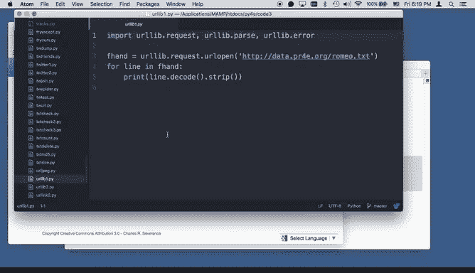
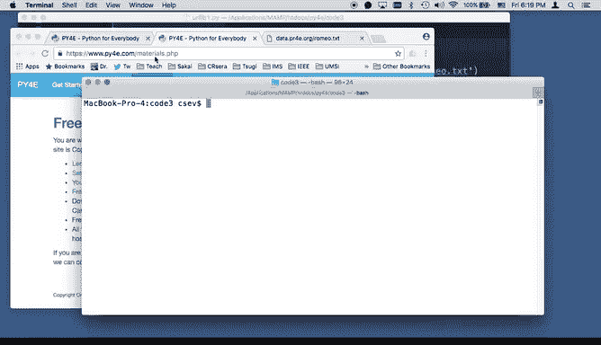
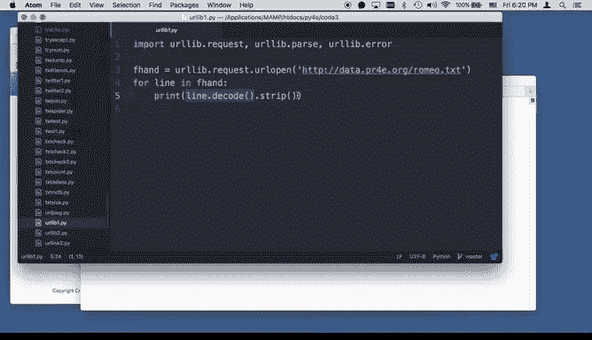
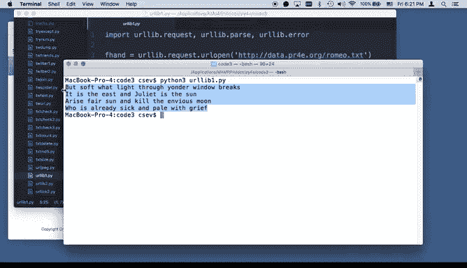
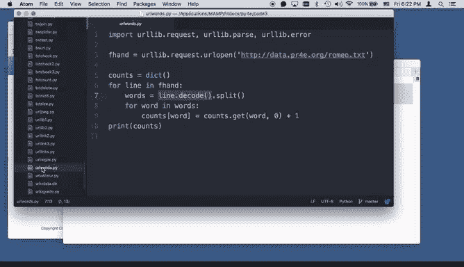
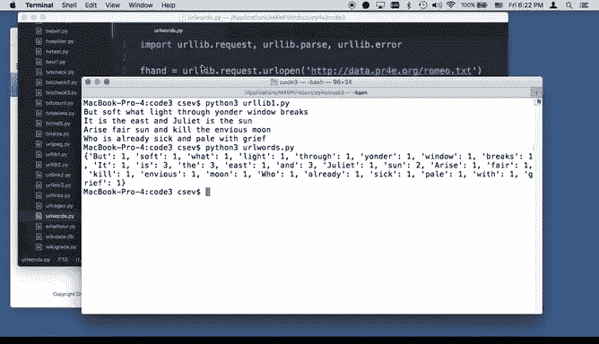
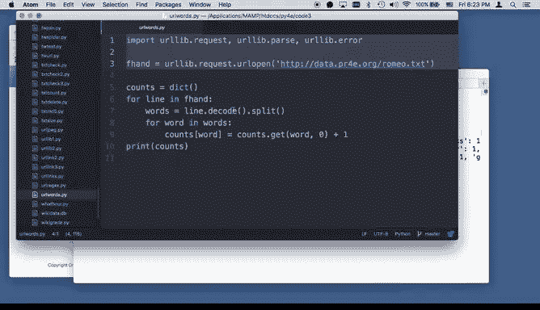

# 密歇根大学《给所有人的Python课》课程3：《使用Python访问Web数据》｜P21：21_04_03_实战示例_使用urllib 📡

在本节课中，我们将学习如何使用Python内置的`urllib`库来访问网络数据。`urllib`库简化了底层的套接字通信，使我们能够像处理本地文件一样轻松地读取网页内容。

## 概述

上一节我们介绍了使用底层`socket`库进行网络通信。本节中我们来看看如何使用更高级的`urllib`库来完成同样的任务，代码将变得更加简洁和易于理解。

## 导入urllib库

首先，我们需要导入`urllib`库。与导入`socket`不同，我们使用以下语句：

```python
import urllib.request
```





## 打开并读取网页

使用`urllib`打开一个网页非常简单。我们创建一个句柄，调用`urllib.request.urlopen()`函数并传入一个URL字符串即可。我们无需像使用`socket`时那样手动编码或发送GET命令。

```python
fhand = urllib.request.urlopen('http://data.pr4e.org/romeo.txt')
```



## 逐行读取内容

读取内容时，我们不再需要使用底层的读写代码。我们可以直接使用一个`for`循环来逐行读取文本。



```python
for line in fhand:
    print(line.decode().strip())
```

循环中的每一行最初以字节数组的形式返回，因此我们需要使用`.decode()`方法将其解码为字符串。之后，我们可以使用`.strip()`方法去除多余的空白字符。这是一个非常简单的读取过程。

## 处理网页内容：统计词频

我们也可以使用`urllib`来演示一些有趣的应用，例如统计网页文本中的词频。

以下是实现此功能的代码步骤：



1.  打开目标URL。
2.  创建一个空字典用于存储词频。
3.  循环遍历每一行文本。
4.  解码每一行并将其拆分成单词。
5.  遍历每个单词并更新字典中的计数。

```python
fhand = urllib.request.urlopen('http://data.pr4e.org/romeo.txt')
counts = {}
for line in fhand:
    words = line.decode().split()
    for word in words:
        counts[word] = counts.get(word, 0) + 1
print(counts)
```

这段代码除了在最初获取行时需要解码之外，与我们之前编写的用于统计文件中词频的代码完全相同。`urllib`使得在Python中处理URL变得非常像处理文件。

## 总结





本节课中我们一起学习了`urllib`库的基本用法。我们了解到，`urllib`在底层封装了`socket`通信，但提供了更简洁、更高级的接口。核心在于，通过`urllib.request.urlopen()`打开URL后，返回的对象可以像文件一样被迭代读取，这极大地简化了从网络获取和处理数据的过程。