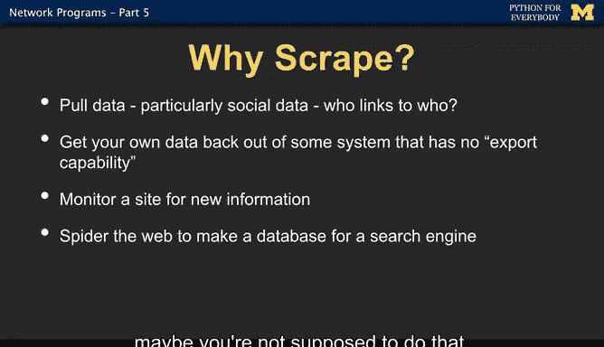
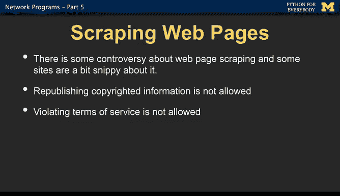
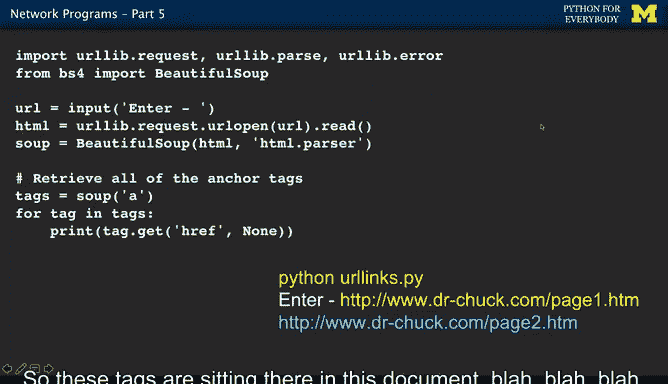
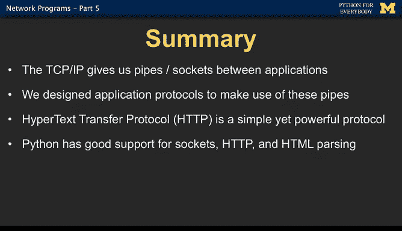

# 3：《使用Python访问Web数据》｜第22讲：网页解析基础 🕸️


## 概述

在本节课中，我们将要学习网络爬虫的基本概念，并介绍如何使用一个名为Beautiful Soup的Python库来解析HTML网页，从而轻松地从网页中提取链接信息。

---

## 什么是网络爬虫？

上一节我们介绍了如何使用HTTP协议获取网页数据。本节中我们来看看如何让Python程序模拟浏览器行为，自动获取并分析网页内容。

网络爬虫（Web Scraping）是指编写一个Python程序，让它伪装成浏览器，向服务器发送请求，获取网页，然后分析网页内容并提取信息。这个过程可能用于搜索、收集更多链接，或者进一步获取其他页面。

我们通常将这种行为称为“网络蜘蛛”（Spidering）或“网络爬虫”（Crawling），因为它像蜘蛛网一样从一个点扩散出去，或者像爬虫一样从一个页面“爬”到另一个页面，最终可能遍历整个或大部分网络。

---



## 为什么要使用网络爬虫？




以下是使用网络爬虫的一些常见原因：

*   获取无法通过其他方式获得的数据。
*   备份自己发布在即将关闭的网站上的内容（例如博客或维基页面）。
*   编写定期运行的程序，检查特定内容是否发生变化。
*   构建一个简易的搜索引擎。

**重要提示**：进行网络爬虫时必须非常谨慎。许多网站拥有版权保护的材料和服务条款，未经授权爬取其数据（例如复制竞争对手的库存或亚马逊的商品信息）可能不合法，网站可能会屏蔽你的网络、计算机或账户。建议只对明确允许此类操作的网站（如Wikipedia）进行爬取。

---

## 解析HTML的挑战

网络爬虫最大的难题在于解析返回的HTML代码。正如之前提到的，HTML的结构并不规整。

浏览器在渲染HTML时具有很强的容错性，能够自动修正许多语法错误。因此，互联网上存在大量包含语法错误的HTML，但用户通常察觉不到。

如果你尝试用正则表达式、字符串查找（`find`）或分割（`split`）等基础方法来解析HTML，最初可能对少数页面有效，但随着处理页面增多，程序很容易因为各种意外的格式变体（例如意想不到的换行符）而崩溃。


修复这些解析问题非常繁琐，因为HTML的变体实在太多。幸运的是，已经有人为我们解决了这个难题。

---

## 引入Beautiful Soup库

为了高效、稳定地解析混乱的HTML，我们将使用一个名为**Beautiful Soup**的第三方库。这个库的名称诙谐地反映了处理网络HTML的“一团糟”现状。

它能够智能地解析HTML，容忍各种错误，并将文档内容转换成一个结构清晰、易于查询的对象树。使用它，你就选择了“捷径”。

### 安装Beautiful Soup

首先，你需要安装Beautiful Soup。有两种主要方式：

1.  **全局安装**：按照Beautiful Soup官方网站的说明进行安装，这样所有Python程序都能使用它。
2.  **本地安装**：如果你在使用无法安装软件的公共计算机（如校园电脑），可以将库文件放在项目文件夹内。具体方法是：下载`bs4.zip`文件，解压后得到一个名为`bs4`的文件夹，将这个文件夹放在你的Python脚本所在的目录下。这样，程序就能从本地导入该库了。

确保安装成功的方法是运行导入语句 `from bs4 import BeautifulSoup`，如果不报错，则说明安装正确。

---

## 使用Beautiful Soup解析网页并提取链接

假设已经成功安装了Beautiful Soup，现在我们来学习如何用它读取网络数据并提取链接。

我们将导入必要的库，请求一个URL，读取其全部内容，然后交给Beautiful Soup进行解析。

```python
import urllib.request, urllib.parse, urllib.error
from bs4 import BeautifulSoup

url = input('Enter - ') # 例如输入：http://www.dr-chuck.com/page1.htm
html = urllib.request.urlopen(url).read()
soup = BeautifulSoup(html, 'html.parser')
```

代码解释：
*   `urllib.request.urlopen(url).read()` 会打开URL并一次性读取所有内容，返回一个包含整个网页HTML的大字符串。
*   `BeautifulSoup(html, 'html.parser')` 创建了一个Beautiful Soup解析对象（这里命名为`soup`）。它使用指定的解析器（这里是`'html.parser'`）清理和结构化混乱的HTML。

解析完成后，`soup`对象就包含了网页的整洁树形结构。我们可以向它提问来获取信息。



一个最常见的操作是提取网页中的所有超链接（即`<a>`标签）。以下是具体方法：

```python
tags = soup('a')
for tag in tags:
    print(tag.get('href', None))
```

代码解释：
*   `soup('a')` 会查找文档中的所有锚点（`<a>`）标签，并以列表形式返回。
*   通过循环遍历这个列表，每个`tag`对象代表一个`<a>`标签。
*   `tag.get('href', None)` 的作用类似于字典操作，它获取该标签的`href`属性值，即链接地址。如果该标签没有`href`属性，则返回`None`。

运行这段代码，你将能够轻松地打印出指定网页上的所有链接，无需编写复杂的正则表达式或进行繁琐的字符串处理。

---


## 本章回顾与总结

本节课中我们一起学习了网络数据访问的完整链条。

让我们回顾一下本章的旅程：我们最初从最底层开始，学习了计算机如何使用**套接字（Sockets）** 进行“通话”——连接到特定主机和端口，并通过双向连接发送和接收数据。



接着，我们学习了必须遵循**应用层协议（如HTTP）**，以规定数据发送的格式、顺序和解释方式（例如，头信息、空行、正文数据）。

然后，我们使用 **`urllib`** 库极大地简化了这一过程，用一两行代码就能获取网页数据。

最后，针对HTML解析这一复杂任务，我们引入了 **Beautiful Soup** 库。它能够优雅地处理混乱的HTML，让我们用寥寥数行代码就完成网络爬虫中最困难的部分。


这正是许多人喜爱Python的原因之一：你可能会想“我要实现一个网络爬虫”，而在短短30分钟后，一个基础的爬虫就已经开始运行了。Python对HTML、HTTP和套接字的强大支持，使其成为处理网络任务的绝佳选择。