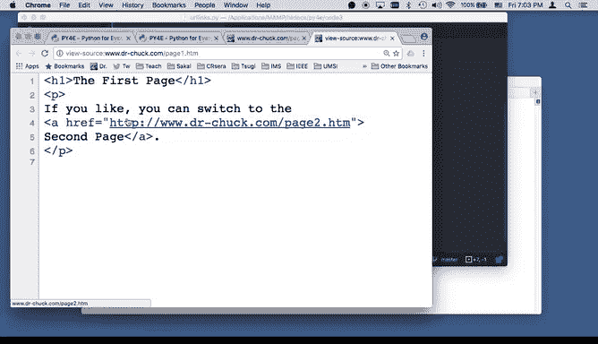
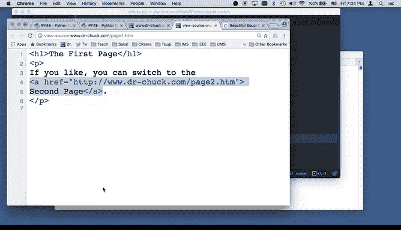
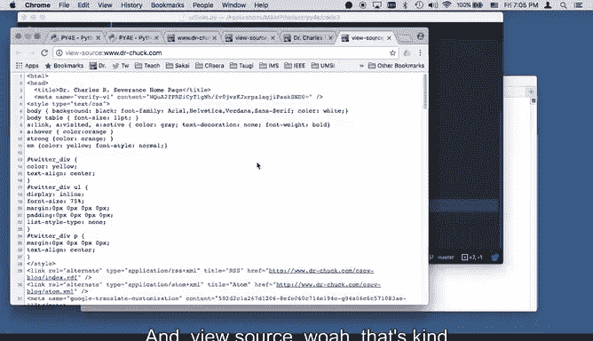
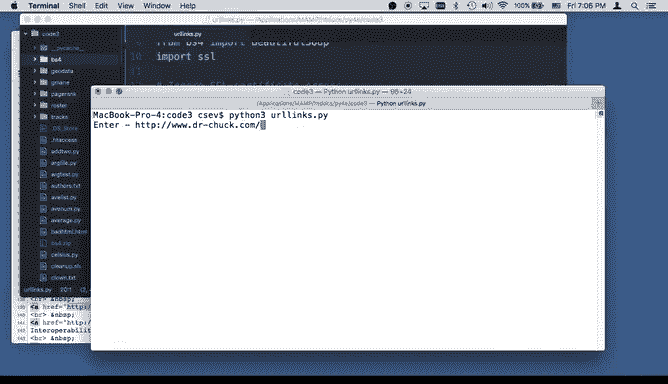
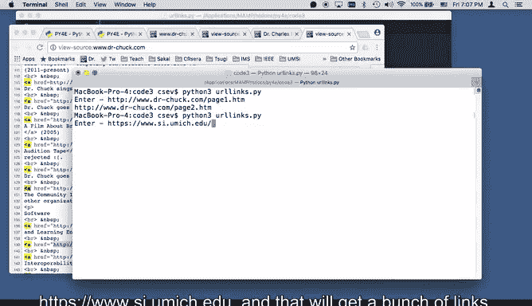

# 课程3：《使用Python访问Web数据》｜P23：实战示例_BeautifulSoup 🧑‍💻

## 概述

在本节课中，我们将学习如何使用BeautifulSoup库来解析HTML网页并提取其中的链接。我们将通过一个具体的代码示例，演示如何从网页中获取所有锚点标签（`<a>`标签）及其`href`属性。

---

## 准备工作

在运行示例代码之前，需要先安装BeautifulSoup库。

以下是两种安装方法：

1.  使用Python的包管理工具全局安装BeautifulSoup，适用于经常使用该库且拥有计算机管理权限的用户。
2.  下载BeautifulSoup 4的ZIP文件，解压后将其中的`BS4`文件夹放在与你的Python脚本相同的目录下。这种方法适合没有计算机管理权限或希望保持环境简单的用户。

示例代码通过以下语句导入BeautifulSoup：
```python
from bs4 import BeautifulSoup
```
当执行此导入语句时，Python会首先在全局安装的库中查找BeautifulSoup。如果未找到，则会检查当前脚本所在目录下的`BS4`文件夹。因此，将解压后的`BS4`文件夹与脚本放在一起是使其工作的有效方法。

---

## 处理HTTPS与SSL证书

上一节我们介绍了如何准备BeautifulSoup环境。本节中我们来看看如何处理可能遇到的HTTPS网站SSL证书验证问题。

如果目标网站使用HTTPS协议，Python的`urllib`在默认情况下可能会因SSL证书验证错误而中断请求。为了避免这个问题，我们需要添加一些代码来忽略SSL证书错误。

以下是处理此问题的代码片段：
```python
import ssl

# 忽略SSL证书错误
ctx = ssl.create_default_context()
ctx.check_hostname = False
ctx.verify_mode = ssl.CERT_NONE
```
之后，在调用`urlopen`函数时，需要传入一个`context`参数：
```python
html = urlopen(url, context=ctx).read()
```
这样设置后，程序就能正常访问HTTPS网站了。如果你只访问HTTP网站，可以省略这部分代码。

---


## 解析HTML并提取链接

现在，让我们进入核心部分：使用BeautifulSoup解析HTML并提取链接。

首先，我们使用`urllib`获取网页的全部HTML内容，并将其作为一个完整的字符串读入。然后，将这个“原始”的HTML字符串传递给BeautifulSoup进行解析。




关键代码如下：
```python
html = urlopen(url, context=ctx).read()
soup = BeautifulSoup(html, 'html.parser')
```
`soup`对象是BeautifulSoup对原始HTML进行智能解析和清理后的结果。它能自动处理HTML中各种不规范的情况，例如标签未正确闭合、属性缺少引号等，这比使用正则表达式或字符串分割方法要可靠和简单得多。

接下来，我们需要从`soup`对象中提取所有锚点标签（即`<a>`标签）。

以下是提取所有锚点标签的代码：
```python
tags = soup('a')
```
这行代码会返回一个包含该网页中所有`<a>`标签的列表。每个标签对象都包含了其属性（如`href`）和内部的文本内容。

---

## 遍历并输出链接

上一节我们获取了所有的锚点标签列表。本节中我们来看看如何遍历这个列表并提取出我们需要的链接地址。

我们将使用一个`for`循环来遍历`tags`列表中的每一个标签。




在循环中，我们主要关注每个`<a>`标签的`href`属性，它包含了链接的目标地址。



以下是遍历并打印所有链接的代码：
```python
for tag in tags:
    print(tag.get('href', None))
```
这段代码会依次访问每个标签，并使用`.get()`方法安全地获取其`href`属性的值。如果某个标签没有`href`属性，则返回`None`。

---

## 运行示例

让我们运行完整的示例脚本，看看实际效果。

首先，我们尝试一个简单的HTTP页面：
```
输入URL: http://www.drchuck.com/page1.htm
```
程序会输出该页面上找到的所有链接。



接着，我们尝试一个HTTPS页面，例如密歇根大学的官网：
```
输入URL: https://www.umich.edu
```
由于我们在代码中处理了SSL证书问题，因此程序能够成功获取并解析这个HTTPS页面，输出其中包含的大量链接。

通过对比，你可以看到BeautifulSoup如何高效地从结构复杂或略有瑕疵的HTML中准确地提取出链接信息。

---

## 总结



本节课中我们一起学习了使用BeautifulSoup库进行网页数据抓取的核心步骤。

我们首先介绍了安装BeautifulSoup的两种方式。然后，讲解了如何处理HTTPS网站的SSL证书验证问题。接着，我们深入探讨了如何使用BeautifulSoup解析HTML，并通过`soup('a')`方法提取所有锚点标签。最后，通过循环遍历这些标签，我们成功地获取并输出了每个链接的`href`属性值。

BeautifulSoup的强大之处在于它能将混乱的HTML文档转化为一个结构清晰、易于操作的对象，使我们能够轻松地定位和提取所需的数据，而无需担心HTML源码本身的复杂性。