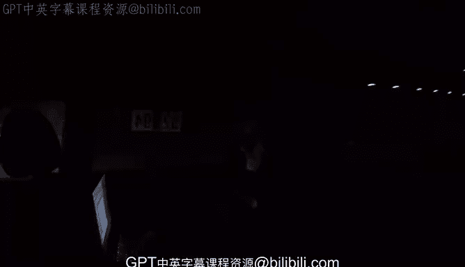

# 密歇根大学《给所有人的Python课》课程3：《使用Python访问Web数据》｜P24：特别办公时间 - 蒙特利尔站 🌍

在本节课中，我们将回顾一次特别的在线办公时间活动，地点位于蒙特利尔。活动中，来自不同背景的学习者分享了他们学习Python的经历与感受。

---

掌握编程可以做很多事情。数学和计算机科学专业的人会告诉你，编程大部分是数学，并且你需要学习非常难的数学课程。然而，**要成为一名计算机科学家，你并不必须精通数学；要成为一名技术专家，同样如此**。

在许多高中课程中，你可以将编程与物理结合起来。我同意这个观点。我并非主张要求每个高中生仅仅因为身处我的领域，就必须修读我所有的12门课程。

因此，他们只选修两到三门课程是可以接受的。他们可能仍然会上一门化学课，这门课某种程度上取代了部分化学内容，并使其更温和。

让我们来谈谈大局。关键在于思考：**向13至18岁的学生教授知识，如何才能让他们真正掌握，而不是仅仅作为筛选机制**。

以下是参与本次蒙特利尔办公时间的部分学习者自我介绍：

*   “嗨，我是Katya，我修了这两门课，它们非常棒，谢谢您的教学。”
*   “你好，我叫Car Hans，是一名网络架构师，正在学习更多知识。”
*   “我是Seravvy，在麦吉尔大学攻读博士学位，计划从事PC相关工作。因为会用到相关软件，所以我准备学习Python来使用随机评估工具。”
*   “我遇到过一位来自麦吉尔大学、我见过的最聪明的人——计算机科学家Ti。”
*   “我是Bni，我正在享受Python课程。”
*   “嗨，我是Jamatist，是一名视觉特效艺术家。感谢Dr. Chuck让我通过学习Python成为一名更好的艺术家。”
*   “嗨，我是Mcwell，我最近在蒙特利尔成立了一家科技公司。Python课程非常棒，我打算夏天再学一遍。非常感谢。”
*   “我是And，我很高兴向Chuck学习Python，它非常有趣且简单。谢谢。”
*   “嗨，我是Sergio，是Icare的航空分析师。Python为我完全打开了一些新的大门，感觉太棒了。谢谢你。”
*   “嗨，我叫Tim Mccherin，我正在修读信息学的Python课程，感谢Chuck带来的这段伟大经历。”
*   “嗨，我叫Olga，这是我与Cora的第一门课，我真的很喜欢。我希望它能帮我找到工作。祝贺你！”
*   “嗨，我是Steve，我正在同时学习互联网历史和Python课程，两门课都让我非常愉快。”
*   “嗨，我是Nancy，我代表‘编程女性’洛杉矶分会感谢您，Dr. Chuck。”
*   “我是Flor，我正在学习Python。这是我认真学习的第二门（实际上也是第一门）语言，我真的很喜欢它，也非常欣赏您设置课程的方式，这非常有帮助。很高兴能上您的课，谢谢。”
*   “嗨，我是Joanna，我正在上Python课程，这是我的第一门编程语言，体验很棒。”
*   “嗨，我是Ramona，我正在学习互联网历史课程，并计划夏天学习Python课程。”
*   “嗨，我叫Pierre，我已经完成了Python课程，并希望继续学习其他Coursera课程。”
*   “我叫Matt，是一名IT管理员。我已经学习Python几年了，它对我所做的每件事都很有帮助。谢谢Dr. Chuck。”
*   “嗨，我叫Saib，我正在和Dr. Chuck学习Python。”
*   “嗨，我是Dominda，是麦吉尔大学的学生，一名初学者，所以今天的活动让我很感兴趣。”

---

本次活动参与人数众多，以至于管理人员不得不请我们离开大厅，我们被迫转移到这个需要购买饮品的房间。

本次蒙特利尔特别办公时间至此圆满结束，干杯！