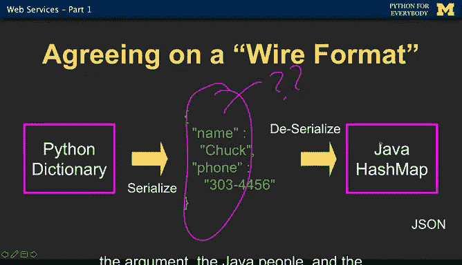

# 每个人的 Python 第三部分 27：网络数据格式与序列化 📡


在本节课中，我们将要学习网络服务的基础概念，特别是数据如何在互联网上的不同程序之间进行交换。我们将重点探讨两种核心的数据交换格式：XML和JSON，并理解序列化与反序列化的过程。

---

## 网络服务与数据交换

上一节我们介绍了HTTP请求-响应循环。本节中我们来看看如何在此基础上，通过更规范化的方式——即网络服务或API——来交换数据。

最初的请求-响应循环是为传输文档和图像设计的，但后来被用于传输数据。我们发展出了一些方法，让程序（而非人类）来生成和消费这些数据。

基本思想是：一个程序（例如Python程序）中拥有数据（可能是一个字典结构），我们需要通过网络将这些数据发送给另一个程序（可能使用Java等语言）。网络本身不识别Python或Java的特定数据结构，它只传输原始数据。因此，我们需要一种双方都同意的中间格式来“承载”数据。

## 序列化与反序列化

将程序内部的数据结构转换为可以在网络上传输的通用格式的过程，称为**序列化**。反之，在接收端将通用格式的数据转换回其内部数据结构的过程，称为**反序列化**。

这个过程可以概括为以下步骤：
1.  **序列化**：将内部数据结构（如Python字典）转换为约定的网络格式（字符串）。
2.  **传输**：通过网络发送序列化后的数据。
3.  **反序列化**：在接收端，将收到的数据字符串转换为其程序语言中的内部数据结构（如Java的HashMap）。

## 主要的数据交换格式

我们将讨论两种最主要的序列化格式：XML和JSON。

以下是这两种格式的简要对比：
*   **XML**：出现较早，格式更复杂、更严谨，看起来类似HTML，使用标签（如 `<tag>`）来标记数据。
*   **JSON**：更现代，格式更轻量，语法与JavaScript对象表示法类似，易于人阅读和机器解析。

## 一个简单的例子

假设我们有一个Python字典，表示一个人的信息，我们需要将其发送出去。

在Python中，数据可能这样表示：
```python
person = {"name": "Chuck", "phone": "303-4456"}
```
序列化时，我们可能将其转换为JSON格式的字符串：
```json
{"name": "Chuck", "phone": "303-4456"}
```
或者转换为XML格式的字符串：
```xml
<person>
  <name>Chuck</name>
  <phone>303-4456</phone>
</person>
```
这个字符串通过网络传输后，接收端的程序（无论是什么语言）会将其反序列化，还原为自己可用的数据结构。

---



本节课中我们一起学习了网络数据交换的核心概念。我们明白了程序间不能直接发送其内部数据结构，而必须通过序列化为XML或JSON等通用格式来实现通信。接下来，我们将深入探讨XML格式的具体细节。