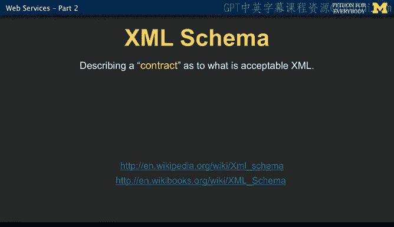

# 课程3：《使用Python访问Web数据》｜第28讲：可扩展标记语言XML 📖

在本节课中，我们将学习可扩展标记语言（XML）的基本概念。XML是一种用于存储和传输结构化数据的标记语言。我们将了解XML的语法规则、元素结构以及它在数据交换中的作用。通过本课，你将掌握XML的核心组成部分，并理解如何将其应用于实际编程中。

---

## XML基础概念

XML被称为可扩展标记语言。任何序列化格式都包含特殊字符和规则，这些规则定义了如何从内部结构形成序列化文档。XML的规则使其在HTML流行的同时变得流行，可以说XML影响了HTML。XML使用小于号和大于号作为标记信息的字符，其工作方式与HTML类似。

上一节我们介绍了XML的基本概念，本节中我们来看看XML的具体语法结构。

XML包含开始标签和结束标签，这些标签用于界定数据块。例如，`<people>`是一个标签，`<person>`是另一个标签，`</person>`是结束标签，`</name>`是结束标签。可以将其视为简单元素。

这些被称为元素或节点。我们稍后将介绍几种可视化这些元素的方法。有一种元素仅包含文本，这是最简单的部分，称为简单元素。另一种元素如`<person>`，实际上包含子节点。简单元素是这些，而复杂元素如`<person>`和`<people>`则嵌套在一起。缩进仅用于使XML看起来更美观，XML本身并不关心额外的空格，但这有助于我们理解其结构。

XML的主要目的是共享结构化数据。它是SGML的简化子集，SGML是XML和HTML的前身。SGML较为复杂，因此XML可以视为SGML的简化版本。

以下是XML的基础规则：

*   开始标签和结束标签：开始标签如`<tag>`，结束标签如`</tag>`。结束标签包含斜杠。
*   文本内容：标签之间的内容称为文本节点。
*   属性：属性始终位于开始标签上，例如`<phone type="intl">`。属性是键值对，使用双引号。

XML与HTML的关键区别在于，XML允许自定义标签。在HTML中，我们使用预定义的标签如`<h1>`或`<a>`，而在XML中，两个交换数据的应用程序可以约定使用`<person>`和`</person>`作为标签。但必须遵守开始标签和结束标签的规则。

属性位于开始标签上，用于序列化。序列化是将内部结构从编程环境发送到网络的过程，反序列化是在目标计算机上接收并转换回内部结构的过程。

---

## XML的树形结构与路径

我们可以通过几种方式查看XML结构，最常见的是树形结构。节点这个词来源于树，每个元素就像一个节点，是连接点。我们可以将外部文档视为树的顶部节点，这实际上是一棵倒置的树。

树的顶部是A节点，它有两个子节点：B节点和C节点。我们将标签之间的文本建模为子节点，因此文本是B节点的子节点。B节点包含所有内容，文本是其子节点。C节点有两个子节点：D和E。D有一个子节点Y，E有一个子节点Z。这些是简单和复杂元素，元素内部是文本。我们将文本建模为节点的子节点，属性则建模为不同的子节点。

例如，如果B节点有一个属性`w="5"`，那么B节点包含文本区域和属性。B节点可以有多个属性子节点，但只有一个文本子节点。当我们开始用编程语言处理XML时，理解节点的文本和属性的区别非常重要。X是节点B的文本，而节点B包含文本、属性等所有内容。

另一种理解XML的方式是通过路径解析。我们可以绘制树形结构，然后沿着路径向下查找数据。例如，X可以视为位于路径`/A/B`的数据。从顶部开始，向下到A，再到B，找到X。同样，路径`/A/C/D`找到Y，路径`/A/C/E`找到Z。这类似于计算机上的文件夹结构，A文件夹下有B和C子文件夹，C文件夹下有D和E子文件夹。

---

## XML模式（Schema）

接下来我们将讨论XML模式（Schema），这是一个重要的方面。当两个应用程序交换数据时，如果数据消费者出现问题，我们需要确定是数据错误还是消费者错误。XML模式为我们提供了这种验证机制。

---

## 总结

本节课中我们一起学习了可扩展标记语言（XML）的基础知识。我们了解了XML的语法结构，包括开始标签、结束标签、文本内容和属性。我们还探讨了XML的树形结构和路径解析方法，以及XML模式在数据验证中的作用。掌握这些概念将帮助你在实际编程中更好地处理结构化数据。