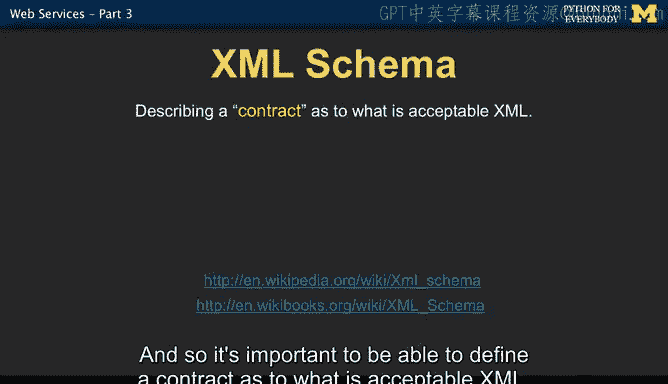
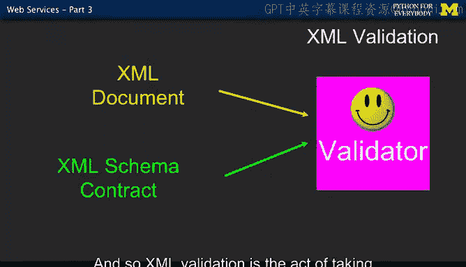
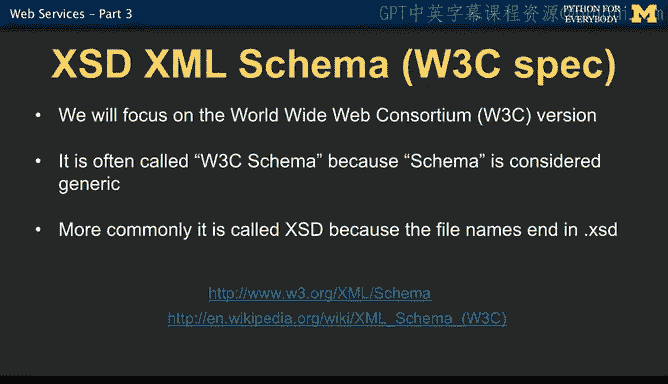
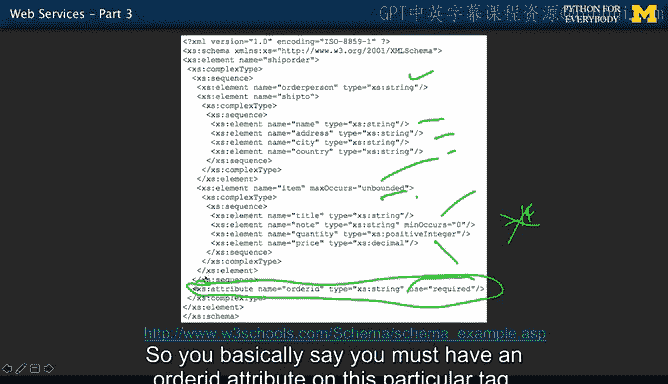

# 密歇根大学《给所有人的Python课》课程3：《使用Python访问Web数据》｜P29：XML模式 📝


## 概述

在本节课中，我们将要学习XML模式（XML Schema）的概念。当两个应用程序需要交换数据时，它们必须就数据的格式达成一致。XML模式就是一种用于定义“可接受的XML数据格式”的“合同”，它独立于任何应用程序，确保数据交换的双方都能验证数据的正确性。

---



## 什么是XML模式？ 🤔

上一节我们介绍了XML的基本结构，本节中我们来看看如何确保XML数据的格式符合预期。

当两个协作的应用程序相互发送数据时，它们可能对数据是否正确存在分歧。一方或另一方可能会因为数据格式问题而“崩溃”。这时，明确“谁的责任”就很重要。因此，能够定义一份关于什么是可接受XML的“合同”至关重要。这份合同必须独立于任何应用程序，不能简单地说“让我的程序不崩溃的XML就是正确的XML”。



XML模式的作用就是在数据交换的时刻定义这份合同。它是一种在任何程序之外建立规范，并可以独立进行检查的方式。这样，发送方可以说“我发送了正确的东西”，接收方可以说“我接收到了正确（或错误）的东西”。你只需查看一个文档，就能判断它是否通过验证。

**验证**不是传输数据或反序列化数据的行为，而是**验证数据格式是否正确**的行为。

---

## XML模式示例 📄

现在，让我们通过一个具体的例子来理解XML模式是如何工作的。

以下是一段XML数据：

```xml
<person>
  <lastname>Severance</lastname>
  <age>17</age>
  <dateborn>2003-04-05</dateborn>
</person>
```

与之对应的XML模式（合同）本身也是一个XML文档，它可能看起来像这样：



```xml
<xs:element name="person">
  <xs:complexType>
    <xs:sequence>
      <xs:element name="lastname" type="xs:string"/>
      <xs:element name="age" type="xs:integer"/>
      <xs:element name="dateborn" type="xs:date"/>
    </xs:sequence>
  </xs:complexType>
</xs:element>
```

这个合同定义了：
*   最外层的标签必须是 `person`。
*   在 `person` 内部，必须按顺序包含三个子标签。
*   `lastname` 标签的内容必须是字符串（`xs:string`）。
*   `age` 标签的内容必须是整数（`xs:integer`）。
*   `dateborn` 标签的内容必须是日期（`xs:date`）。

我们可以逐一检查XML文档：外层是 `person`，里面有 `lastname`（字符串）、`age`（数字）、`dateborn`（日期格式）。所有检查都通过，因此这份XML符合合同规定。

---

## XML模式语言：XSD 🔧

在早期，存在多种模式语言。如今你最可能遇到的是由万维网联盟（W3C）制定的 **XML Schema**，通常被称为 **XSD**。

以下是关于XSD的一些基本概念：

*   XML数据文件通常使用 `.xml` 后缀。
*   XML模式文件通常使用 `.xsd` 后缀。
*   我们将主要讨论XSD。

### XSD 核心概念

以下是XSD中一些基本的标签和概念：

1.  **复杂类型与简单类型**：能包含子元素的元素称为**复杂类型**（`complexType`），不能包含子元素的称为**简单类型**。
2.  **序列**：`xs:sequence` 标签用于规定子元素必须按特定顺序出现。
3.  **出现次数约束**：使用 `minOccurs` 和 `maxOccurs` 属性来规定一个元素可以出现的最小和最大次数。
    *   例如：`<xs:element name="fullname" minOccurs="1" maxOccurs="1"/>` 表示必须有且仅有一个 `fullname` 元素。
    *   例如：`<xs:element name="nickname" minOccurs="0" maxOccurs="10"/>` 表示 `nickname` 元素可以出现0到10次。
4.  **数据类型**：XSD支持多种数据类型。
    *   `xs:string`：字符串。
    *   `xs:integer`：整数。
    *   `xs:decimal`：十进制数（浮点数）。
    *   `xs:date`：日期。
    *   `xs:dateTime`：日期和时间。

### 关于日期和时间的格式

在互联网上，通常采用一种便于计算机排序的固定日期格式：`YYYY-MM-DD`（例如：2001-01-01）。这种格式将年、月、日按重要性降序排列，并用零填充，使得字符串可以直接按字典顺序排序。

对于日期时间，格式为：`YYYY-MM-DDThh:mm:ss`，末尾可以附加时区信息（如 `Z` 表示UTC时间）。在计算机内部，通常使用UTC（协调世界时）来避免时区和夏令时带来的复杂性。

---

## 更多XSD示例 📚

让我们看一个更复杂的XSD示例，它定义了一个地址格式：

```xml
<?xml version="1.0" encoding="UTF-8"?>
<xs:schema xmlns:xs="http://www.w3.org/2001/XMLSchema">
  <xs:element name="address">
    <xs:complexType>
      <xs:sequence>
        <xs:element name="recipient" type="xs:string"/>
        <xs:element name="house" type="xs:string"/>
        <xs:element name="street" type="xs:string"/>
        <xs:element name="town" type="xs:string"/>
        <xs:element name="county" type="xs:string" minOccurs="0"/>
        <xs:element name="postcode" type="xs:string"/>
        <xs:element name="country">
          <xs:simpleType>
            <xs:restriction base="xs:string">
              <xs:enumeration value="GB"/>
              <xs:enumeration value="US"/>
              <xs:enumeration value="FR"/>
              <xs:enumeration value="DE"/>
              <xs:enumeration value="IT"/>
            </xs:restriction>
          </xs:simpleType>
        </xs:element>
      </xs:sequence>
    </xs:complexType>
  </xs:element>
</xs:schema>
```

这个模式规定：
*   `county` 元素是可选的（`minOccurs="0"`）。
*   `country` 元素的内容被限制为只能是 `GB`， `US`， `FR`， `DE`， `IT` 这五个字符串中的一个。这是一种**枚举**限制。

另一个例子展示了更多功能：
*   `maxOccurs="unbounded"` 表示该元素可以出现任意多次。
*   `xs:positiveInteger` 表示必须是正整数。
*   `use="required"` 用于规定属性是必须存在的，例如：`<xs:attribute name="orderid" type="xs:string" use="required"/>` 表示 `orderid` 属性必须出现在标签上。

---

## 总结



本节课中我们一起学习了XML模式（XSD）的核心概念。XML模式是一份独立于应用程序的“合同”，用于定义XML数据的正确格式，从而解决协作应用间的数据格式争议。我们了解了XSD的基本结构，包括复杂/简单类型、序列、出现次数约束以及常见的数据类型（如字符串、整数、日期）。我们还看到了如何使用枚举来限制取值，以及如何规定属性的必要性。

记住，本节的目的是让你理解这种用于建立数据交换合同的语言是存在的，并且是可读的，而不是让你立即成为XSD专家。接下来，我们将从模式切换回XML本身，学习如何在Python中解析XML数据。