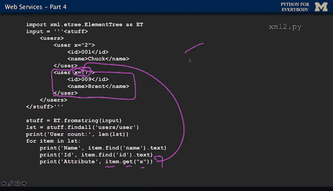

# 每个人的 Python 第三部分 30：解析XML 📂


在本节课中，我们将学习如何使用Python解析XML数据。XML是一种常见的数据交换格式，广泛用于网络数据传输和配置文件。我们将通过两个示例，掌握解析XML的基本方法，包括提取单个标签内容和遍历多个标签。

---

## 导入XML解析库

首先，我们需要导入Python的XML解析库。Python内置的`xml.etree.ElementTree`库提供了强大的XML处理功能。

```python
import xml.etree.ElementTree as ET
```

这里使用`as`关键字为库创建别名`ET`，简化后续代码。通常，我们会通过`urllib`等库从网络或文件读取XML数据，但为了简化演示，我们将XML数据直接定义为字符串。

---

## 解析简单XML数据

以下是一个简单的XML字符串示例，使用三引号定义多行字符串：

```python
data = '''
<person>
  <name>Chuck</name>
  <phone type="intl">303</phone>
  <email hide="yes"/>
</person>
'''
```

接下来，我们使用`ET.fromstring()`方法解析这个字符串，将其转换为一个树形结构对象：

```python
tree = ET.fromstring(data)
```

如果XML格式正确，`tree`将包含解析后的数据。如果XML存在语法错误（例如缺少闭合标签），解析会失败并抛出异常。

---

## 提取标签内容和属性

解析完成后，我们可以从树形结构中提取特定标签的内容或属性。

### 提取标签内容

要提取`<name>`标签中的文本内容，使用`find()`方法定位标签，再通过`.text`属性获取文本：

```python
name = tree.find('name').text
print(name)  # 输出: Chuck
```

### 提取标签属性

对于`<email>`标签，它是一个自闭合标签，没有文本内容，但包含`hide`属性。我们可以使用`.get()`方法提取属性值：

```python
email_hide = tree.find('email').get('hide')
print(email_hide)  # 输出: yes
```

---

## 解析包含多个标签的XML数据

上一节我们介绍了如何解析简单XML数据，本节中我们来看看如何处理包含多个相同标签的XML数据。以下是包含多个`<user>`标签的XML示例：

```python
input = '''
<stuff>
  <users>
    <user x="2">
      <id>001</id>
      <name>Chuck</name>
    </user>
    <user x="7">
      <id>009</id>
      <name>Brent</name>
    </user>
  </users>
</stuff>
'''
```

首先，我们解析这个XML字符串：

```python
stuff = ET.fromstring(input)
```

---

## 遍历多个标签

为了处理多个`<user>`标签，我们使用`findall()`方法获取所有`<user>`标签的列表：

```python
lst = stuff.findall('users/user')
```

`lst`是一个包含多个标签对象的列表，每个对象代表一个`<user>`标签及其子标签。我们可以获取列表长度并遍历每个标签：

```python
print('User count:', len(lst))

for item in lst:
    print('Name:', item.find('name').text)
    print('Id:', item.find('id').text)
    print('Attribute:', item.get('x'))
```



以下是代码执行过程：
- 第一次循环中，`item`指向第一个`<user>`标签，提取`name`为"Chuck"，`id`为"001"，属性`x`为"2"。
- 第二次循环中，`item`指向第二个`<user>`标签，提取`name`为"Brent"，`id`为"009"，属性`x`为"7"。

---

## 总结

本节课中我们一起学习了如何使用Python解析XML数据。我们掌握了以下关键技能：
1. 导入`xml.etree.ElementTree`库并解析XML字符串。
2. 使用`find()`和`.text`提取标签内容。
3. 使用`.get()`方法提取标签属性。
4. 使用`findall()`遍历多个相同标签，并提取嵌套数据。

XML是一种丰富的数据序列化格式，但解析时需要注意数据结构的变化。下一节课中，我们将介绍一种更轻量级的数据格式——JSON（JavaScript Object Notation）。