# 每个人的 Python 第三部分 31：实战示例 - XML解析 📖

在本节课中，我们将学习如何使用Python内置的`ElementTree`库来解析和处理XML格式的数据。XML是一种常见的数据交换格式，广泛用于网络服务和数据存储。掌握其解析方法对于处理网络数据至关重要。

## 概述

我们将通过两个具体的代码示例，学习如何从XML字符串中提取数据和属性。首先，我们会解析一个简单的XML片段，然后处理一个包含列表结构的复杂XML。

---

## 解析简单XML结构

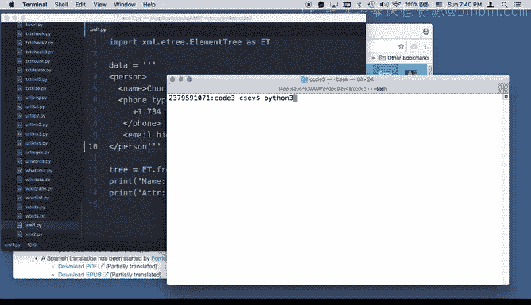

首先，我们来看一个基础的XML解析示例。这个例子演示了如何从一个XML字符串中提取特定标签的文本内容和属性。

以下是示例代码`xml1.py`的核心内容：

```python
import xml.etree.ElementTree as ET

data = '''
<person>
  <name>Chuck</name>
  <phone type="intl">
    +1 734 303 4456
  </phone>
  <email hide="yes"/>
</person>'''

tree = ET.fromstring(data)
print('Name:', tree.find('name').text)
print('Attr:', tree.find('email').get('hide'))
```

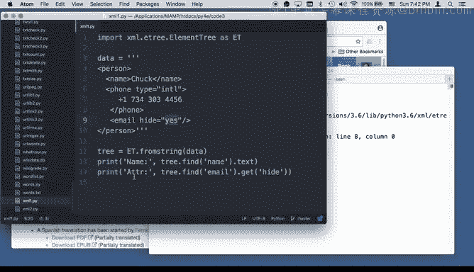

**代码解析：**
1.  **导入模块**：`import xml.etree.ElementTree as ET` 导入了Python内置的XML解析库，并使用`ET`作为其别名。
2.  **定义XML字符串**：将XML数据定义为一个多行字符串。
3.  **解析字符串**：`ET.fromstring(data)` 方法将字符串解析成一个树状结构对象。如果XML格式不正确，这一步会报错。
4.  **查找与提取**：
    *   `tree.find('name')` 查找名为`name`的标签。
    *   `.text` 属性获取该标签内的文本内容（`Chuck`）。
    *   `tree.find('email').get('hide')` 先找到`email`标签，然后使用`.get()`方法获取其`hide`属性的值（`yes`）。

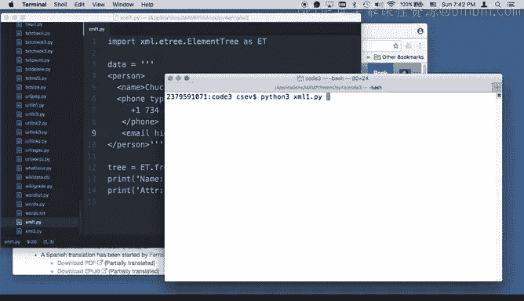

运行这段代码，会成功输出姓名和属性值。

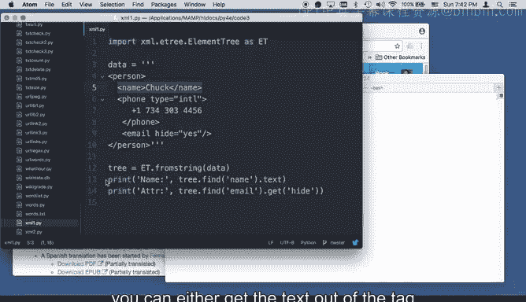

---

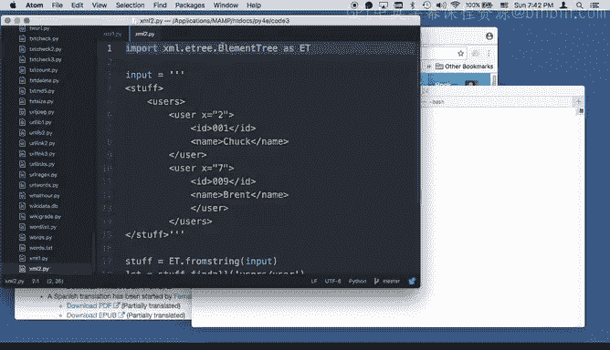

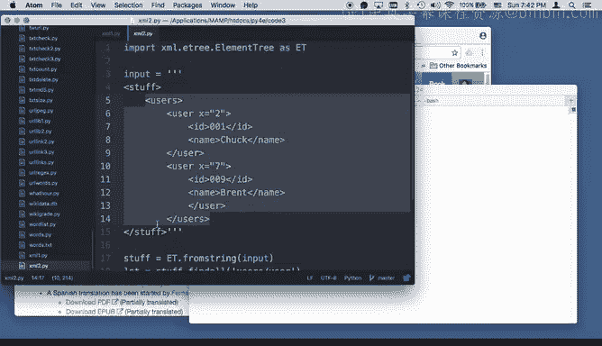

## 解析包含列表的XML结构

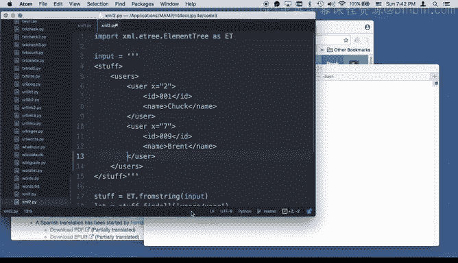

上一节我们介绍了如何解析单个数据项。本节中我们来看看如何处理包含多个相似项目的XML数据，例如一个用户列表。

以下是示例代码`xml2.py`的内容，它演示了如何遍历XML中的多个项目：

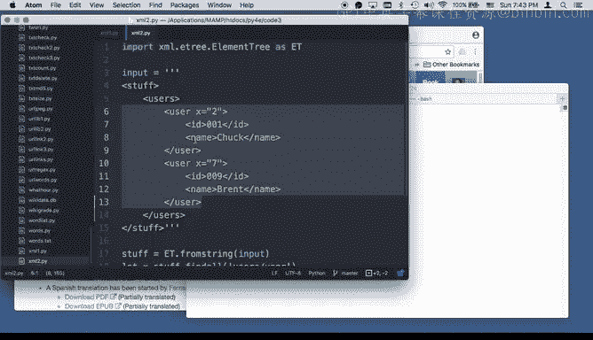

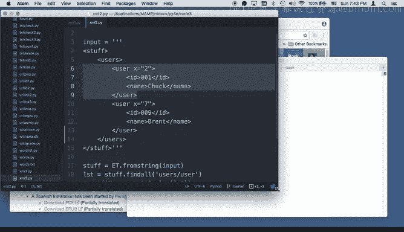

```python
import xml.etree.ElementTree as ET


input = '''
<users>
  <user x="2">
    <id>001</id>
    <name>Chuck</name>
  </user>
  <user x="7">
    <id>009</id>
    <name>Brent</name>
  </user>
</users>'''

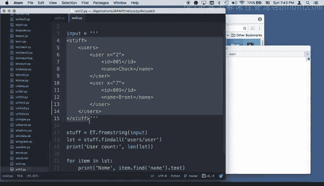

stuff = ET.fromstring(input)
lst = stuff.findall('users/user')
print('User count:', len(lst))

for item in lst:
    print('Name', item.find('name').text)
    print('Id', item.find('id').text)
    print('Attribute', item.get('x'))
```

**代码解析：**
1.  **解析与查找所有项目**：`stuff.findall('users/user')` 会查找所有作为`users`标签直接子级的`user`标签，并返回一个包含这些标签对象的Python列表。
2.  **遍历列表**：使用`for`循环遍历这个列表。每次循环中，`item`变量代表一个`user`标签对象。
3.  **提取每个项目的数据**：在循环内部，我们可以像第一个例子一样，对每个`item`（即每个`user`标签）使用`.find().text`来获取子标签文本，或使用`.get()`来获取属性。

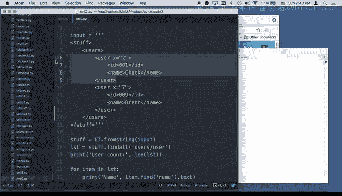

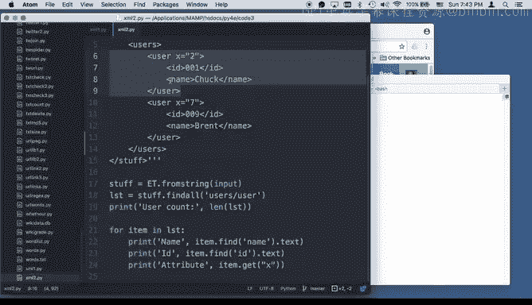

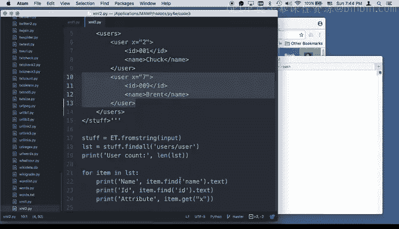

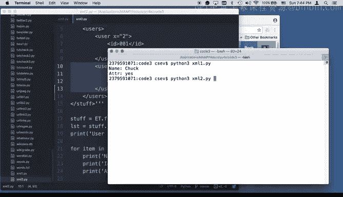

运行此代码，将输出用户数量以及每个用户的姓名、ID和属性。

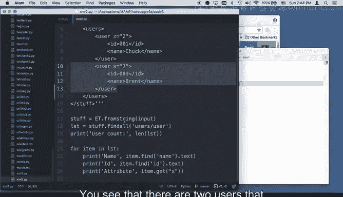

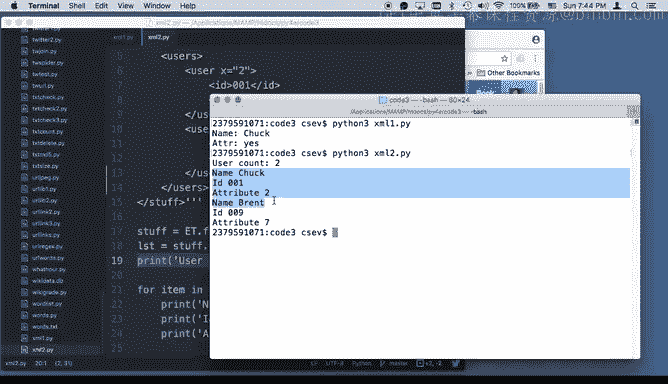

---

## 总结

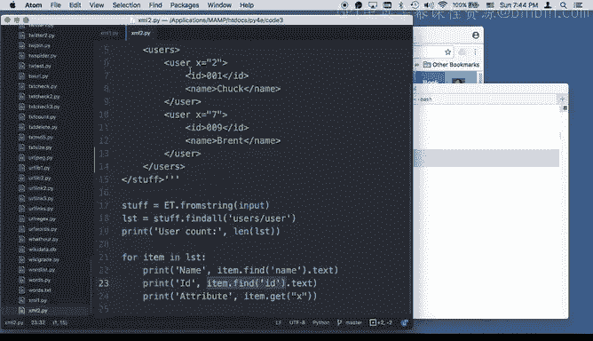

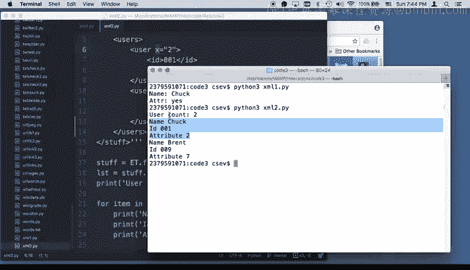

本节课中我们一起学习了使用Python的`ElementTree`库解析XML数据。
*   我们掌握了`ET.fromstring()`将XML字符串转换为可操作的对象树。
*   我们学会了使用`.find()`定位单个标签，以及使用`.findall()`获取匹配的标签列表。
*   我们实践了通过`.text`属性获取标签内的文本，并通过`.get()`方法获取标签的属性值。

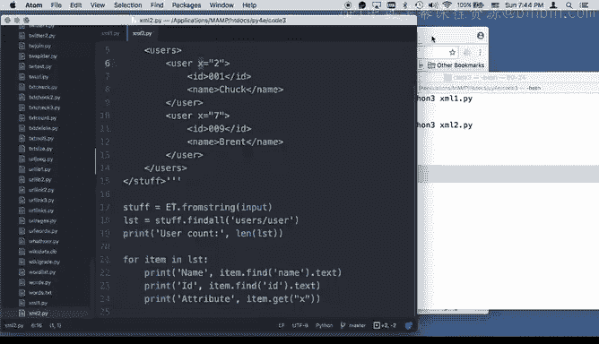

这些是处理来自网络API或数据文件的XML格式数据的基础技能。