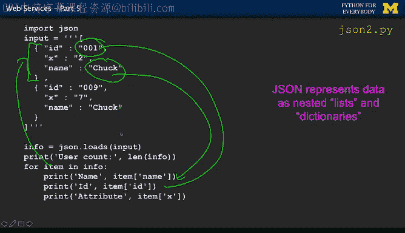

# 课程3：《使用Python访问Web数据》｜第35讲：JavaScript对象表示法（JSON）📘


## 概述

在本节课中，我们将学习一种名为JSON（JavaScript Object Notation）的数据序列化格式。我们将了解JSON的基本结构、它与Python数据结构的对应关系，以及如何使用Python的`json`库来解析和处理JSON数据。

---

## JSON简介：一种更简单的序列化格式

上一节我们介绍了XML，它是一种功能强大但相对复杂的数据格式。本节中，我们来看看JSON。JSON是一种更为简单的数据序列化格式，近年来因其简洁性而日益流行。

JSON并非一种全新的发明。它实际上源于JavaScript语言中用于表示常量的语法——即数组、变量常量和对象的字面量表示法。道格拉斯·克罗克福德（Douglas Crockford）意识到了这种语法可以作为通用的数据序列化方式，从而推广了JSON标准。

JSON与JavaScript语言高度契合。随着基于浏览器的应用日益增多，JavaScript语言本身也越来越重要，这无疑也推动了JSON的普及。

---

## JSON与Python数据结构

与XML不同，JSON的结构更接近于编程语言中常见的数据结构，如列表和字典。这使得它在许多场景下更易于使用。

以下是JSON数据的一个示例，它描述了一个包含联系人信息的对象：

```json
{
  "name": "Chuck",
  "phone": {
    "type": "intl",
    "number": "+1 734 303 4456",
    "hide": "yes"
  },
  "email": {
    "hide": "yes"
  }
}
```

这个JSON对象以花括号`{}`开始，类似于Python中的字典。它包含一系列的键值对：
*   **键**：始终是字符串（用引号包围）。
*   **值**：可以是字符串、数字、布尔值、数组（列表）、另一个对象（字典）或`null`。

在这个例子中，`"phone"`键的值本身又是一个嵌套的JSON对象。

如果我们将这个结构想象成一棵树，那么根节点是包含`name`、`phone`和`email`的对象。`phone`节点下又有`type`、`number`和`hide`子节点。

JSON与XML的一个关键区别在于，JSON没有开始/结束标签，也没有属性（Attribute）的概念。所有数据都通过键值对和嵌套结构来表达。

---

## 在Python中解析JSON

现在，我们来看看如何在Python中处理JSON数据。Python标准库中的`json`模块提供了所需的功能。

首先，我们需要导入`json`库：

```python
import json
```

假设我们有一个包含JSON数据的字符串（在实际应用中，这个字符串可能来自网络请求或文件读取）。我们可以使用`json.loads()`函数来解析它：

```python
data = '''
{
  "name": "Chuck",
  "phone": {
    "type": "intl",
    "number": "+1 734 303 4456",
    "hide": "yes"
  }
}
'''

info = json.loads(data)
print('Name:', info['name'])
print('Hide:', info['phone']['hide'])
```

代码解析：
1.  `json.loads()`：这个函数接收一个JSON格式的字符串，并将其解析为Python对象。
2.  解析成功后，`info`变量将变成一个Python字典。
3.  我们可以像操作普通字典一样，使用方括号`[]`和键名来访问其中的数据。例如，`info['name']`获取名字，`info['phone']['hide']`获取嵌套在`phone`对象中的`hide`值。

这种访问方式非常直接，因为JSON的结构（对象和数组）几乎可以一对一地映射到Python的字典和列表上，这使得代码编写和理解都更加简单。

---

## 处理JSON数组（列表）

JSON不仅可以表示对象（字典），还可以表示数组（在Python中对应列表）。数组由方括号`[]`包围。

以下是一个包含两个对象的JSON数组示例：

```json
[
  { "id": "001", "x": "2", "name": "Chuck" },
  { "id": "009", "x": "7", "name": "Brent" }
]
```

当我们在Python中解析这个JSON字符串时，`json.loads()`会返回一个Python列表。

以下是处理此类数据的代码示例：

```python
import json

data = '''
[
  { "id": "001", "x": "2", "name": "Chuck" },
  { "id": "009", "x": "7", "name": "Brent" }
]
'''

info = json.loads(data)  # info 现在是一个列表
print('User count:', len(info))

for item in info:
    print('Name:', item['name'])
    print('Id:', item['id'])
    print('Attribute:', item['x'])
```

代码解析：
1.  `json.loads(data)`将JSON数组解析为一个Python列表，赋值给`info`。
2.  `len(info)`可以获取列表中元素的数量。
3.  我们可以使用`for`循环遍历这个列表。每次循环，`item`变量会指向列表中的一个元素，在这里每个元素都是一个字典。
4.  在循环体内，我们可以通过键名（如`item['name']`）访问每个字典中的具体值。

与处理等价的XML数据相比，JSON的代码通常更加简洁明了。这正是许多人偏爱JSON的原因：它在大多数常见场景下提供了足够的表达能力，同时保持了极简的语法和直观的映射关系。

---



## 总结

本节课中我们一起学习了JSON数据格式。
*   我们了解到JSON是一种轻量级的数据交换格式，源于JavaScript，结构简单，易于人阅读和编写，也易于机器解析和生成。
*   我们探讨了JSON的基本构成：对象（对应Python字典）和数组（对应Python列表），以及它们的嵌套组合。
*   我们掌握了使用Python `json`库中的`json.loads()`函数来解析JSON字符串，并将其转换为Python的字典或列表，从而可以方便地使用Python语法来访问和处理数据。

JSON的简洁性和与编程语言数据结构的天然亲和力，使其在现代Web服务和应用程序的数据交换中占据了主导地位。在下一节中，我们将站得更高一些，讨论面向服务的架构（Service-Oriented Approach）概念。