# 3：《使用Python访问Web数据》｜第36讲：JSON实战示例 📚

在本节课中，我们将学习如何使用Python处理JSON数据。JSON是一种轻量级的数据交换格式，与XML相比，其结构更简单，语法与Python的字典和列表非常相似，因此在许多场景下更受欢迎。

## 概述 📋

我们将通过两个具体的代码示例，学习如何：
1.  导入并使用Python内置的`json`模块。
2.  解析JSON字符串并将其转换为Python数据结构（字典或列表）。
3.  从转换后的数据结构中提取所需的信息。

---


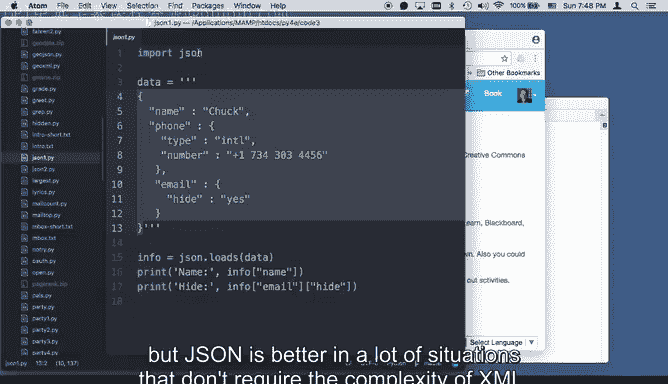

## 示例一：解析JSON对象（字典）🔍

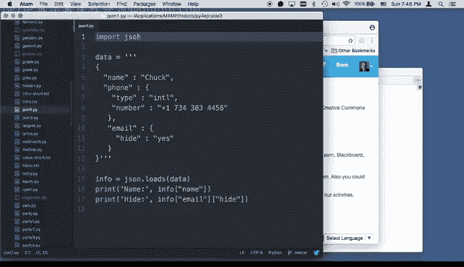

上一节我们介绍了JSON的基本概念。本节中，我们来看看如何解析一个JSON对象，它对应Python中的字典。

首先，我们需要导入Python内置的`json`模块。然后，我们使用一个三引号字符串来存储一段JSON数据。

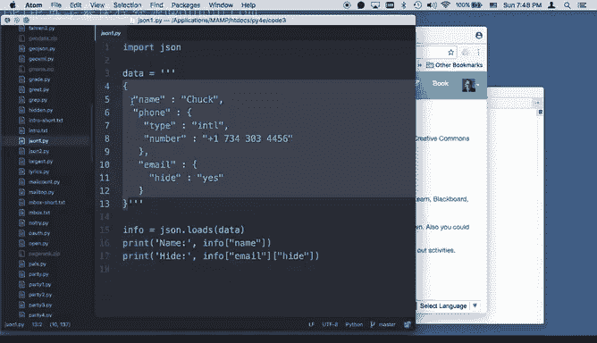


```python
import json

data = '''
{
  "name": "Chuck",
  "phone": {
    "type": "intl",
    "number": "+1 734 303 4456"
  },
  "email": {
    "hide": "yes"
  }
}
'''
```

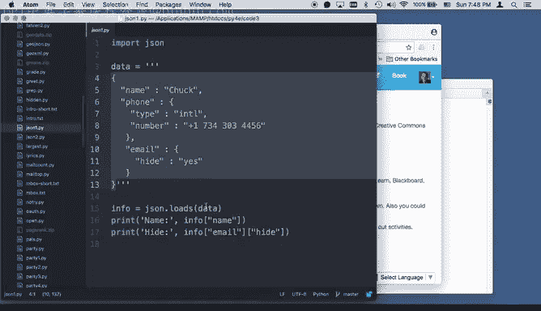

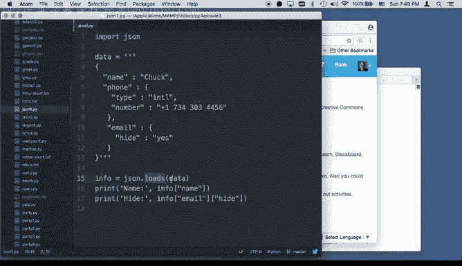

这段JSON看起来很像Python的字典，由键值对组成。其中，`"phone"`和`"email"`的值本身又是另一个字典（在JSON中称为对象）。

接下来，我们使用`json.loads()`函数来解析这个字符串。这个函数会将JSON语法（花括号、逗号等）转换成结构化的Python对象。如果JSON字符串存在语法错误，此步骤会报错。

```python
info = json.loads(data)
```

解析成功后，`info`就变成了一个Python字典。我们可以像操作普通字典一样，使用键来访问其中的值。

以下是访问嵌套字典中数据的示例：


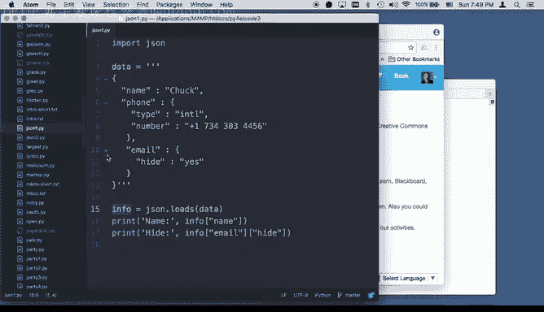

```python
print('Name:', info["name"])
print('Hide:', info["email"]["hide"])
```

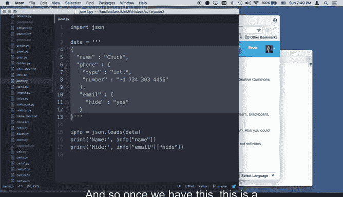

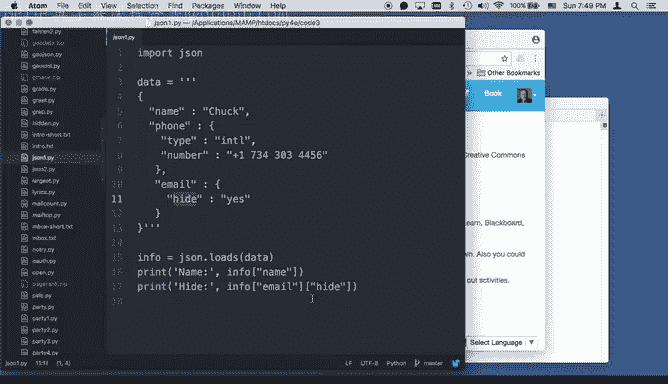

运行这段代码，会输出：
```
Name: Chuck
Hide: yes
```

---

## 示例二：解析JSON数组（列表）📝

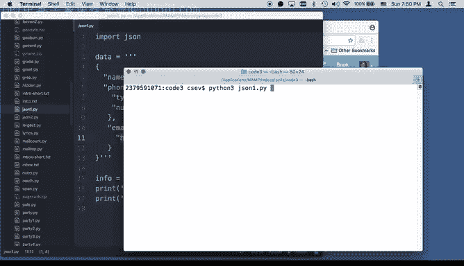

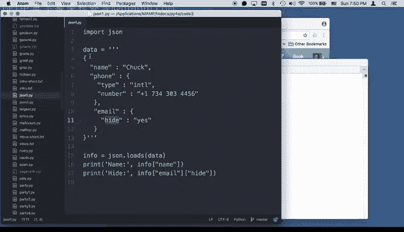

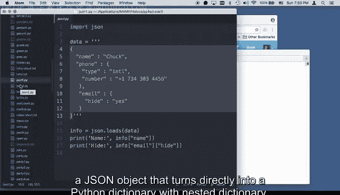

在第一个示例中，我们处理了JSON对象。现在，让我们看看如何处理JSON数组，它在Python中对应列表。

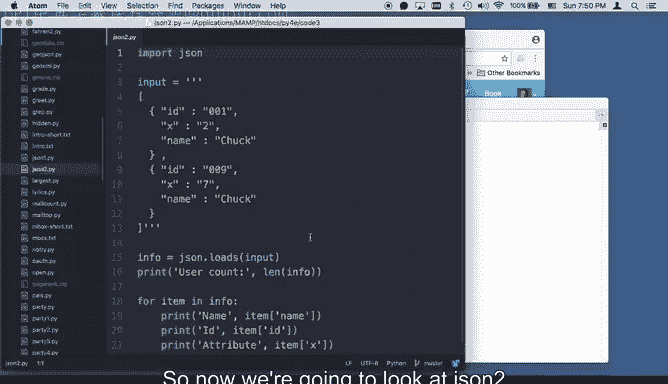

以下代码定义了一个包含JSON数组的字符串。这个数组里有两个对象。

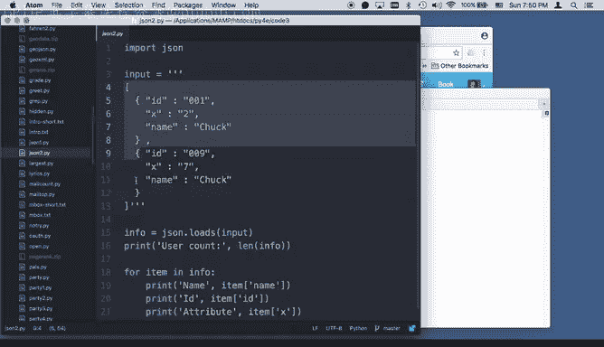

```python
import json

input = '''
[
  { "id": "001",
    "x": "2",
    "name": "Chuck"
  } ,
  { "id": "009",
    "x": "7",
    "name": "Brent"
  }
]'''
```

同样，我们使用`json.loads()`来解析它。由于最外层是方括号`[]`，解析结果将是一个Python列表。

```python
info = json.loads(input)
```

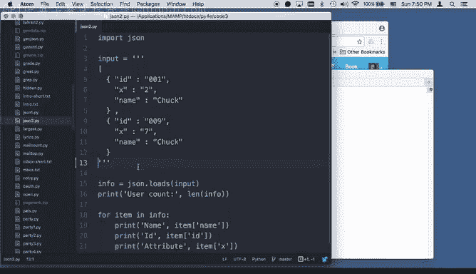

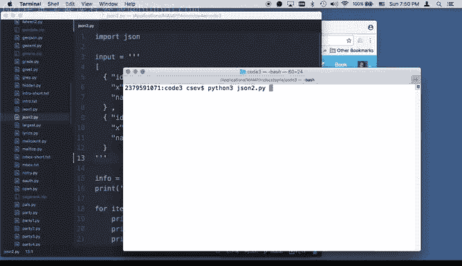

现在，`info`是一个列表。我们可以获取它的长度，并遍历其中的元素（每个元素都是一个字典）。


以下是遍历列表并提取信息的代码：

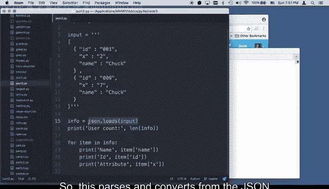

```python
print('User count:', len(info))

for item in info:
    print('Name', item['name'])
    print('Id', item['id'])
    print('Attribute', item['x'])
```

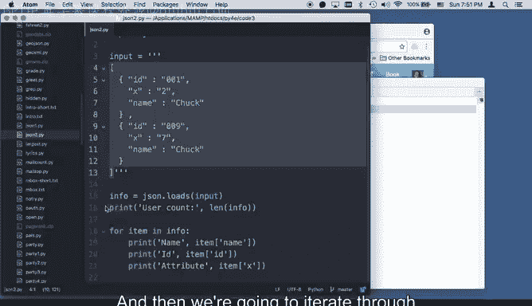

运行这段代码，会输出：
```
User count: 2
Name Chuck
Id 001
Attribute 2
Name Brent
Id 009
Attribute 7
```

与XML不同，JSON没有“属性”的概念，所有数据都以键值对的形式存在，结构更简单直接。

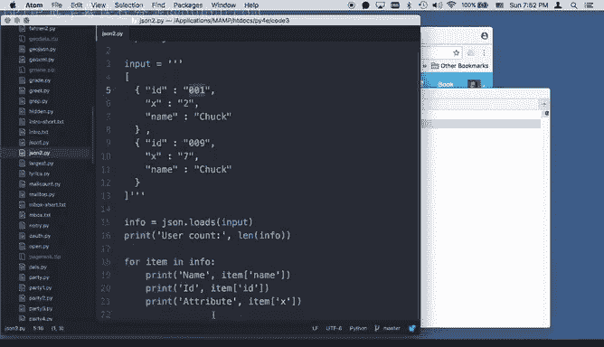

---

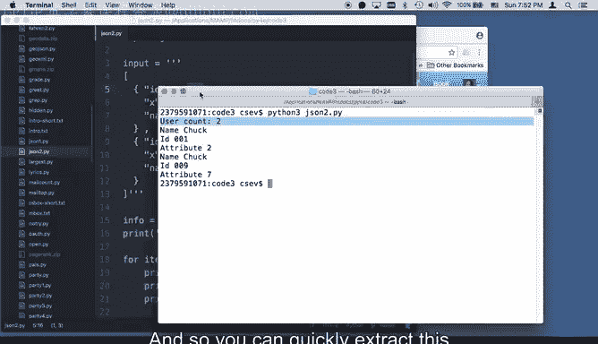

## 总结 🎯

本节课中我们一起学习了使用Python处理JSON数据。
*   我们了解到JSON是一种简洁的数据格式，易于阅读和编写。
*   通过`json.loads()`函数，可以轻松地将JSON字符串转换为Python的字典或列表。
*   转换后，我们可以使用熟悉的字典键访问和列表遍历语法来提取所需数据。
*   与XML相比，JSON的结构更扁平，在数据关系不复杂时，使用起来更加方便快捷。

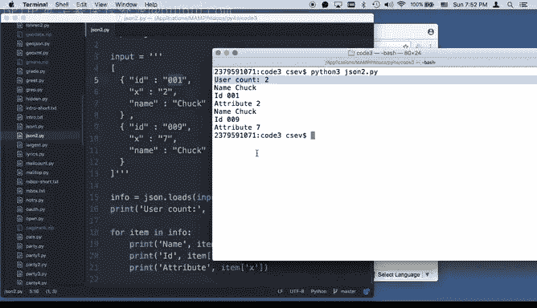

希望本教程能帮助你理解并开始使用JSON进行数据交互。