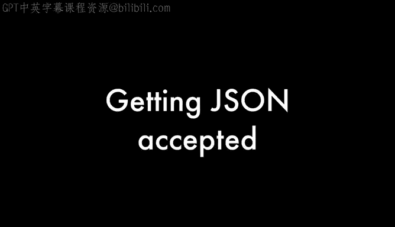
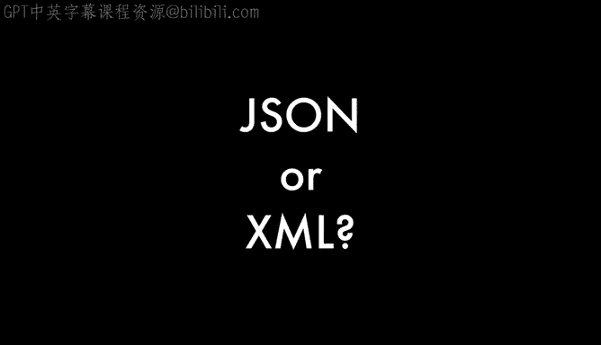

# 课程3：《使用Python访问Web数据》｜第37讲：JSON的发现之旅 🧩

在本节课中，我们将跟随道格拉斯·克罗克福德的访谈，了解JSON（JavaScript Object Notation）这一关键数据交换格式的发现过程、设计理念及其重要性。JSON如今已成为Web数据交换的基石。

---

## JSON的发现与本质

上一节我们了解了Web数据交换的背景，本节中我们来看看JSON是如何被发现的。

道格拉斯·克罗克福德在2001年发现了JSON。他并不声称发明了JSON，因为它早已以某种形式存在。他只是识别出其价值，为其命名、描述并展示了其优点。他也不是第一个发现此概念的人，后来他发现有其他人在2000年也产生了类似的想法。

JSON是世界上广受欢迎的数据交换格式。其最早的应用实例可追溯到1996年网景公司使用JavaScript作为数据交换格式。JSON的理念已经存在了一段时间。如果观察其他数据表示法，例如NeXT和后来苹果公司使用的属性列表，除了少数表面差异，它们本质上也是JSON的表示形式。

这似乎是一种**不可避免的数据表示形式**，至少对于旨在被编程语言消费的数据而言是如此。所有数据最初都始于JavaScript，但他的第一个应用是促进用JavaScript编写的程序与用Java编写的服务器之间的通信。

他认识到，尽管JSON诞生于JavaScript，但它可以且应该是**语言无关的**。因此，他尽可能地简化它，剔除冗余，尝试为如何结构化数据并通过网络传输制定最简单的规范，这最终成为了JSON。

---

## JSON的标准化之路

了解了JSON的起源后，本节我们探讨它是如何从一个想法走向广泛标准的。

2001年，克罗克福德在一家名为State Software的公司工作。他们开发了一个平台，用于创建可通过未经修改的Web浏览器交付的应用程序，即今天所说的Ajax。在当时，这是一个激进的想法。

作为描述的一部分，他们会提到使用JSON在客户端和服务器之间来回通信。潜在客户会问：“JSON是什么？”他会解释这是在JavaScript中发现的一个很棒的东西。但客户的常见反应是：“我们不能用那个，我们刚刚承诺使用XML。”他们会列举XML的种种问题，如成本高昂、难以使用等，但最终拒绝JSON的理由是：“你做的那个东西不是标准。”

克罗克福德回应说，JSON是ECMA-262标准（JavaScript语言规范）的一个**真子集**，因此本身就是一个标准。但对方并不接受。于是他决定，如果他想使用JSON，就需要使其成为一个公认的标准。

他购买了 `json.org` 域名，建立了一个网页，并**宣告JSON是一个标准**。他并没有去游说行业或政府，只是建立了一个基本上只有一页的网站。多年来，人们发现了它，并意识到：“这容易多了，我就要用这个。”

---

## JSON vs. XML：设计哲学与优势

上一节我们看到了JSON如何成为标准，本节我们来深入比较JSON与XML，理解其设计优势。

克罗克福德一直不理解XML用于数据交换的模式。通常的模式是：发送一个查询到服务器，服务器查询数据库，然后返回一个XML文档。接着，你必须再向这个XML文档发送查询才能取出数据。他的疑问是：**为什么不能直接给我一种我能立即识别并使用的数据形式？**

他认为这才是JSON的主要好处。并非因为花括号 `{}` 比尖括号 `<>` 更好，这些表象并不重要。关键在于，**JSON所代表的数据结构，与编程语言中使用的数据结构是完全一致的**。

当Ajax被提出时，其中的“X”本意是代表XML。但聪明的开发者很快意识到处理XML太困难了。其中一些人发现可以用JSON代替，这变得**简单得多，也快得多**。于是他们开始这样做。

当时有一场争论，有人认为“X代表XML，所以只能使用XML”，但这种观点并未持续太久。那时还有其他一些XML的替代方案被考虑，但**JSON是唯一一个专门为Ajax应用设计的**。

---

## JSON的设计决策与未来

在探讨了JSON的优势后，我们最后来看看其关键的设计决策以及对未来的展望。

克罗克福德在设计JSON时做出的最大胆的决定之一是：**不为它添加版本号**。因此，没有修订它的机制。我们被“困”在了JSON当前的形式里，它就是它最终的样子。

这结果成为了JSON最好的特性，因为它旨在成为一个**底层的基础设施**，是你在其上构建一切的东西。这类似于语言中的字母表。我们可以创造许多新词和造句方式，但很少创造新的字母。JSON就处在这个“字母表”的位置。因此，它保持不变是件好事。

他预计，也许有一天我们会发现JSON确实无法很好地处理某些非常重要的东西，例如**循环结构（图）**。图结构在JSON中不易直接表示，虽然可以做到，但需要额外的处理工作。如果未来我们不想做这些额外工作，我们**不会去扩展JSON，而是会替换掉JSON**。

即使到了那一天，所有已经开发的使用JSON的应用程序仍将继续工作，因为**JSON永远不会改变**。

---

## 总结

本节课中，我们一起学习了JSON数据格式的发现与演进历程。我们了解到JSON并非被发明，而是从JavaScript和编程语言的通用数据结构中被识别出来的。它因其**语言无关性**、**与编程语言数据结构的天然一致性**以及**极简的设计**而获得成功。通过与XML的对比，我们看到了JSON在数据交换中**简单、高效**的优势。最后，JSON**不加版本号**的坚定设计决策，确保了其作为Web基础协议的长期稳定性和可靠性，这正是其强大生命力的源泉。