# 3：《使用Python访问Web数据》｜P39：面向服务的架构 🏗️

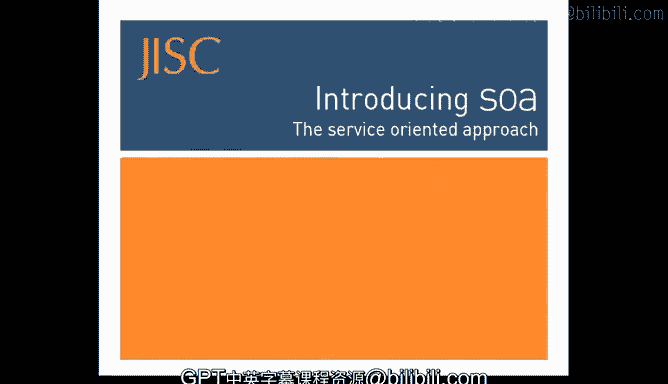

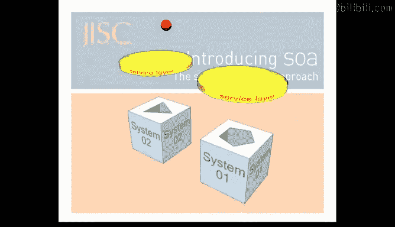

在本节课中，我们将要学习一种重要的软件架构模式——面向服务的架构。这种架构正在改变许多组织共享数据的方式，它通过在系统之间提供一个服务层，改进了现有的数据共享方法。

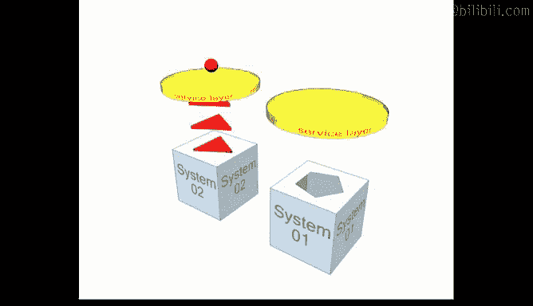

## 什么是面向服务的架构？

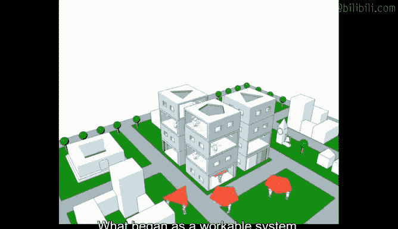

上一节我们介绍了Web数据访问的基本概念，本节中我们来看看如何通过架构设计来更优雅地共享数据。

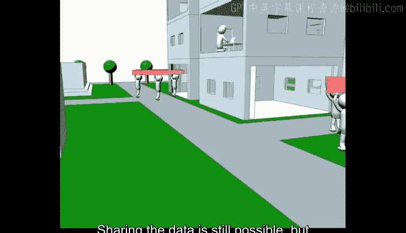

应用程序之间的数据共享是一个基础原则，在简单层面上运作良好。但随着系统扩展，连接两个软件应用的解决方案通常无法适用于第三个应用。最初可行的系统最终会将宝贵的数据锁在孤岛中。

虽然共享数据仍然可能，但需要大量的调整和修改。这个过程既费力又耗时，会导致瓶颈和系统过载。这个世界的现实是，大量不必要的精力被耗费在数据重复上。

## 服务层如何解决问题？

通过在希望连接的应用程序上应用一个服务层，数据可以以通用格式提供，以便在其他地方重复使用。

面向服务的方法可以与现有的软件系统协同工作，不需要移除庞大的单体应用程序。替换的应用程序可以重用已建立的链接，并可以接入服务层，而不影响数据的其他用户。

新应用程序可以以同样的方式添加，以扩展整体系统架构。每个应用程序中的数据都作为一项服务提供，任何其他应用程序都可以使用。

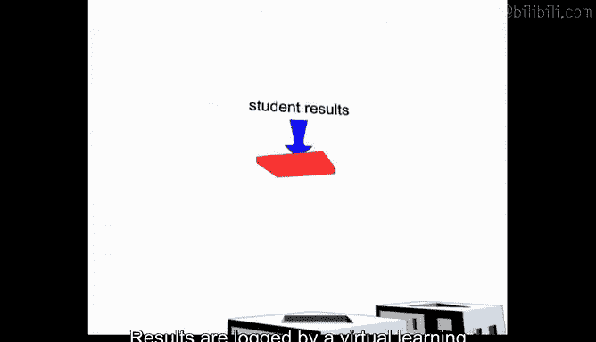

## 架构的扩展与影响

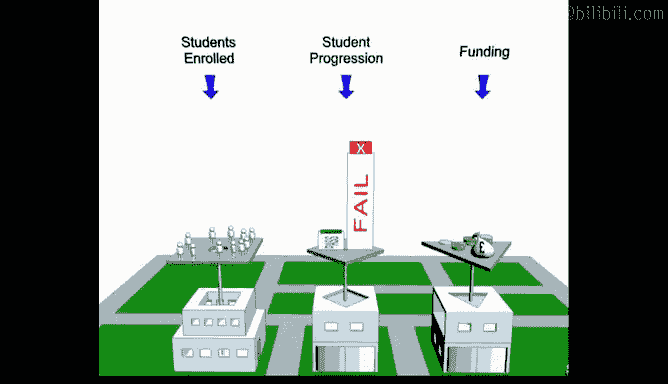

当面向服务的方法演变为系统范围的架构时，它允许在组织内部乃至全球范围内建立连接和服务共享机会。

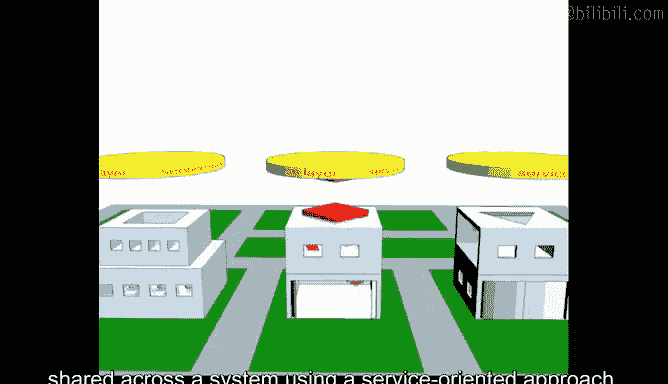

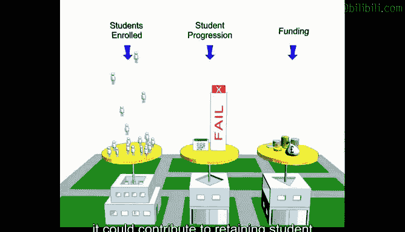

以下是几个关键的应用场景：

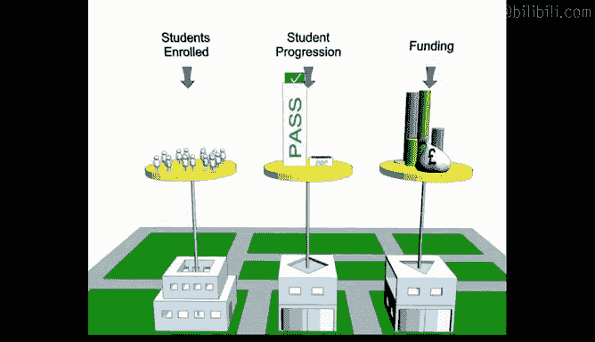

以监控学生进度为例。结果由虚拟学习环境记录，但这些数据有多少与跟踪资金进度的管理系统共享？如果 struggling students 的动力和承诺没有得到解决，他们决定离开，会直接影响资金。

如果数据被释放出来，并通过面向服务的方法在系统中共享，它可能有助于保持学生的学习动力，从而最大化收入。

## 实际应用案例

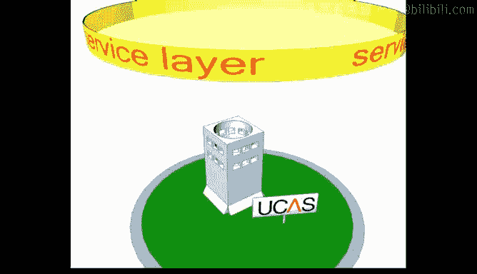

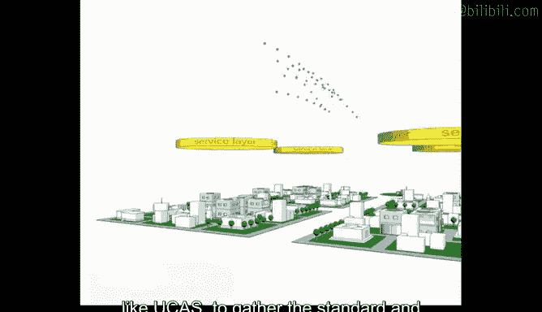

在教育界，如果有一种标准且公认的方式来描述课程，会怎样？这将允许课程信息作为可消费的服务提供，无论是在内部还是外部。这是一个当前项目的主题，称为交换课程相关信息，涵盖了课程营销、质量保证、注册和报告要求。

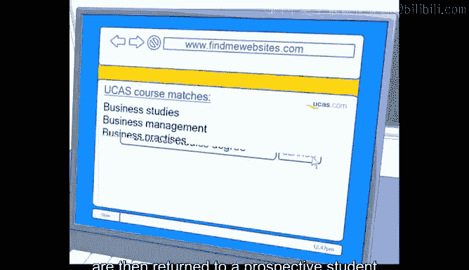

这种面向服务的方法使像UCAS这样的聚合组织能够从每个提供者那里收集标准且公认的课程描述。然后，已批准的注册机会的全面详细信息将返回给潜在学生，以便进行简单而准确的比较。

在研究界，原则是相同的。面向服务的方法使研究人员能够在虚拟组织中跨机构工作。Miggrid是一个项目，它通过协调分布式资源和服务之间的信息流，为创建实验提供了一个共享工具包。

工作流和查询规范使用Web服务协议将远程和本地资源链接在一起。由Miggrid创建的工作流代表了它们所实施的实验的科学过程，使其成为科学家创建自己新实验的丰富资源。

## 行业实践与框架

许多教育和研究服务已经在开发面向服务的方法，以商业世界和主要软件开发者为引领。正是在这种背景下，E-Framework作为一个成功且不断扩展的国际倡议，致力于为教育和研究界理解面向服务的方法。

E-Framework网站识别并描述了所需的服务组件。它为那些希望获得更多理解和知识，以实施面向服务方法的社区成员提供了蓝图和参考示例。

因此，E-Framework网站正在成为一个知识库，为所有教育和研究人员开发共享词汇和思维方式。

---

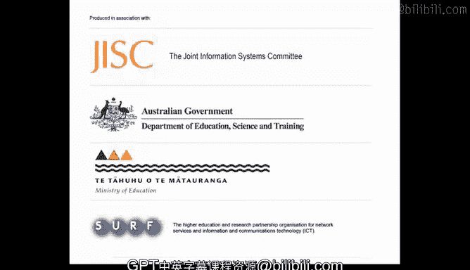

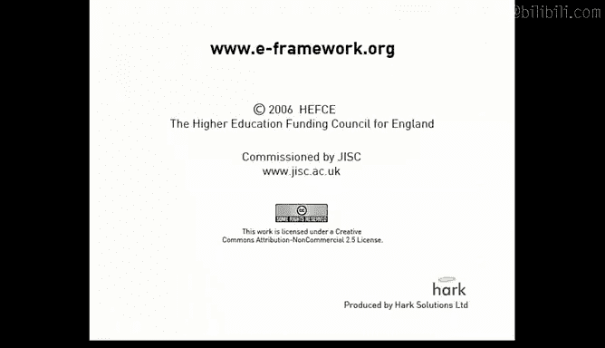

本节课中我们一起学习了面向服务的架构核心思想。它通过引入一个标准化的服务层，解决了传统系统间数据共享的孤岛问题，使得数据能够以通用格式被复用，从而提升了效率，并支持系统与组织的扩展。这种架构模式是构建现代可互操作Web应用和数据服务的重要基础。