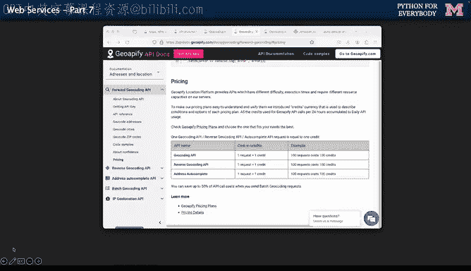
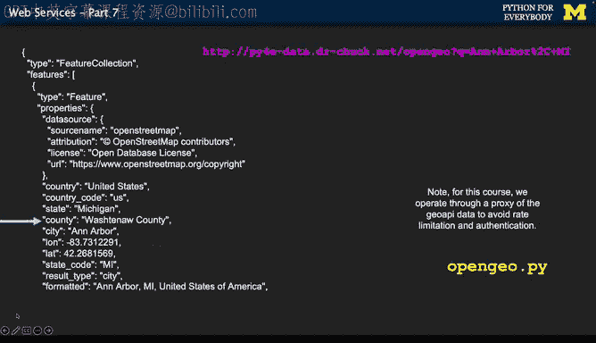

# 课程3：《使用Python访问Web数据》｜P40：使用应用程序编程接口 📡


## 概述

在本节课中，我们将学习如何使用应用程序编程接口（API）来获取和处理网络数据。我们将通过一个具体的地理编码API示例，展示如何从Python代码中发送请求、接收JSON格式的响应，并从中提取所需信息。

---

## 从通用概念到实际应用

上一节我们介绍了API的通用概念，本节中我们来看看如何实际操作一个真实的API。

现在我们将不再泛泛地讨论应用程序编程接口（API），而是进行实际操作。存在大量API，许多组织提供API服务，他们出售API访问权限，API是非常有价值的商品。因此，通常你需要一个账户才能访问API。

我们将使用一种开源、开放内容、开放数据库的API——OpenStreetMap。OpenStreetMap类似于由世界各地人员维护的免费开放版谷歌地图，它体现了开放的概念。但即使是对于OpenStreetMap数据，尽管数据本身免费，你仍需要一个账户来访问这个特定的API。这是因为我们不想自己搭建API服务器，那需要抓取数据、更新数据并运行自己的服务器，工作量太大。

你可以在应用程序中与此API通信，但它有免费的请求额度限制。你需要注册一个账户，然后获得免费请求额度，超过额度后则需要付费。对于本课程，你无需花费任何金钱，我将在最后展示如何实现这一点。

这个API叫做Geocoding API，它是一个地理位置平台。仔细看，它主要提供各种地理编码服务。我们将要做的示例是：输入一个文本地址（如密歇根州安娜堡），然后查找它的位置。这被称为地理编码，即查找地址位置。这是一个常见的操作。当我最初构建这门课程时，我就使用过它。我收集了一些数据，你可以在谷歌表单中输入你所在的城市，然后我将其显示在地图上。这非常有趣，将东西放在地图上总是充满乐趣。这被称为地址查询，属于地理编码API的范畴。还有一个反向地理编码API，你可以提供一个位置，然后查询该位置是什么。这里有很多功能，所以这是一个非常有价值的API。

我们将要使用的是正向地理编码API。正如所说，它接收一个地址，查找该地址，并确定其在世界上的位置。最重要的输出结果是GPS坐标。稍后我们将制作地图，并将信息标注在地图上。目前，我们只讨论如何在Python中与此API通信。

基本思路是，他们提供了一个“游乐场”，你可以免费使用，并且可以随意尝试。例如，我输入了一个地址并进行了查询，它显示了数据和其他信息。这是一个游乐场，你可以尽情玩耍，非常有趣。

这是定价信息，基本上告诉你请求次数的限制。这些信息在你查看时可能会发生变化，他们可能厌倦免费定价，想要调整数字等。但在本课程中，我不会要求你直接与此API通信，你甚至不需要注册账户。不过，你需要一个API密钥，获取它非常容易。对于这个特定的API密钥，他们主要想知道你是谁，因为他们要跟踪你的使用情况。



如果你只使用免费额度，他们仍然想知道你是谁，以便跟踪你的使用情况。如果你没有账户，他们无法跟踪。有了账户，他们就能跟踪你的使用情况。如果你每天请求超过100次，他们就会关闭你的访问。这是一种通过账户管理来保持服务免费的方式。

重申一下，我不会要求你这样做，原因是我构建了一个系统，专门确保你无需直接与Geocoding API通信。我构建了一个代理服务器，你在代码中会看到它叫做`py4e-data`。我所做的是在Geocoding API上创建了一个账户，并将我的账户信息编码在`py4e-data`服务器中。因此，当你发送请求时，你是在与我的服务器通信（无需密码），然后我使用密码与Geocoding API通信。我自己也有速率限制。

但我使用了名为Cloudflare的服务，它提供边缘缓存功能。因此，无论你在世界何处，如果你请求相同的数据，一旦请求过一次，Cloudflare就会保存一份副本，并将副本存储在世界各地分散的服务器中。所以你的代码实际上是在与Cloudflare通信。当Cloudflare缓存未命中时，它会与`py4e-data`通信。`py4e-data`本身也有一个广泛的缓存。当`py4e-data`缓存未命中时，它才会去访问Geocoding API。总之，我确保你可以在没有账户的情况下快速操作，并且我很少真正访问Geocoding API。只有当你请求之前从未请求过的内容时，我才会访问Geocoding API。

如果我这样做，我有自己的速率限制，所以在某些时候，它会关闭或减慢你的访问速度，或者告诉你需要等待。当`py4e-data`缓存未命中时，我会故意让它变得非常慢。所以不用担心，大多数情况下，当你运行应用程序时，你是在与Cloudflare上已经缓存的数据通信，这提供了无限的免费带宽，这非常惊人。重点是，有时使用API时，我需要跳过一些障碍，我编写了一些软件，只是为了避免你在Geocoding API上遇到速率限制。

---

## 在浏览器中直接访问API

你可以直接在浏览器中输入这个URL：`http://py4e-data.dr-chuck.net/geojson?q=Ann+Arbor,+MI`。这里的`q=`是一个查询参数。如果你输入这个URL，你会得到这些数据，这些数据告诉你安娜堡的位置。数据是JSON格式。我们之前讨论过JSON，外层花括号表示一个对象。然后我们有一个`features`，它是一个特征数组。通常，第0个特征（`features[0]`）是最有趣的。

如果我们进入`features[0]`，然后进入`lon`和`lat`，我们会看到密歇根州安娜堡的经度和纬度，以及其他信息。所以，也许如果你拼错了安娜堡，比如在结尾多加了一个“e”，它可能会说：“你实际上是指安娜堡，密歇根州。”然后你可以看到格式化后的字段显示：“哦，那是你真正想找的地方。”它还会告诉你它所在的县、国家等信息。这就是你与浏览器的交互。

---

## 在Python中访问API

现在，你可以在Python中做同样的事情，就像我们一直讨论的那样，使用`requests`库。

以下是使用Python代码访问API的步骤：

1.  定义服务URL。
2.  设置查询参数（例如地址）。
3.  发送请求并获取响应。
4.  解析JSON数据。
5.  从嵌套结构中提取所需信息。



以下是实现这些步骤的示例代码：

```python
import urllib.request, urllib.parse, urllib.error
import json

# 服务基础URL
serviceurl = 'http://py4e-data.dr-chuck.net/geojson?'

while True:
    address = input('Enter location: ')
    if len(address) < 1: break

    # 构造完整的URL，包括编码后的地址参数
    url = serviceurl + urllib.parse.urlencode({'q': address})

    print('Retrieving', url)
    uh = urllib.request.urlopen(url)
    data = uh.read().decode()
    print('Retrieved', len(data), 'characters')

    try:
        js = json.loads(data)
    except:
        js = None

    if not js or 'features' not in js or len(js['features']) == 0:
        print('==== Failure To Retrieve ====')
        print(data)
        continue

    # 从嵌套的JSON结构中提取纬度和经度
    lat = js['features'][0]['properties']['lat']
    lon = js['features'][0]['properties']['lon']
    location = js['features'][0]['properties']['formatted']
    print('Latitude:', lat, 'Longitude:', lon)
    print('Location:', location)
```

在这段代码中，`serviceurl`是服务URL，后面跟着一个问号表示查询参数。我将请求一个位置，例如“Ann Arbor, MI”。你可以看到这是我输入的内容。它是一个循环，所以你可以反复输入。然后它清理数据并创建`q`参数，`q`等于地址，并使用URL编码（这就是那些百分号出现的地方，比如`%2C`代表逗号和空格）。这是URL编码的规则。

然后它检索数据，并使用`decode()`读取数据。如果你还记得，`read()`获取原始数据，`decode()`表示我将其视为UTF-8编码。然后数据在内部只是一个Python字符串。我有一个打印语句，打印出我们获取了多少数据以及该数据的前20个字符。你可以在输出中看到这些信息。

然后我使用`json.loads()`进行JSON解析。`data`只是一个字符串。然后JSON基本上就是字典和列表的嵌套结构，这回到了上一张幻灯片，它展示了所有花括号和方括号中的数据。

接下来的这行代码：`lat = js['features'][0]['properties']['lat']`，基本上是遍历一个分层的字典和列表结构。每当我编写这样的代码时，都需要花点时间。我会先打印`js`，然后打印`js['features']`，再打印`js['features'][0]`。然后我可能会错误地在`[0]`后面添加`lat`，结果发现它不存在。我就会想：“哦，等等，我需要通过`properties`来访问`lat`。”所以这有点棘手。如果你必须自己操作，你可能需要在一个屏幕上打开JSON，然后在Python中反复尝试。最终你会找到从这个特定API的返回值中提取纬度的正确路径。

我也打印了位置信息，即进入`formatted`字段。同样，编写最后四行代码需要一些努力，但并不是那么困难。

---

## 总结

在本章中，我们讨论了面向服务的架构，即如何将应用程序分解为多个部分并在网络中分布。API就像一份合同。我们介绍了各种Web服务，包括XML和SOAP，以及REST（通常使用JSON），这基本上是现代的实现方式。SOAP和XML是一种非现代的方式，我之所以包含它们，是因为将来你可能需要与XML打交道，你可能会问：“为什么不是REST？”正如我们之前讨论的，使用XML有某些原因，XML具有某些优势。我们讨论了两种序列化格式：XML和JSON。