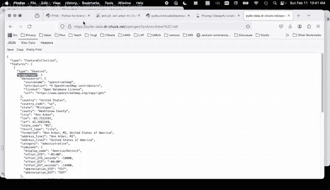

# 每个人的 Python 第三部分 41：实战示例 - 使用OpenStreetMap API进行地理编码 🗺️

在本节课中，我们将学习如何使用Python和OpenStreetMap的API进行地理编码。地理编码是指将文本形式的地址（例如“Ann Arbor, Michigan”）转换为精确的地理位置坐标（纬度和经度）。我们将通过一个实际的代码示例，一步步解析如何从网络API获取并处理JSON数据。


---


## 概述

地理编码是地图应用中的一项核心技术。本节课我们将使用一个名为Geoapify的API服务，它基于OpenStreetMap的开源数据。我们将编写一个Python程序，允许用户输入一个地址，然后程序会查询API，并返回该地址的经纬度坐标和格式化地址信息。


为了便于课堂练习，我们将使用一个经过速率限制的代理API端点，以避免直接使用可能需要付费或注册的官方服务。


---


## 代码结构与核心概念


我们将分析的代码文件是 `opengeo.py`。其核心逻辑是构建一个HTTP请求，获取JSON格式的响应，然后从中提取所需信息。


以下是构建请求URL的核心代码片段：
```python
serviceurl = 'http://py4e-data.dr-chuck.net/opengeo?'
params = {'q': address}
url = serviceurl + urllib.parse.urlencode(params)
```


上一节我们介绍了地理编码的概念和我们将要使用的API。本节中我们来看看代码的具体实现细节。


### 处理HTTPS与证书


由于Python的`urlopen`在访问某些HTTPS站点时可能会遇到证书验证问题，我们的代码中包含了一段上下文设置来忽略证书验证。这在生产环境中不推荐，但适用于我们的学习目的。


```python
import ssl
ctx = ssl.create_default_context()
ctx.check_hostname = False
ctx.verify_mode = ssl.CERT_NONE
```


### 获取并解析JSON数据


程序通过循环提示用户输入地址。对于每个地址，它会向API发送请求，读取返回的JSON数据，并将其解析为Python字典。


以下是获取和解析数据的关键步骤：
```python
uh = urllib.request.urlopen(url, context=ctx)
data = uh.read().decode()
js = json.loads(data)
```


### 从复杂JSON结构中提取信息


API返回的JSON数据结构是嵌套的。我们需要像剥洋葱一样，一层层地提取出我们需要的经纬度和格式化地址。


以下是提取数据的逻辑路径：
1.  整个响应是一个字典。
2.  这个字典中有一个键叫 `‘features’`，其值是一个列表。
3.  我们通常取这个列表的第一个元素（索引0），它也是一个字典。
4.  在这个字典中，键 `‘properties’` 对应的值是我们真正需要的信息所在的字典。
5.  最后，从 `‘properties’` 字典中，我们可以获取 `‘lat’`（纬度）、`‘lon’`（经度）和 `‘formatted’`（格式化地址）。


对应的代码可以整合为：
```python
lat = js['features'][0]['properties']['lat']
lon = js['features'][0]['properties']['lon']
location = js['features'][0]['properties']['formatted']
```


---


## 代码调试与数据探索


在编写代码时，直接写出完整的提取路径可能容易出错。一个更稳妥的方法是逐步探索数据结构。


以下是探索JSON结构的调试方法：
1.  首先打印整个解析后的 `js` 对象。
2.  然后打印 `js[‘features’]`，查看列表内容。
3.  接着打印 `js[‘features’][0]`，查看第一个特征对象的详细信息。
4.  最后打印 `js[‘features’][0][‘properties’]`，找到目标数据。


通过这种渐进的方式，可以清晰地理解数据层次，并准确定位到 `‘lat’`、`‘lon’` 和 `‘formatted’` 等字段。


---


## 运行示例与速率限制


运行程序时，输入地址“Ann Arbor, Michigan”，程序会输出类似以下结果：
```
Retrieving http://py4e-data.dr-chuck.net/opengeo?q=Ann+Arbor%2C+Michigan
Retrieved 1319 characters
lat 42.2808256 lon -83.7430378
Ann Arbor, Washtenaw County, Michigan, United States of America
```


需要注意的是，我们使用的代理API有速率限制。如果短时间内请求过多或输入错误地址触发新的搜索，可能会遇到响应变慢的情况，这是正常现象。


---


## 总结


本节课中我们一起学习了地理编码的基本原理，并完成了一个实战练习。我们掌握了如何使用Python的 `urllib` 库访问网络API，如何处理可能存在的SSL证书问题，以及如何解析和遍历复杂的JSON数据结构来提取关键信息。这个技能对于处理各种网络服务和数据源至关重要。在后续课程中，我们将利用地理编码技术进行批量处理，并将地点数据可视化到地图上。




---