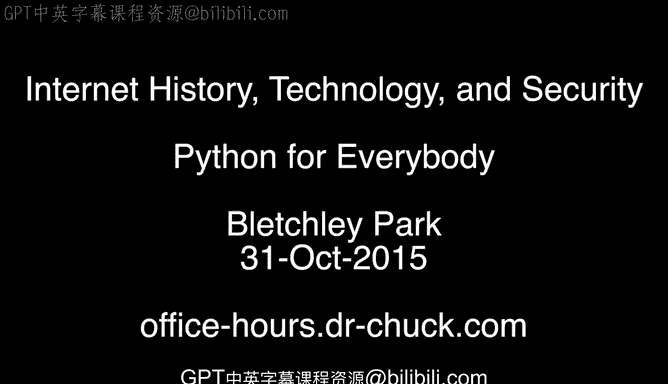
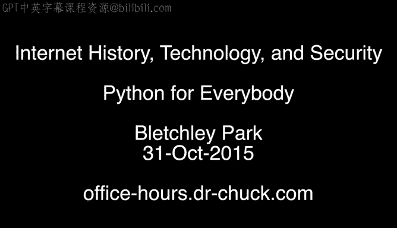

# 密歇根大学《给所有人的Python课》课程3：《使用Python访问Web数据》｜ 第44课：特别课程重聚 🎉

在本节课中，我们将跟随课程团队来到计算机科学、互联网历史与技术的发源地之一——布莱切利园，参加一场特别的线下“课程重聚”活动。你将见到来自世界各地的课程学员与导师，听听他们学习Python的故事与心得。

---

我们正在布莱切利园。计算机科学、互联网历史、技术以及所有计算的起源都可以追溯到这里。我们举办了一场非常特别的、破纪录的线下答疑会，我想让你认识一下你的同学们。

以下是参与本次重聚的学员与导师们的自我介绍。

大家好，我是史蒂夫。我是Python系列课程所有课程的导师之一。欢迎你，史蒂夫。这些年来能与你共事是我的荣幸。

史蒂夫是完成所有艰苦工作的人，而我获得了所有的赞誉。像史蒂夫和其他导师们，他们实际上承担了繁重的工作。非常感谢你，史蒂夫。

谢谢你的邀请，在你的帮助下，这次活动非常棒。

大家好，我是邦瓦尔，来自法国，现居伦敦。很高兴来到这里见到你，查克博士。我上过你的互联网历史课程，非常喜欢。我很期待接下来关于树莓派和物联网的课程。

别担心，这是广角镜头，所以我并不是在特写你的鼻子。我是克雷格，我正在学习《使用Python访问Web数据》这门课，我们网上见。

当那位工作人员过来和你交谈时，你有遇到麻烦吗？不过你没事，他们允许你回来了。我是史蒂夫，我完成了第一门Python课程，并且很快会开始学习其他课程。这门课程对我入门这门语言真的非常有帮助，非常感谢。

大家好，我是珍妮，是一名软件开发人员。我使用《给所有人的Python课》在泰国清迈的一所国际学校教授编程课。很高兴来到英国布莱切利园。你知道这本书被翻译成中文了吗？这在泰国好用吗？可能没那么好用。好吧，看来我没那么酷。

大家好，我是阿诺，来自查理斯。我在我的大学担任Arduino讲师。因为学习了Python课程，我忘记了Arduino的语法，这在我的工作中有点尴尬。我的意思是处理……我是说，我现在不再用Processing了，我用Python代替了Processing。现在我使用Arduino，我本应在大学进行调试。他们到处都在用Arduino，然后我却因为Python把它忘了。欢迎你，你是从巴黎来的吗？是的，你从巴黎过来。我想是坐欧洲之星来的，不像从澳大利亚那么远，对吧？我想没人能超过我。不，不，我的意思是你是对的，欧洲之星，巴黎比我们想象的要近。

凯文，我只是从伦敦来的。但能听到课程是如何组合在一起的，以及你如何制作课程，真的很好，谢谢你。

大家好，我是J，我们来自中国。我们是你的学生吗？是的，我们目前在英国工作。很高兴在布莱切利园见到你们，Python课程很棒。

大家好，我是詹尼斯。我使用Python很长时间了，但这是我第一次专门为了系统地学习这门语言而参加课程。谢谢你。

大家好，我是米。我用你的课程来刷新我的计算机科学知识。是的，我正在和你一起学习Python。我来布莱切利园至少五次了，像你一样，我也是这里的粉丝。我多希望能在二战期间在这里工作，那一定非常激动人心。是的，你知道吗，今天这里参加课程的人中有三位是女性。是的，令人印象深刻。她们不一定有最有趣的工作，但我们……确实如此。

大家好，我是帕特里克。我上过互联网历史课程。今天对我来说是非常激动人心的一天，因为当我上那门课时我说过我想来布莱切利园，今天我来了。我还说过我想参加一次查克博士的线下答疑会，所以今天我一次完成了两件事，这真是太棒了。我的一个想法是，这就是我们的课程重聚。是的，我正是这么想的。嘿，我们举办了一场课程重聚。

大家好，我是大卫。我上过你的Python课程和互联网历史课程，非常喜欢，欢迎你，很高兴你在这里。

大家好，我是保罗。我上过你的Python课程，它们非常棒，谢谢你。

大家好，我是休，来自剑桥。我上过你的Python课程，目前正在学习网络数据这门课。非常兴奋能在这里和你在一起。我学习它也是为了教孩子们，实际上我学习是因为我儿子为了考试正在学Python，希望我能帮到他。你离树莓派总部就几个街区远，对吧？就在剑桥，他们那里也在大量使用Python。是的，我喜欢把所有这些东西联系起来，我想到了一个绝妙的计划。

大家好，我是罗杰。我完成了《给所有人的Python课》，刚刚开始学习网络数据这门课，我真的很期待能顺利完成它。

大家好，我是多斯。我来自波兰，现居英国。我刚刚开始我的Python学习之旅。我应该非常感谢你所做的一切，这些真的非常棒。

那么，这里有个问题：你知道布莱切利园的历史和那三位波兰密码学家吗？哦，非常厉害。但是，这里的历史学家们已经做了很好的工作来澄清那段历史。这引出了我的下一个问题：你会来参加线下答疑会吗？我会去很多地方，所以也许我们会找到解决办法。还有一件事：向我的妻子和两个女儿问好。就这样。

大家好，我是麦迪，住在伦敦北部。我上了第一门Python课程，主要是为了能跟上我在学校学习Python的小儿子的进度。很高兴见到你。

大家好，我叫安德鲁，是一名退休人员。我学习Python课程是出于兴趣，并希望将其与我在树莓派上的一些小项目结合起来。我认为Python课程是一门引人入胜的课程。对于退休人员来说，你非常年轻。确实，我刚70出头。

大家好，我是马达姆，我和我的家人一起来的。我刚开始学习Python。我原本是学生物学的，后来从事相关工作。我希望将来能教我的女儿编程。是的，在某个时候，这会变得很平常。是的，就是下一代密码破译者，带他们来到这个一切开始的原点非常重要。在未来，情况会好得多，因为我们打破了这片土地，而它会保持被打破的状态。当然。

大家好，我是爱丽丝，住在布里斯托尔。布里斯托尔？那很远。是那个方向。我几个月前完成了Python课程，我打算学习你的新课，课程3，很期待见到你。课程3，它们很好。我尝试过Coursera上的一些课程，我可能得剪掉那部分……在现实中见到你真不错。最后，我是一名分析师，我希望能将学到的知识应用到我的工作中。我会跟着你学习到顶点课程，这很棒。希望到我们开设顶点课程时，我能把它设计出来。

大家好，我是大卫，来自利物浦。我正在学习，我有兴趣学习Python来提高我的编程技能。我本人也是一名学习技术专家。

大家好，我是辛西娅。我正在学习你的Python课程，这门课非常优秀，我强烈推荐给任何想学习编程的人。我现在正处于职业间歇期，在养育孩子。这对我保持理智非常有帮助。这实际上是一个非常重要的应用场景。但你的职业是和核反应堆或隐形飞机有关吗？不，是质谱分析。哦，质谱分析，我知道这很复杂。如果没有计算，质谱分析就像大海捞针，如果没有编程，我们根本无法理解那些数据。我以前从来不知道怎么做，我希望当我重返职场时，我能真正知道自己在做什么。这真是一个度过职业间歇期的好方法。

大家好，我叫奥芬，来自伦敦。我上过互联网历史与技术课程，我期待着学习Python课程。很好，很好。你想躲起来吗？只是我妻子。好的，好的，你是摄影师。那么，我们来给你们所有人拍个广角镜头。请为你们的优秀、主动和……给自己一轮热烈的掌声。

---

所以，我们做到了，这也许是在布莱切利园举办的多次课程重聚中的第一次。那么，网上见。

---

**本节课总结**

本节课中，我们一起在布莱切利园这个具有历史意义的地点，见证了一场特别的Python课程线下重聚。我们听到了来自全球各地、不同背景的学员和导师分享他们学习Python的动机、经历以及如何将Python应用于工作、教学和个人兴趣中。这展示了Python语言的广泛适用性和学习社区的活力。希望他们的故事能激励你继续在编程学习的道路上前进。