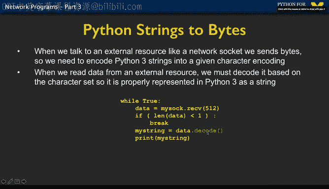
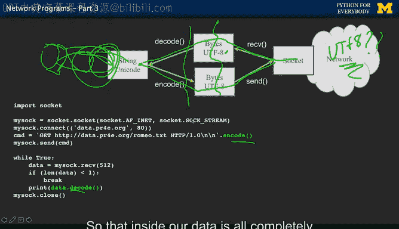

# 密歇根大学《给所有人的Python课》课程4：《使用数据库进行Python编程》｜python-databases｜ - P2：02_01_05_Unicode字符与字符串 📚


在本节课中，我们将要学习计算机如何表示文本，特别是从简单的ASCII编码到复杂的Unicode编码的演变。我们将理解为什么在网络通信和数据库操作中，字符编码是一个必须处理的问题，并学习如何在Python 3中正确地编码和解码字符串。

## 从简单字符到复杂世界 🌍

我们整个课程以打印“hello world”开始。在早期计算时代，这很简单。上世纪70年代，字符集非常有限，甚至只有大写字母。计算机本质上只理解数字，因此需要建立字母与数字之间的映射关系。

历史上出现过多种映射方案，其中20世纪80年代最常见的是ASCII（美国信息交换标准代码）。它定义了数字与字符的对应关系。例如，大写字母`H`对应数字`72`，小写字母`e`对应数字`101`，换行符对应数字`10`。

在计算机内部，存储的是这些数字。ASCII最初只有128个字符，无法容纳世界上所有的字符。

## 理解字符的数值：`ord`函数 🔢

对于简单的ASCII字符，可以使用`ord`函数来获取其对应的数值（序数值）。

以下是`ord`函数的使用示例：
```python
print(ord('H'))  # 输出：72
print(ord('e'))  # 输出：101
print(ord('\n')) # 输出：10
```
`ord`代表“ordinal”（序数），它返回字符对应的数字。这也解释了为什么在ASCII中，所有大写字母的序数值都小于小写字母。

早期，每个字符恰好存储在一个字节（8位）的内存中。因此，一个16GB的U盘可以存储约160亿个字符。

## 现实世界的挑战与Unicode的诞生 🌐

现实世界拥有各种各样的字符和语言。ASCII无法满足需求，导致出现了许多互不兼容的字符集，如拉丁字符集、阿拉伯字符集、日文字符集等。这造成了不同地区的计算机无法顺利交换数据。

为了解决这个问题，Unicode应运而生。它是一个通用的字符编码标准，旨在为全球数百万种字符提供唯一的数字代码，涵盖了数百种字符集。

## 编码方案：UTF-8、UTF-16与UTF-32 ⚙️

Unicode定义了字符的代码点，但还需要具体的编码方案来在计算机中存储和传输这些代码点。主要有三种方案：
*   **UTF-32**：每个字符固定使用4个字节（32位）。虽然简单，但非常浪费空间。
*   **UTF-16**：每个字符使用2或4个字节（变长）。它是许多系统的折中方案。
*   **UTF-8**：每个字符使用1到4个字节（变长）。这是目前最推荐、使用最广泛的方案。

UTF-8有一个关键优势：它与ASCII完全兼容。纯ASCII文本在UTF-8编码下与原样相同。对于非ASCII字符，UTF-8使用特殊的标记位来指示使用多字节编码。

从趋势图可以看出，UTF-8已成为数据交换（尤其是网络传输）的事实标准，因为它高效且兼容性好。


## Python 2 与 Python 3 的字符串处理 🔄

Python 2 和 Python 3 在字符串处理上有重大区别，这主要围绕Unicode支持。

在Python 2中：
*   普通字符串（`str`）实际上是字节串。
*   需要显式使用`u‘’`前缀来创建Unicode字符串。
*   程序员需要手动在字节串和Unicode字符串之间转换。

在Python 3中：
*   普通字符串（`str`）就是Unicode字符串。
*   新增了`bytes`类型来表示原始的字节序列。
*   所有内部字符串操作都使用Unicode，简化了处理。

这种改变意味着在Python 3中，当程序与“外部世界”（如网络、文件、数据库）交互时，需要明确处理编码和解码。

## 编码与解码：连接内外世界的桥梁 🌉

当数据进出Python程序时，我们需要在Unicode字符串（内部）和字节序列（外部）之间进行转换。

以下是处理流程：
1.  **发送数据（到外部）**：将内部的Unicode字符串**编码（encode）** 为字节序列（通常是UTF-8）。
    ```python
    my_string = “Hello 世界”
    byte_data = my_string.encode(‘utf-8’) # 编码为字节
    # 现在可以将 byte_data 发送到网络或写入文件
    ```
2.  **接收数据（从外部）**：将接收到的字节序列**解码（decode）** 为Unicode字符串。
    ```python
    # 假设 received_data 是从网络收到的字节
    received_data = b‘Hello World’
    unicode_string = received_data.decode(‘utf-8’) # 解码为字符串
    # 现在可以在程序内部使用 unicode_string
    ```

`encode()`是字符串的方法，用于生成字节。`decode()`是字节对象的方法，用于生成字符串。默认情况下，它们都使用`‘utf-8’`编码，这在绝大多数情况下都是正确的选择。



## 实践：重写网络程序 💻

理解了编码解码的原理后，我们可以重写之前的网络客户端程序，确保在通过网络套接字发送和接收数据时正确处理字符串。

核心修改是在发送前对字符串进行`encode()`，在接收后对字节数据进行`decode()`。这就在程序的内部Unicode世界和外部字节世界之间建立了一个清晰的屏障。

通过这种方式，我们可以确保无论数据来源的字符集是什么，在Python程序内部都能一致且正确地处理所有字符串。


## 总结 📝

本节课我们一起学习了字符编码的演进：
1.  从简单的ASCII编码开始，理解了字符与数字的映射。
2.  认识到全球字符多样性带来的挑战，以及Unicode作为统一解决方案的重要性。
3.  比较了UTF-8、UTF-16、UTF-32等编码方案，明确了UTF-8作为网络传输标准的原因。
4.  区分了Python 2和Python 3在字符串处理上的关键差异，重点是Python 3将字符串统一为Unicode。
5.  掌握了`encode()`和`decode()`方法，学会了如何在Python 3中正确地在Unicode字符串和字节序列之间转换，这是与外部系统（网络、数据库）交互的关键。




记住核心原则：**在Python内部使用Unicode字符串；与外部交换时，明确进行编码和解码。** 这使得你的程序能够稳健地处理国际化的文本数据。