# 🐍 4：《使用数据库进行Python编程》｜P3：Windows 10系统安装Python与编写程序

在本节课中，我们将学习如何在Windows 10操作系统上安装Python 3，配置一个合适的程序员文本编辑器，并编写并运行你的第一个Python程序。整个过程旨在为后续的数据库编程课程打下基础。

---

## 第一步：下载Python 3

首先，我们需要下载Python 3的安装程序。本课程使用Python 3版本，请确保下载对应版本。

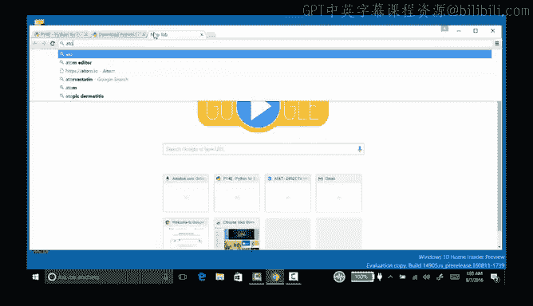

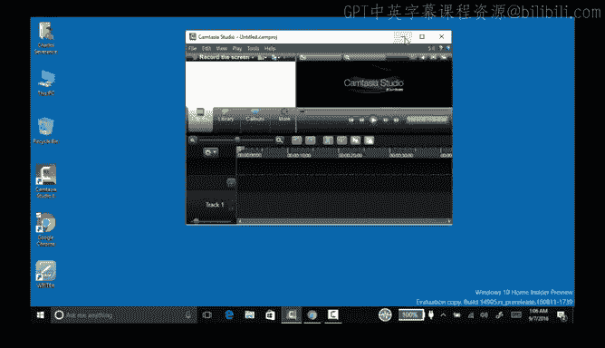

1.  打开浏览器，访问Python官方网站。
2.  找到并点击下载Python 3.x.x的链接（视频中演示的是3.5.2版本）。
3.  等待安装程序下载完成。

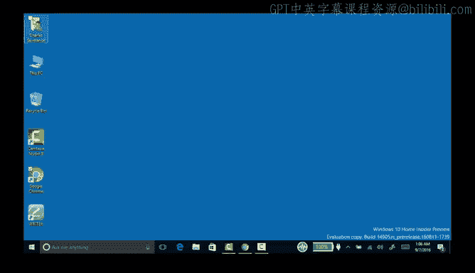

---

## 第二步：安装Python 3

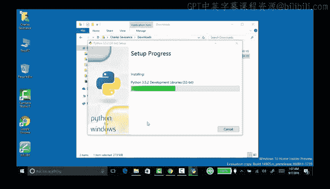

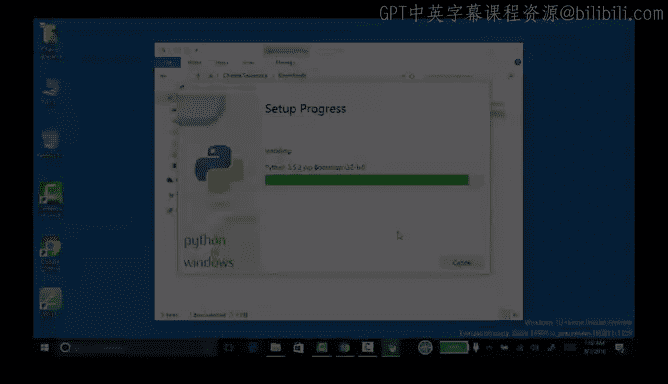

下载完成后，运行安装程序进行安装。安装过程中有几个关键选项需要注意。

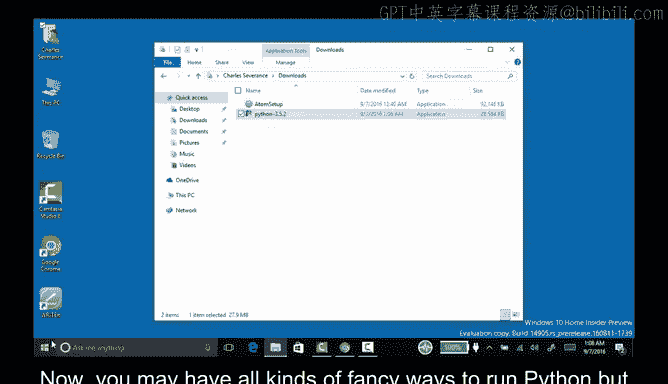

以下是安装步骤：
*   **添加Python到PATH**：在安装向导中，勾选“Add Python 3.x to PATH”选项。这非常重要，它允许你在系统的任何位置通过命令行直接运行Python。
*   **选择安装位置**：安装程序会提示默认的安装路径，通常无需更改，直接点击“Install Now”即可。
*   **授予权限**：系统可能会请求管理员权限以完成安装，请点击“是”或“允许”。

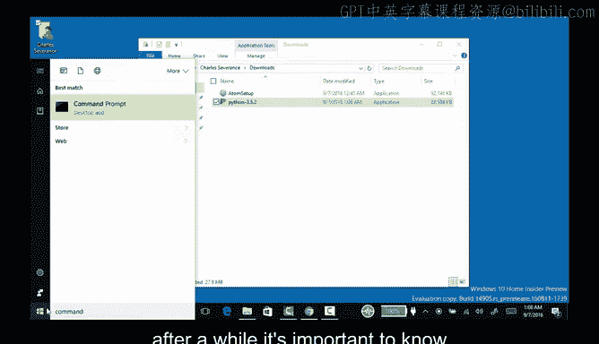

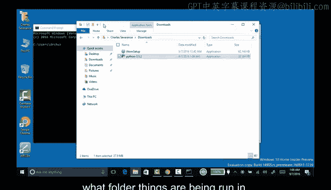

安装过程会自动进行，完成后会显示安装成功的界面。

---

## 第三步：验证Python安装

安装完成后，我们需要验证Python是否已成功安装并可以运行。

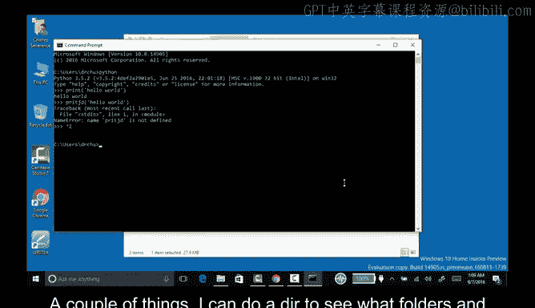

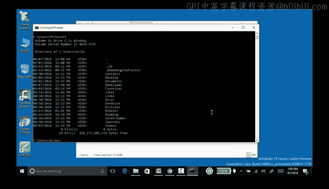

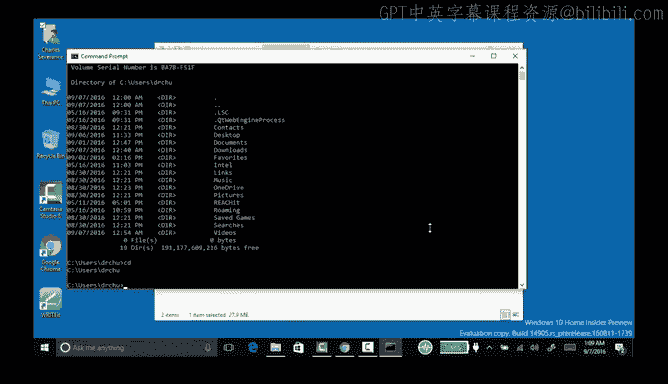

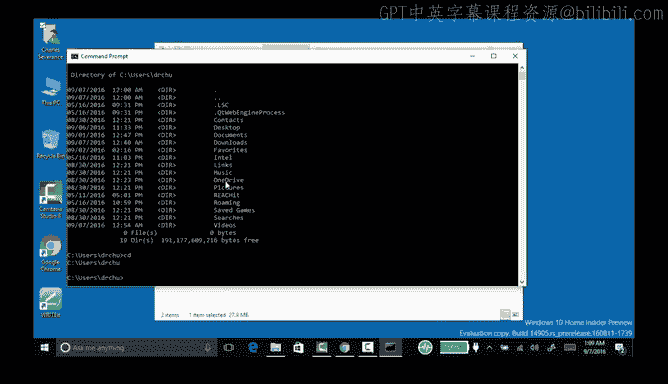

上一节我们完成了Python的安装，本节中我们来看看如何验证它。

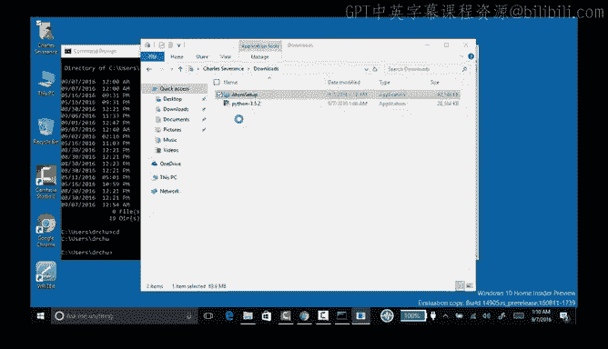

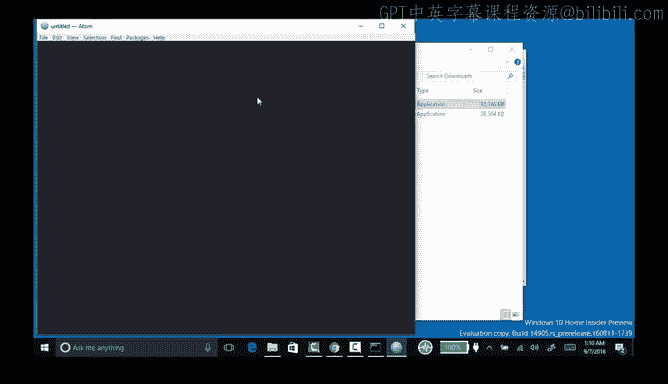

1.  打开Windows命令提示符。你可以通过搜索“cmd”或“命令提示符”来找到并打开它。
2.  在命令提示符窗口中，输入命令 `python` 并按下回车键。
3.  如果安装成功，你将看到Python解释器的启动信息，并进入交互模式（提示符变为 `>>>`）。
4.  在 `>>>` 提示符后输入你的第一个Python命令：`print("Hello world")`，然后按回车。如果屏幕成功打印出“Hello world”，则说明Python运行正常。
5.  要退出Python交互模式，可以输入 `quit()` 或按下 `Ctrl+Z` 然后回车，即可返回到普通的命令提示符。

---

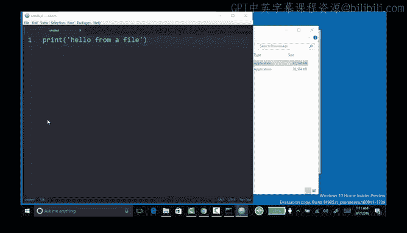

## 第四步：安装程序员文本编辑器

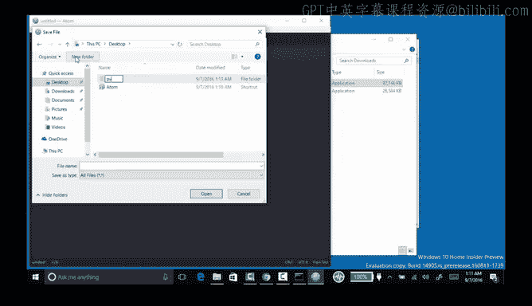

为了编写Python代码，你需要一个专业的文本编辑器。不要使用记事本或Word，因为它们可能会引入隐藏的格式字符。

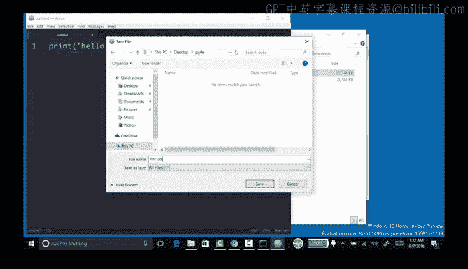

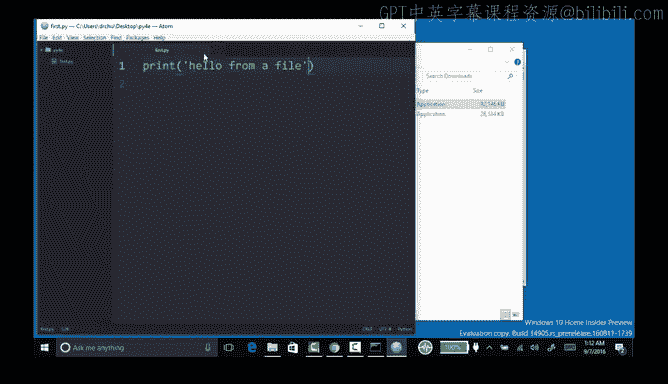

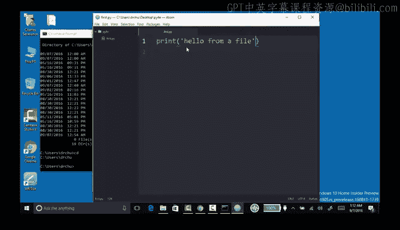

以下是选择编辑器的要点：
*   你可以选择任何你喜欢的程序员文本编辑器，如Notepad++、JEdit等。
*   视频中推荐使用**Atom**编辑器，因为它在Windows、Mac和Linux系统上表现一致。
*   确保编辑器能正确处理纯文本，并支持代码高亮等编程功能。

前往Atom官网下载并安装Atom编辑器，安装过程遵循常规的软件安装步骤即可。

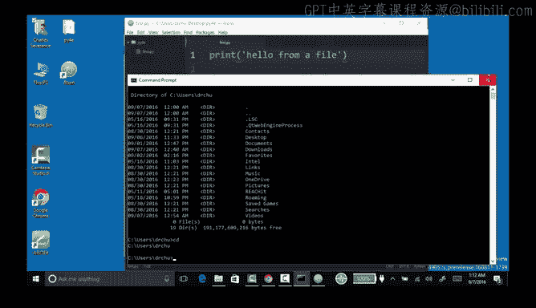

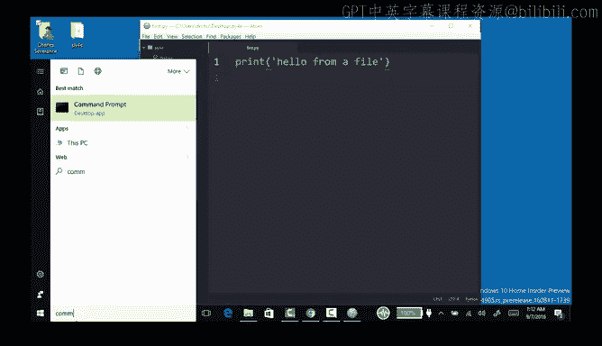

---

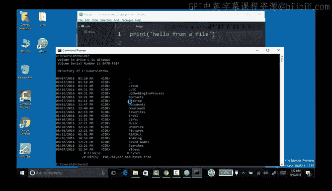

## 第五步：编写并运行第一个Python程序

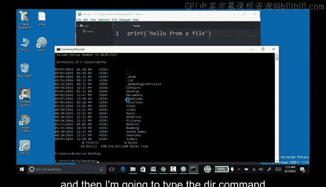

现在，我们将使用Atom编辑器创建一个Python脚本文件，并通过命令行运行它。

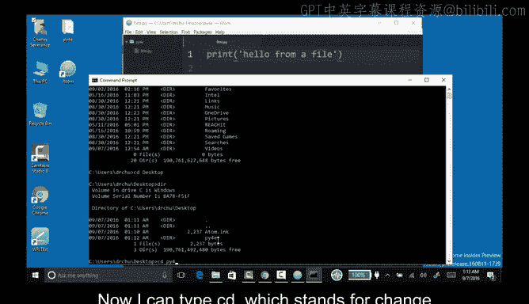

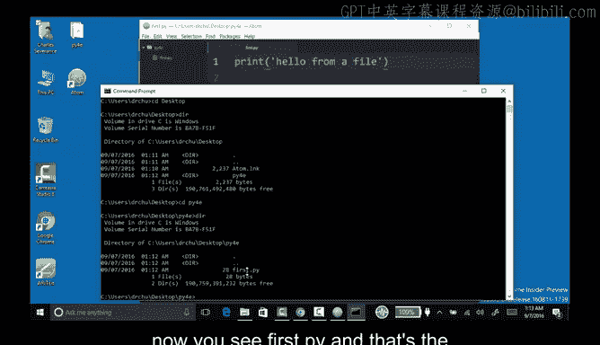

上一节我们配置好了编程环境，本节我们来实际编写和运行代码。

1.  **创建项目文件夹**：在桌面上创建一个新文件夹，例如命名为 `PY4E`。这有助于你管理代码文件。
2.  **编写Python代码**：
    *   打开Atom编辑器。
    *   输入一行简单的代码：`print("Hello from a file")`。
    *   点击“File” -> “Save As”，将文件保存到刚才创建的 `PY4E` 文件夹中。
    *   将文件命名为 `first.py`。注意，`.py` 扩展名非常重要，它告诉系统和编辑器这是一个Python文件。保存后，Atom会自动对代码进行语法高亮显示。
3.  **在命令行中导航到文件所在目录**：
    *   重新打开命令提示符。
    *   使用 `cd` 命令切换到桌面目录：输入 `cd desktop` 并回车。
    *   再使用 `cd` 命令进入 `PY4E` 文件夹：输入 `cd PY4E` 并回车。
    *   使用 `dir` 命令可以列出当前文件夹下的所有文件，你应该能看到 `first.py`。
4.  **运行Python程序**：在命令提示符中，确保你位于 `PY4E` 目录下，然后输入命令 `python first.py` 并回车。程序将运行，并在屏幕上输出“Hello from a file”。

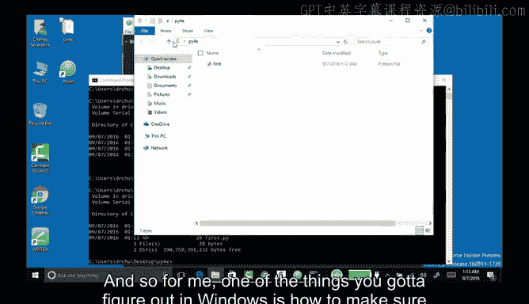

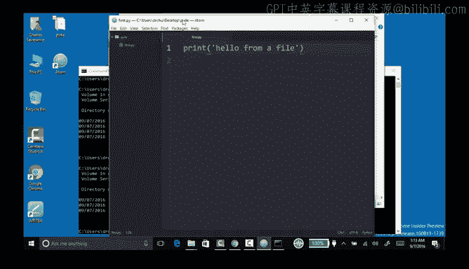

**另一种运行方式（仅限Windows）**：由于文件关联，在Windows系统中，你也可以直接在命令行输入 `first.py` 来运行程序，系统会自动调用Python解释器。

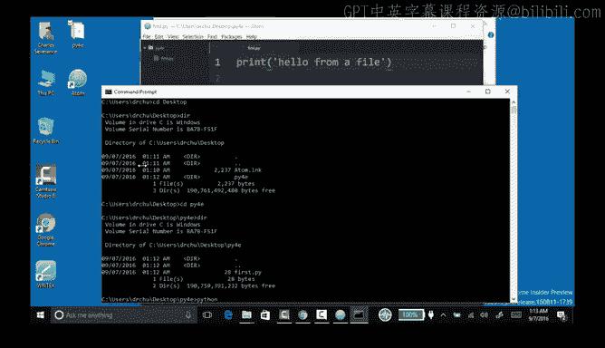

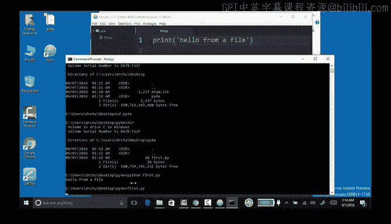

---

## 总结

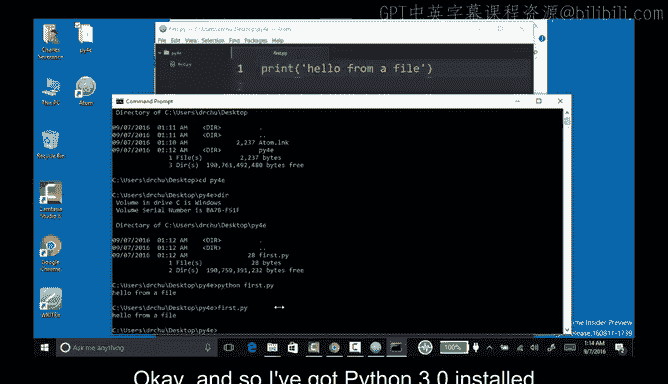

本节课中我们一起学习了在Windows 10系统上搭建Python编程环境的完整流程。我们完成了Python 3的下载与安装，验证了其可以正常运行，配置了Atom作为代码编辑器，并成功创建、保存和运行了你的第一个Python脚本文件。现在，你的开发环境已经准备就绪，可以开始后续的Python编程学习了。