# 4：《使用数据库进行Python编程》｜P4：04_01_02_Windows系统截屏操作 📸

在本节课中，我们将要学习如何在Windows操作系统中使用内置的“截图工具”进行屏幕截图。这是一种简单直接的方法，可以帮助你捕获屏幕上的任何区域，并保存为图片文件，以便在课程作业或日常工作中使用。

## 概述

屏幕截图是记录和分享屏幕信息的常用方法。Windows系统自带了“截图工具”，它功能实用且操作简便。本节教程将详细介绍从启动工具到保存截图的全过程。

## 启动截图工具

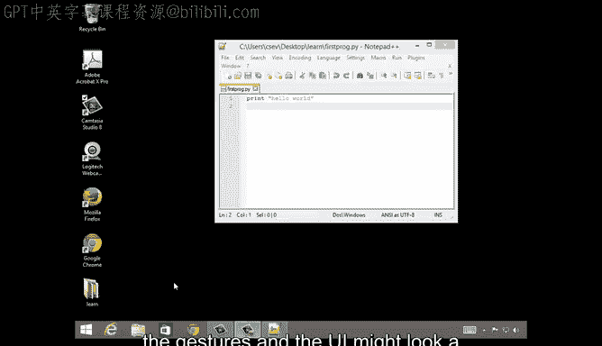

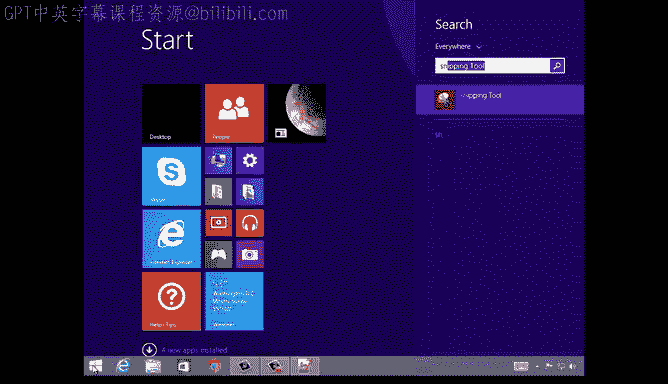

首先，我们需要找到并启动“截图工具”。在Windows 8及更早版本中，该工具的名称和界面可能略有不同，但基本功能一致。

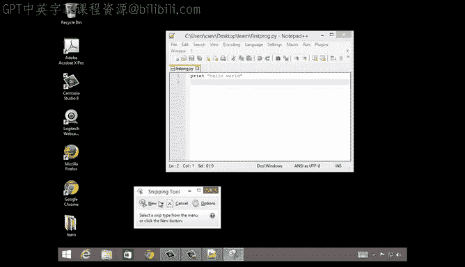

以下是启动截图工具的步骤：

1.  点击屏幕左下角的“开始”按钮或按下键盘上的Windows键。
2.  在搜索框中输入“截图”或“Snipping Tool”的前几个字母（例如“SN”）。
3.  从搜索结果中点击“截图工具”应用程序。

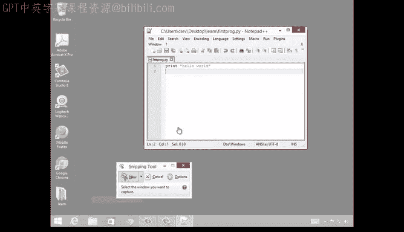

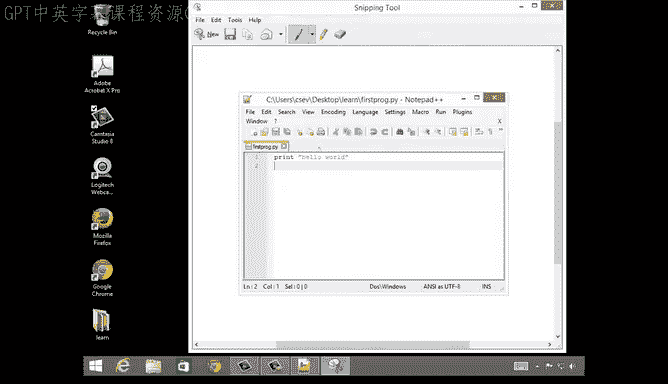

启动后，工具窗口会出现在屏幕上。

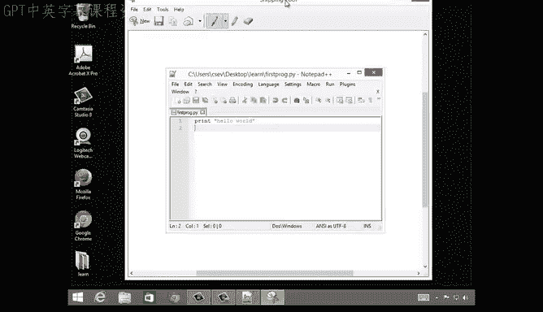

## 进行截图

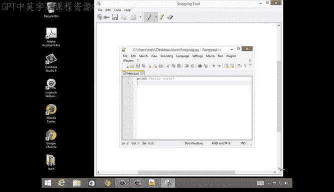

上一节我们介绍了如何启动工具，本节中我们来看看如何进行截图。

启动截图工具后，点击“新建”按钮。此时整个屏幕会变暗，鼠标光标会变成一个十字线。

以下是截图的具体操作：

*   将十字线光标移动到你想截取的区域。
*   按住鼠标左键并拖动，框选出你想要截取的区域。
*   松开鼠标左键，完成截图。

完成截图后，被选中的区域会显示在“截图工具”的编辑窗口中。请注意，原始窗口仍然存在，编辑窗口只是截图的一个副本。

## 编辑与保存截图

截图完成后，你可以在“截图工具”中对图片进行简单的编辑。例如，你可以使用画笔工具涂抹掉图片中的敏感信息。

以下是编辑和保存截图的步骤：

1.  在编辑窗口中，使用工具栏中的“笔”或“荧光笔”工具进行涂画。例如，你可以涂抹掉文件路径中的个人姓名。
2.  编辑完成后，点击菜单栏的“文件”，然后选择“另存为”。
3.  在弹出的对话框中，选择你想要保存文件的位置（例如桌面）。
4.  为文件输入一个名称，并为其添加文件扩展名，如 `.png` 或 `.jpg`。虽然Windows系统能识别文件类型，但添加扩展名有助于在不同系统间传输文件或通过电子邮件发送时保持兼容性。
5.  点击“保存”按钮。

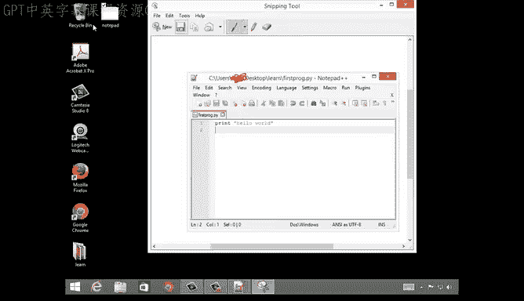

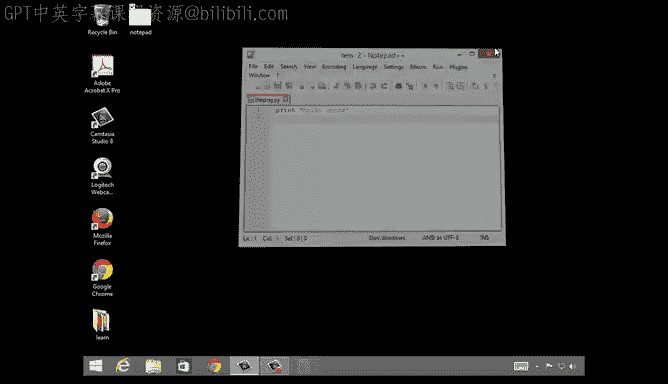

保存后，你可以在指定的位置找到截图文件。你可以关闭“截图工具”窗口，原始被截图的窗口不会受到影响。

## 总结

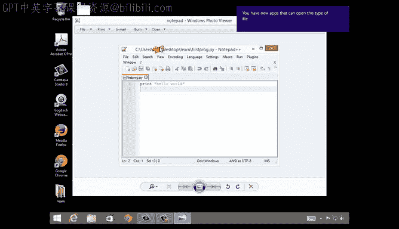

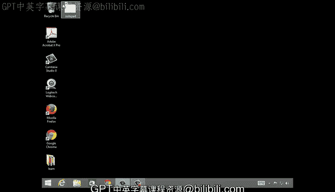

本节课中我们一起学习了使用Windows系统内置“截图工具”进行屏幕截图的全过程。我们掌握了如何启动工具、框选截图区域、进行简单的涂鸦编辑，以及将截图保存为带扩展名的图片文件。这是一个非常实用的技能，能帮助你有效地捕获和分享屏幕信息。