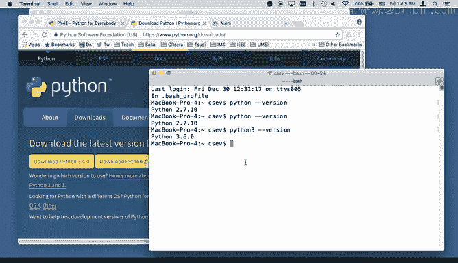
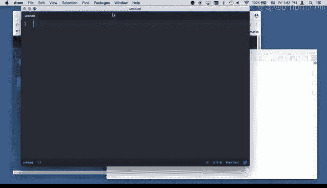
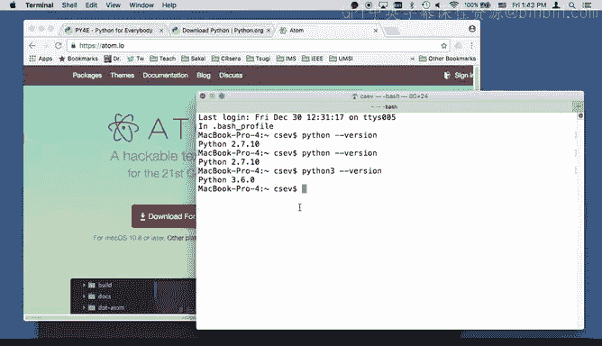
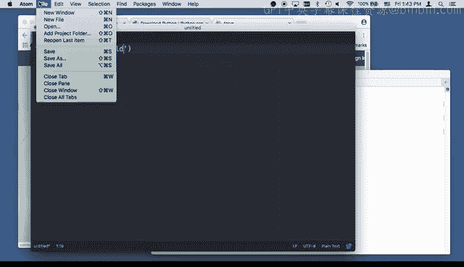
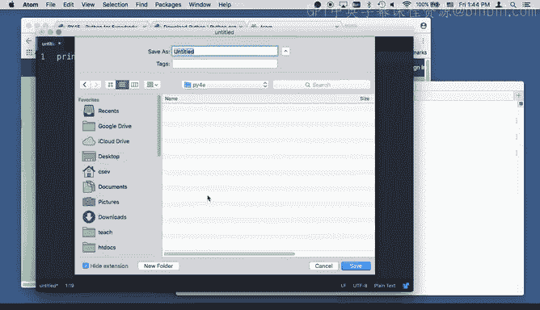
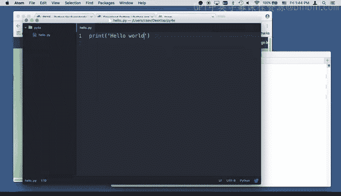
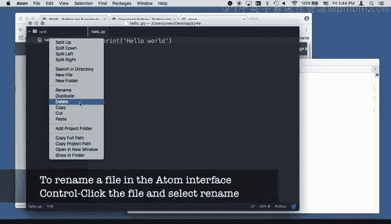
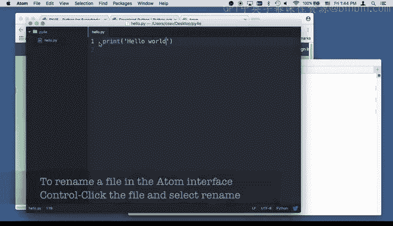
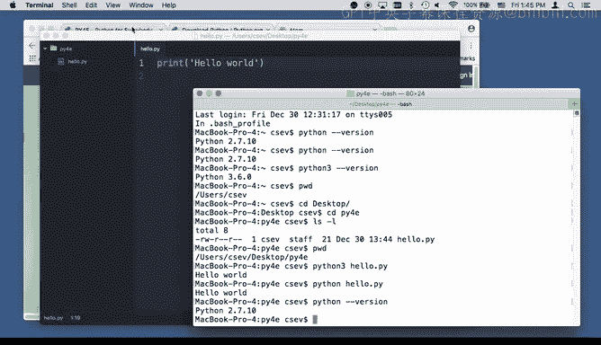

# 每个人的 Python 第四部分 5：05_01_03_Macintosh系统使用Python与编写程序 🍎

在本节课中，我们将学习如何在Macintosh系统上下载并安装Python 3，以及如何编写并运行你的第一个Python程序。

---

## 下载与安装Python 3

Macintosh系统长期以来都预装了Python 2。如果你在终端中输入 `python --version`，可能会看到类似 `Python 2.7.18` 的版本信息。我们的目标是在此基础上安装Python 3。

苹果公司未来可能会升级其系统自带的Python版本，但由于Mac系统内部有许多组件依赖于Python 2，因此我们预计系统自带的Python 2会一直保留。新安装的Python 3版本通常需要通过 `python3` 命令来调用。

以下是安装步骤：

1.  访问Python官方网站 [python.org](https://www.python.org)。
2.  点击下载Python 3的安装包。
3.  下载完成后，在“下载”文件夹中找到安装文件（通常名为 `python-3.x.x-macosx.pkg`）。
4.  双击运行安装程序，按照提示点击“继续”并同意许可协议，直至安装完成。

安装完成后，你可以打开终端应用程序进行验证。输入 `python3 --version`，如果显示Python 3的版本号（例如 `Python 3.9.13`），则说明安装成功。此时，`python` 命令仍然指向系统自带的Python 2，而 `python3` 命令则指向我们新安装的Python 3。



---



## 选择并配置代码编辑器

上一节我们成功安装了Python 3，本节中我们来看看如何编写Python程序。首先，你需要一个文本编辑器。本教程推荐使用Atom编辑器，因为它在Windows、Mac和Linux系统上表现一致，并且支持语法高亮等功能，非常适合初学者。



以下是获取和配置Atom编辑器的步骤：

1.  访问Atom编辑器官网 [atom.io](https://atom.io) 下载并安装。
2.  安装完成后，启动Atom。
3.  创建一个新文件，并输入你的第一行代码：`print(“Hello world”)`。此时你可能还看不到语法高亮效果。
4.  为了保存文件，点击菜单栏的 `File` -> `Save As...`。
5.  建议在桌面上创建一个名为 `Py4E`（Python for Everybody的缩写）的文件夹，用于存放本课程的所有代码。
6.  将你的第一个程序命名为 `hello.py` 并保存到 `Py4E` 文件夹中。请注意，Python程序文件的后缀必须是 `.py`。



---





## 在终端中运行Python程序



我们已经准备好了代码文件，接下来学习如何运行它。虽然有一些图形化工具可以运行Python程序，但我们强烈建议你学习使用终端（Terminal），这能帮助你更深入地理解程序的执行过程。

以下是运行程序的步骤：



1.  打开终端应用程序。
2.  使用 `cd` 命令切换到你的程序所在的目录。例如，如果你的 `Py4E` 文件夹在桌面，可以输入：
    ```bash
    cd ~/Desktop/Py4E
    ```
3.  使用 `python3` 命令后接文件名来运行程序：
    ```bash
    python3 hello.py
    ```
    如果一切正常，终端会输出 `Hello world`。

请注意，必须使用 `python3` 命令来运行，以确保调用的是Python 3解释器。如果错误地使用了 `python` 命令，可能会调用Python 2，这可能导致某些语法（如 `print` 函数在Python 3中的括号用法）不兼容而报错。

---

## 课程总结

本节课中我们一起学习了在Macintosh系统上配置Python开发环境的核心步骤。我们首先从官网下载并安装了Python 3，然后介绍了Atom编辑器的基本用法并创建了第一个程序文件，最后通过在终端中执行 `python3 hello.py` 命令成功运行了程序。



现在，你的Mac电脑已经具备了编写和运行Python 3程序的能力。