# 每个人的 Python 第四部分 6：06_01_04_Macintosh系统截屏操作 📸

在本节课中，我们将学习如何在Macintosh（Mac）操作系统中进行屏幕截图。这是一个非常实用的技能，尤其是在需要提交作业截图或记录软件界面时。我们将使用Mac系统内置的“预览”应用程序来完成这项任务。

---

## 启动“预览”应用程序

Macintosh系统内置了一个非常简单的工具——“预览”应用程序。它最初是为查看PDF文件而设计的，但也包含了一系列强大的屏幕捕捉功能。

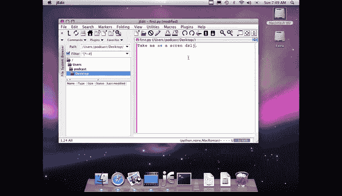

首先，我们需要找到并启动“预览”应用程序。你可以进入Macintosh硬盘驱动器，打开“应用程序”文件夹，然后搜索“预览”。

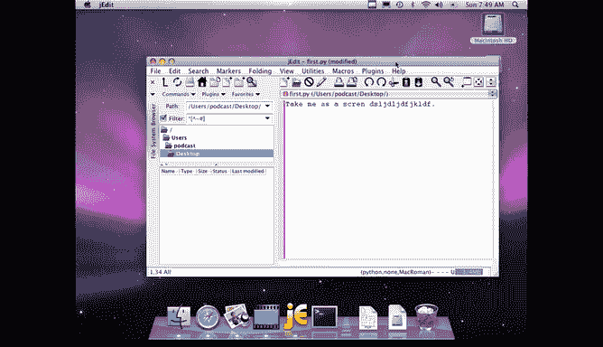

为了方便日常使用，建议将“预览”应用程序固定在程序坞中。只需右键点击程序坞中的预览图标，选择“在程序坞中保留”即可。

---

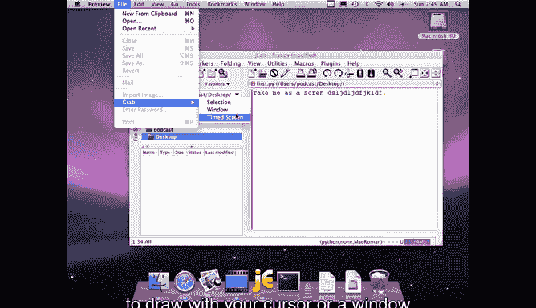

## 进行屏幕截图

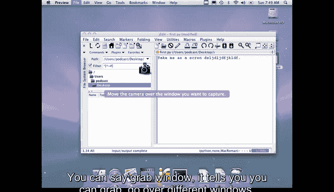

上一节我们介绍了如何启动“预览”应用程序，本节中我们来看看如何使用它来截取屏幕。

以下是使用“预览”截取特定窗口的步骤：

1.  **打开目标窗口**：首先，打开你想要截图的程序窗口。例如，这里我们打开了一个文本编辑器窗口。
2.  **启动截图功能**：在“预览”应用程序中，点击顶部菜单栏的“文件”。
3.  **选择截图模式**：在“文件”菜单中，选择“拍摄屏幕快照”。这里有几个选项：
    *   **选择部分**：允许你用光标绘制一个矩形区域进行截图。
    *   **窗口**：截取一个完整的应用程序窗口（最常用）。
    *   **整个屏幕**：截取整个显示器画面。
4.  **截取窗口**：选择“窗口”后，光标会变成一个相机图标。将其移动到目标窗口上，窗口会高亮显示，点击即可完成截图。

截图完成后，图像会立即在“预览”中打开。需要注意的是，系统会默认将截图文件以 **`snapshot [日期].tiff`** 的格式保存到桌面上。

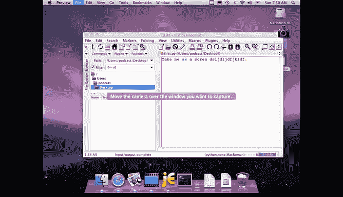

---

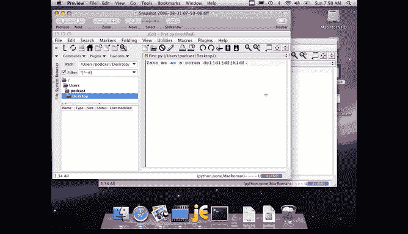

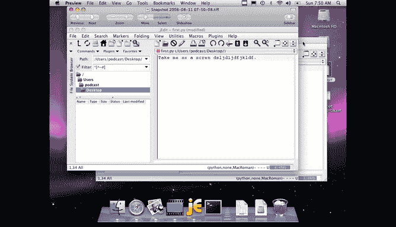

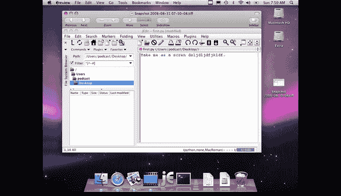

## 保存与编辑截图

上一节我们完成了截图，本节中我们来看看如何保存为更通用的格式并进行简单的编辑。

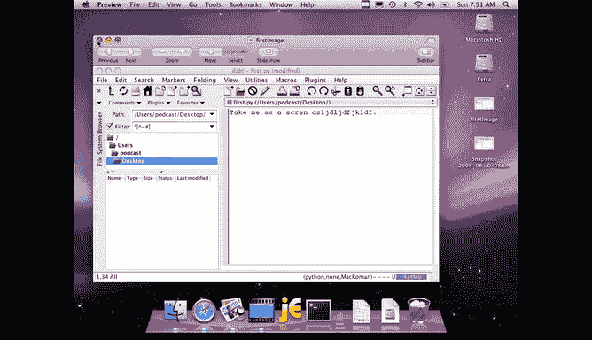

默认的TIFF格式并非最通用。为了便于分享和上传，我们通常需要将其保存为JPEG或PNG格式。

以下是保存和编辑截图的步骤：

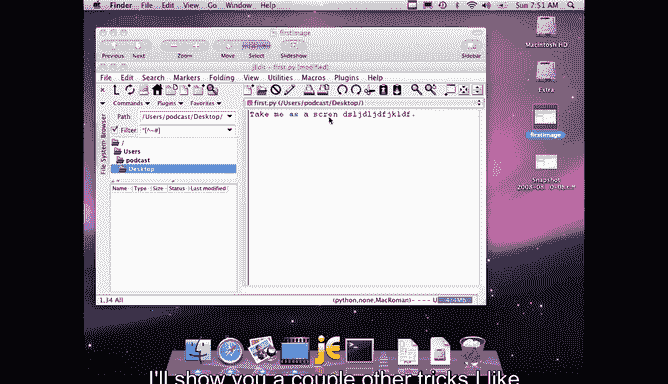

1.  **另存为通用格式**：在“预览”中，点击“文件” -> “导出...”。在格式选项中，选择 **`JPEG`** 或 **`PNG`**，并为文件起一个更有意义的名称（例如 `first_image.jpg`），然后保存。
2.  **裁剪图像**：“预览”提供了简单的裁剪工具。
    *   在图像上，用光标拖拽出一个矩形，框选你想要保留的部分。
    *   然后，点击顶部菜单栏的“工具” -> “裁剪”。
    *   这样，图像就只保留了你框选的部分。
3.  **保存编辑后的图像**：再次使用“导出...”功能，将裁剪后的图像保存为新文件（例如 `tiny_image.jpg`）。

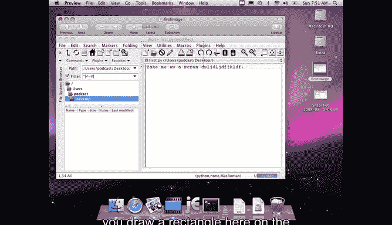

你可以使用快捷键 **`Command (⌘) + W`** 来快速关闭当前预览的图片标签页。

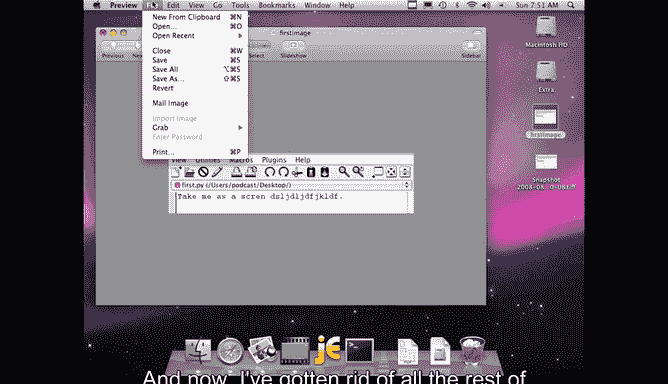

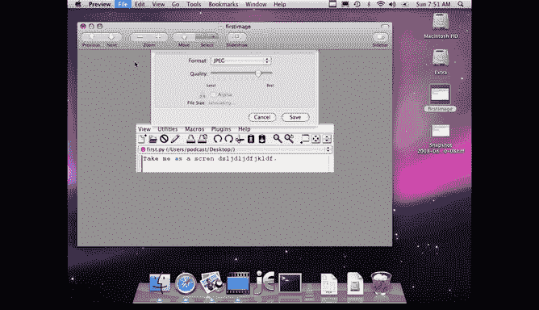

---

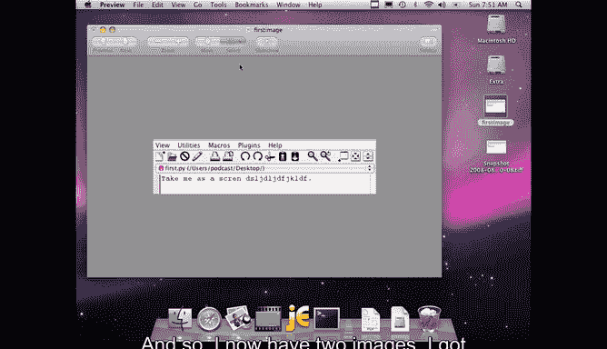

## 总结与清理

本节课中我们一起学习了在Mac系统上使用“预览”应用程序进行屏幕截图的全过程。

我们首先找到了“预览”应用并将其固定在程序坞。然后，我们使用“文件”->“拍摄屏幕快照”->“窗口”的命令流程，成功截取了一个应用程序窗口。接着，我们将默认的TIFF格式截图导出为更通用的JPEG格式，并学习了如何使用裁剪工具来优化图像，只保留核心部分。

最后，请记住及时清理桌面上自动生成的 `snapshot` 文件，以保持工作区的整洁。当你需要提交作业截图时，使用此方法生成并保存的JPEG或PNG文件就是你需要上传的正确文件。