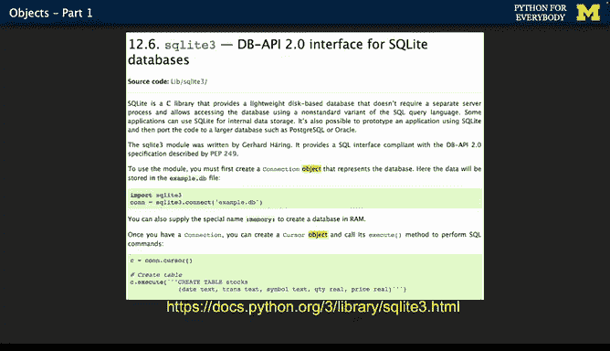
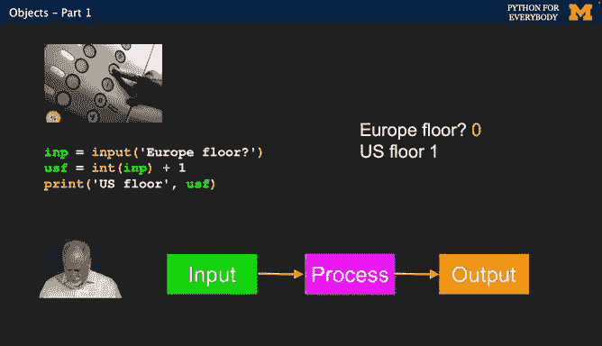
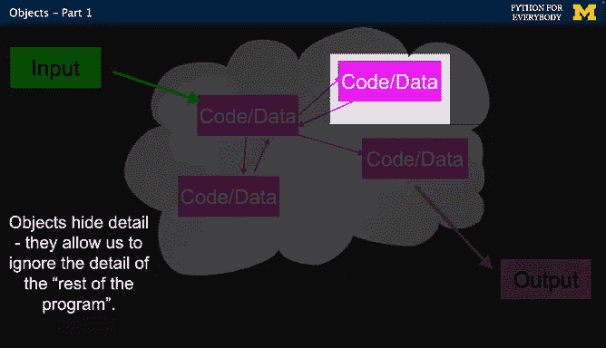
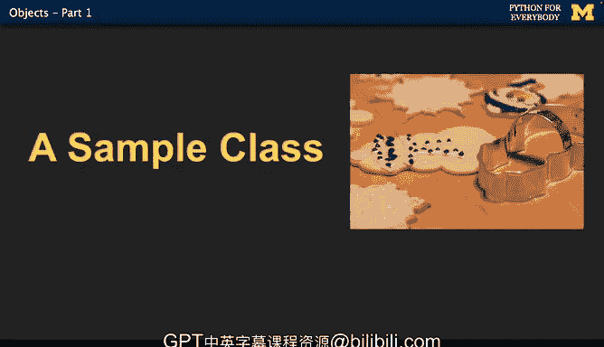

# 密歇根大学《给所有人的Python课》课程4：《使用数据库进行Python编程》｜python-databases｜ - P7：07_01_01_面向对象定义与术语 🧩


在本节课中，我们将要学习面向对象编程的基本概念和术语。面向对象编程是编程中一个非常强大且深入的主题，本课的目标是让你熟悉相关的术语，减少对这些术语的陌生感，并通过一些简单的语法示例来帮助你初步理解。真正的掌握需要时间和实践，所以请放松心态，享受这次学习过程。

## 无处不在的“对象”概念

如果你查看过Python的官方文档，你可能已经注意到“对象”这个词频繁出现。例如，在列表的文档中，你会看到“list object”或“list data type has some methods”。这里的“对象”和“方法”是什么意思呢？

实际上，你已经在使用它们了。当你写下 `list.append()` 这样的代码时，点号 `.` 就是一种语法，它表示“在某个对象或类中，调用其内部的一个东西”。`append` 就是 `list` 对象（或类）内部的一个方法。



所以，虽然语法本身很简单，但我们现在要开始学习这些术语背后的含义。这样，当你再看到“连接对象”、“方法”、“属性”这些词时，就不会感到困惑了。

## 抽象：内部与外部的分离

面向对象编程的一个核心概念是“抽象”。抽象意味着一个事物有内部实现和外部接口之分。



我们可以把一个程序想象成一个“小工具”。例如，一个楼层转换器。它的内部是几行代码逻辑：读取一个代表欧洲楼层的变量，将其转换为整数，加1，然后打印出对应的美国楼层。

它的外部则是我们提供给它的输入（欧洲楼层数）和它返回给我们的输出（美国楼层数）。作为使用者，你不需要知道这个工具内部是用Python、人工智能还是其他什么技术实现的。你只需要知道它能为你做什么。这就是一个抽象的对象。

## 程序由协作的对象构成

一个程序不仅仅是一个整体对象，它内部也是由许多相互协作的小对象构成的。这种“内部与外部”的洋葱式结构层层嵌套。

例如，在你的程序中，每个字符串、整数、字典、列表都是一个独立的小对象。每个对象内部都包含一些数据和一些方法。你编写程序的过程，实际上就是在“指挥”这些对象：从一个对象中取出数据，放入另一个对象，或者把一个对象（如字符串）放入另一个对象（如列表）中。

所以，你的程序就像一个由众多对象组成的乐团，而你是指挥家，控制着它们如何互动。

## 什么是对象？

对象是一个自包含的单元。它的内部封装了代码和数据。面向对象编程的一个关键好处是，它允许我们使用一个功能强大的东西，而无需理解其内部复杂的实现。



例如，Python中的字符串对象。对于使用者来说，使用字符串非常简单。但在Python解释器的底层，实现字符串功能的代码可能有数千行。我们不需要关心这些，我们只需要知道如何通过字符串对象提供的方法（如 `.upper()`, `.reverse()`）来使用它。

同样，创建字符串对象的专家们也不需要关心我们的程序在做什么。他们只需要确保字符串对象对外提供的接口（方法）是正确和高效的。这种隔离使得复杂的功能可以变得易于使用，并且允许底层实现不断优化和改进，而不会影响上层的使用代码。

## 核心术语定义

以下是面向对象编程中的一些核心术语，理解它们对后续学习至关重要。

### 类与对象/实例

*   **类**：类的定义是描述对象将如何行为的代码模板，但它本身不是对象。你可以把它想象成**饼干模具**。模具定义了饼干的形状，但它不是饼干本身。在代码中，类定义了对象将拥有哪些属性（数据）和方法（行为）。
*   **对象/实例**：对象（或称为实例）是根据类创建出来的具体实体。使用上面的比喻，**饼干**就是对象。你可以用一个模具（类）制作出许多块饼干（对象）。对象是真正存储数据并与我们交互的东西。我们通常与对象交互，而不是直接与类交互（除了创建对象的那一刻）。

### 属性/字段与方法/消息

*   **属性/字段**：这是对象内部存储的数据。例如，一个“汽车”对象可能有 `color`（颜色）、`speed`（速度）等属性。它们代表了对象的状态。
*   **方法/消息**：这是对象可以执行的操作或行为。例如，一个“汽车”对象可以有 `accelerate()`（加速）、`brake()`（刹车）等方法。在术语上，“方法”和“消息”常常可以互换使用。“方法”更侧重于指代类内部定义的那段代码，而“消息”更侧重于描述对象之间“请求执行某个操作”的这种交互行为。

## 在Python中探索对象

Python内置了一些功能，可以帮助我们探索对象的类型和结构。

`type()` 函数可以告诉我们一个对象是由哪个类创建的。
```python
x = “hello”
print(type(x)) # 输出：<class ‘str’>
```
输出中的 `<class ‘str’>` 表明变量 `x` 是一个由 `str`（字符串）类创建的对象。

`dir()` 函数可以列出一个对象（或类）所拥有的所有属性和方法名称。
```python
x = “hello”
print(dir(x)) # 输出一个长长的列表，包含 ‘upper’, ‘lower’, ‘strip’ 等方法名
```
虽然查看官方文档是更好的学习方式，但 `dir()` 在你忘记某个具体方法名时，可以作为一个快速的参考工具。它展示了Python本身是如何“知晓”并管理所有这些对象、类和方法的。

## 总结

本节课我们一起学习了面向对象编程的基础。我们了解到程序是由相互协作的对象构成的，对象封装了内部的代码和数据，并通过定义良好的接口与外部交互。我们明确了**类**是创建对象的蓝图，而**对象**（或实例）是根据类创建的具体实体。对象通过**属性**存储状态，通过**方法**定义行为。



记住，完全理解这些概念需要时间。本节课的目标是让你对这些术语不再陌生，并为后续实际创建我们自己的类打下基础。在下一节中，我们将不再空谈概念，而是动手编写我们自己的第一个类。