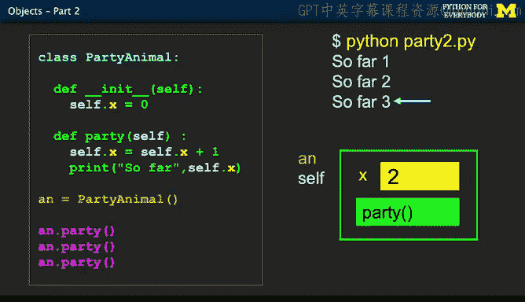
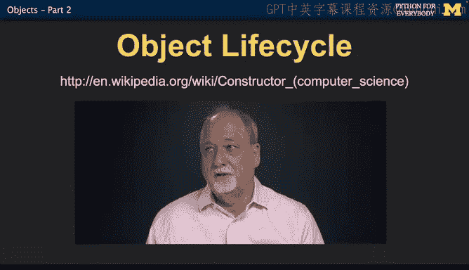

# 4：《使用数据库进行Python编程》｜python-databases｜ - P8：08_01_02_首个类与对象 🐍


在本节课中，我们将学习如何创建你的第一个Python类与对象。我们将从编写一个简单的类开始，理解其基本语法和结构，并探索如何使用`dir()`命令来查看对象的属性和方法。

---

## 定义第一个类 🏗️

上一节我们讨论了类和对象的基本概念。本节中，我们来看看如何实际编写代码来定义一个类。

以下是创建一个名为`PartyAnimal`的类的步骤：

```python
class PartyAnimal:
    def __init__(self):
        self.x = 0

    def party(self):
        self.x = self.x + 1
        print("So far", self.x)
```

*   **`class`**：这是一个保留字，用于声明一个类，就像`def`用于声明函数一样。
*   **`PartyAnimal`**：这是类的名称。
*   **`__init__(self)`**：这是一个特殊的方法，称为构造函数。当创建类的新实例（对象）时，Python会自动调用它。`self`参数代表正在创建的实例本身。
*   **`self.x = 0`**：这行代码在实例中创建了一个名为`x`的属性（或实例变量），并将其初始值设为0。
*   **`party(self)`**：这是类的一个普通方法。它也需要`self`作为第一个参数，以便访问和修改该实例的属性。

---

## 创建和使用对象 🚀

现在我们已经定义了一个类模板，接下来看看如何根据这个模板创建对象并使用它。

以下是创建`PartyAnimal`对象并调用其方法的代码：

```python
an = PartyAnimal()
an.party()
an.party()
an.party()
```

*   **`an = PartyAnimal()`**：这行代码根据`PartyAnimal`类创建了一个实例（对象）。Python会执行`__init__`方法，将`an.x`初始化为0。
*   **`an.party()`**：我们调用对象的`party`方法。注意，调用时括号内是空的，但在方法定义中，第一个参数是`self`。Python会自动将`an`作为`self`参数传入。每次调用`party()`，`an.x`的值都会增加1。

运行这段代码，输出将是：
```
So far 1
So far 2
So far 3
```

---

## 探索对象内部 🔍



我们已经创建了自己的类，这相当于扩展了Python的能力。Python具有自省能力，我们可以使用`dir()`函数来查看一个对象内部有哪些属性和方法。

以下是使用`dir()`探索对象的示例：

```python
an = PartyAnimal()
print(type(an))
print(dir(an))
```

*   **`type(an)`**：会显示`an`是`__main__.PartyAnimal`类的一个实例。
*   **`dir(an)`**：会列出`an`对象所有可用的属性和方法。你会看到列表中包含我们定义的`party`方法和`x`属性，以及许多由Python自动添加的、以双下划线`__`开头和结尾的特殊方法。

这些双下划线方法是Python内部使用的，除非有明确说明，否则我们通常不直接调用它们。`__init__`就是一个我们被明确告知需要定义的特殊方法。

---

## 总结 📝

本节课中我们一起学习了如何创建和使用Python中的类与对象。

我们首先定义了一个简单的`PartyAnimal`类，它包含一个构造函数`__init__`来初始化属性，以及一个`party`方法来修改属性。接着，我们通过`PartyAnimal()`创建了类的实例（对象），并调用了其方法。最后，我们使用`type()`和`dir()`函数来探索对象的类型和内部结构，这帮助我们理解Python的对象自省机制。



通过创建自己的类，你已经开始“接入”Python系统，像使用内置类型（如`list`， `str`）一样，定义和使用自己的数据类型。下一节，我们将更深入地探讨对象的生命周期。