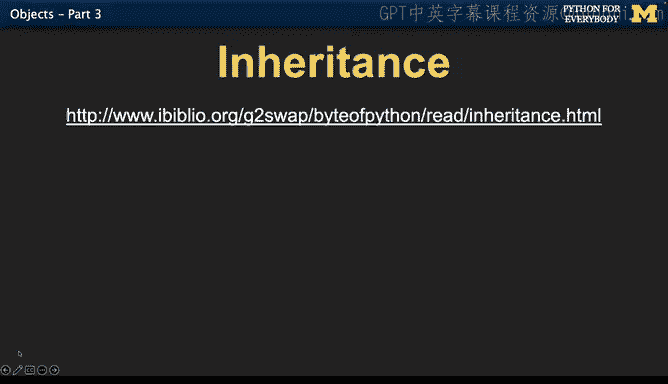

# 4：《使用数据库进行Python编程》｜P9：09_01_03_对象生命周期 🧬


在本节课中，我们将要学习Python中对象的生命周期。我们将了解对象如何被创建、使用和销毁，并介绍构造函数和析构函数的概念。

## 概述

对象生命周期是面向对象编程中的一个核心概念。它描述了对象从创建到销毁的整个过程。理解这个过程有助于我们编写更高效、更可靠的代码。

## 对象的创建、使用与销毁

对象遵循一个简单的生命周期：它们被创建，被使用，然后被丢弃。这个过程通常是自动进行的，无需程序员过多干预。在计算机科学中，我们称之为“垃圾回收”。当一个对象不再被使用时，系统会自动回收它所占用的内存。

## 构造函数与析构函数

作为对象的创建者，我们可以通过特定的代码块参与到对象的创建和销毁时刻。这些代码块就是构造函数和析构函数。

### 构造函数

构造函数的主要目的是设置实例变量的初始值。在Python中，构造函数是通过 `__init__` 方法实现的。虽然严格来说，对象的构造发生在 `__init__` 被调用之前，但通常我们都将 `__init__` 方法称为构造函数。

以下是构造函数的一个示例：

```python
class PartyAnimal:
    def __init__(self):
        self.x = 0
        print('I am constructed')
```

在这个例子中，`__init__` 方法初始化了实例变量 `self.x` 并打印一条消息。

### 析构函数

析构函数在对象被销毁时调用。在Python中，析构函数是通过 `__del__` 方法实现的。当对象不再被引用时（例如，当变量被重新赋值），Python会自动调用析构函数来清理资源。

以下是析构函数的一个示例：

```python
class PartyAnimal:
    def __del__(self):
        print('I am destructed')
```

## 对象生命周期的演示

为了更直观地理解对象的生命周期，我们来看一个完整的例子。这个例子展示了对象的创建、方法调用和销毁过程。

```python
class PartyAnimal:
    def __init__(self):
        self.x = 0
        print('I am constructed')

    def party(self):
        self.x = self.x + 1
        print('So far', self.x)

    def __del__(self):
        print('I am destructed', self.x)

an = PartyAnimal()
an.party()
an.party()
an = 42
print('an contains', an)
```

运行这段代码，你会看到以下输出：

```
I am constructed
So far 1
So far 2
I am destructed 2
an contains 42
```

### 代码解析

1.  **创建对象**：`an = PartyAnimal()` 语句创建了一个 `PartyAnimal` 对象，并调用了构造函数 `__init__`。
2.  **调用方法**：`an.party()` 被调用了两次，每次都会增加 `self.x` 的值。
3.  **销毁对象**：当执行 `an = 42` 时，变量 `an` 被重新赋值，不再引用原来的 `PartyAnimal` 对象。此时，Python会自动调用析构函数 `__del__` 来销毁该对象。
4.  **输出结果**：最后，打印出 `an` 的新值，即 `42`。

## 多个实例与实例变量

在面向对象编程中，一个类可以作为模板创建多个对象，每个对象称为一个实例。每个实例都有自己独立的实例变量。

以下是创建多个实例的示例：

```python
class PartyAnimal:
    def __init__(self, nam):
        self.x = 0
        self.name = nam
        print(self.name, 'constructed')

    def party(self):
        self.x = self.x + 1
        print(self.name, 'party count', self.x)

s = PartyAnimal('Sally')
s.party()

j = PartyAnimal('Jim')
j.party()
s.party()
```

### 代码解析

1.  **创建第一个实例**：`s = PartyAnimal('Sally')` 创建了一个名为“Sally”的 `PartyAnimal` 实例，并初始化了 `self.x` 和 `self.name`。
2.  **调用方法**：`s.party()` 增加了 `s` 实例的 `self.x` 值。
3.  **创建第二个实例**：`j = PartyAnimal('Jim')` 创建了另一个名为“Jim”的 `PartyAnimal` 实例。
4.  **分别调用方法**：`j.party()` 和 `s.party()` 分别增加了各自实例的 `self.x` 值。

通过这个例子，你可以看到每个实例都独立维护着自己的状态。

## 总结

本节课中我们一起学习了Python对象的生命周期。我们了解了对象如何通过构造函数 `__init__` 被创建和初始化，以及如何通过析构函数 `__del__` 被销毁。我们还学习了如何创建多个实例，并且每个实例都拥有自己独立的实例变量。理解这些概念是掌握面向对象编程的基础。




在下一节中，我们将介绍继承的概念。继承是一种代码复用的机制，允许我们基于已有的类创建新的类，并为其添加新的功能。